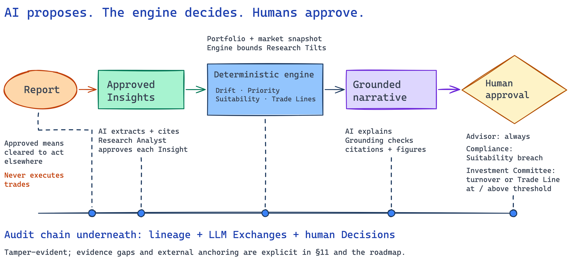

# Executive Summary

**AI proposes, the engine decides, humans approve, everything is audited.**

Portfolio Rebalancing is an advisor-assist and decision-support platform for wealth management. It connects research to Portfolio-specific Recommendations and human Decisions, with evidence reviewers can inspect. **It never executes trades:** Approved means cleared to act on outside this system. This is a demonstrator using synthetic Clients and a committed market data snapshot ([§1](01-introduction-and-goals.md), [§2](02-architecture-constraints.md)).

## Business problem

Advisors must reconcile research, Portfolio misalignment and suitability constraints before deciding which Clients need attention and what to recommend. Research interpretation alone cannot establish a suitable trade; a numerical rebalance alone cannot explain why action matters now. Reviewers also need to reconstruct the evidence and approvals behind each Decision. The platform brings those tasks into one reviewable workflow ([§1.1](01-introduction-and-goals.md#11-requirements-overview)).

## Value

- **Focus advisor attention.** A ranked Queue combines deterministic drift, risk, opportunity and urgency scores with a cited “why this client, why now” narrative.
- **Make research actionable under control.** Research Analysts review extracted Insights against Report passages; only approved Insights inform downstream scoring, Research Tilts and explanations.
- **Support defensible Decisions.** The engine owns every number, Trade Line and Suitability verdict. Humans decide through the required approval tiers, and reviewers can inspect lineage, model Exchanges and the tamper-evident audit chain.

These are demonstrated capabilities, not measured productivity or investment-return claims. The quality priorities are Auditability, Explainability, Human control / safety, Data protection and Reproducibility; performance and scalability are current-version non-goals ([§1.1–1.2](01-introduction-and-goals.md#12-quality-goals)).

## How it works

[Editable Excalidraw source](assets/value-flow.excalidraw). The picture summarises the flow; runtime ordering and failure paths are in [§6](06-runtime-view.md).

**Research to Recommendation.** AI extracts Insights with page citations. A Research Analyst approves or rejects each one. With Portfolio data and the market snapshot, the deterministic engine calculates drift and Priority, bounds any AI-proposed Research Tilt, constructs Trade Lines and evaluates Suitability. AI writes the rationale and memo; Grounding checks citations and figures, flags ungrounded claims and keeps them out of the memo ([§6.1](06-runtime-view.md#61-analysis-run), [§6.3](06-runtime-view.md#63-report-ingestion-to-insight-review)).

**Human authority.** Advisor approval is always required. Compliance is required on a Suitability breach; Investment Committee approval is required when turnover or a single Trade Line meets or exceeds its configured threshold. No Recommendation becomes Approved until every required tier accepts it ([§6.2](06-runtime-view.md#62-tiered-decisions)).

**Inspectable evidence.** A hash-chained audit trail links business events and model evidence for verification. The bounded read-only Assistant helps users inspect the platform through permission-checked lookups; it cannot change Recommendations or approve them. Server-side authorization and pseudonyms constrain access and prompt disclosure ([§4](04-solution-strategy.md), [§8.2](08-crosscutting-concepts.md#82-audit-recording), [§8.8–8.9](08-crosscutting-concepts.md#88-authentication-and-authorization)).

“Everything is audited” is the governing principle, with documented gaps: failed scoring can discard Research Tilt Exchanges; a tilt producing no Trade Lines lacks an audit anchor; interrupted recording can leave incomplete evidence. The chain is tamper-evident, not externally immutable. These limitations remain explicit in [§11](11-risks-and-technical-debt.md) and drive roadmap evidence controls.

## Roadmap headline

**Move from a reproducible demonstrator to a controlled production pilot through evidence-based gates.** The proposed sequence establishes enterprise identity/MFA and browser security, then managed PostgreSQL and migrations, followed by shared run state and recovery before multiple workers. Further gates cover complete and atomic audit evidence, external audit anchoring, a governed LLM gateway, cost and operational telemetry, frontend regression coverage and reproducible model recordings. A controlled data pilot and measured capacity gate precede any real-client or service-level commitment ([Target / Production Roadmap](13-roadmap.md)).

These are proposed capabilities. Today's deployment remains one API process with SQLite and in-memory Run Step progress; SSO/MFA, a CSRF token and production cookie defaults remain gaps. The document maps controls to governance frameworks; it makes no compliance or certification claim ([§7](07-deployment-view.md), [§11](11-risks-and-technical-debt.md), [Appendices](appendices.md)).
