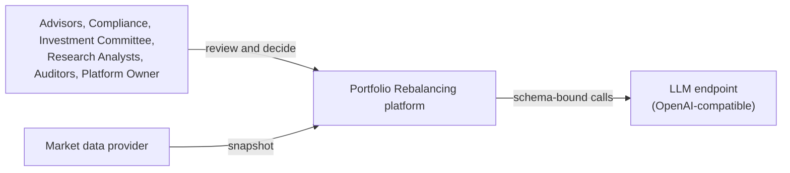

# 3. Context and Scope

## 3.1 Business context

_To be written in architecture-document ticket 04._ Placeholder System Context until then:

## 3.2 Technical context

_To be written in architecture-document ticket 04._
