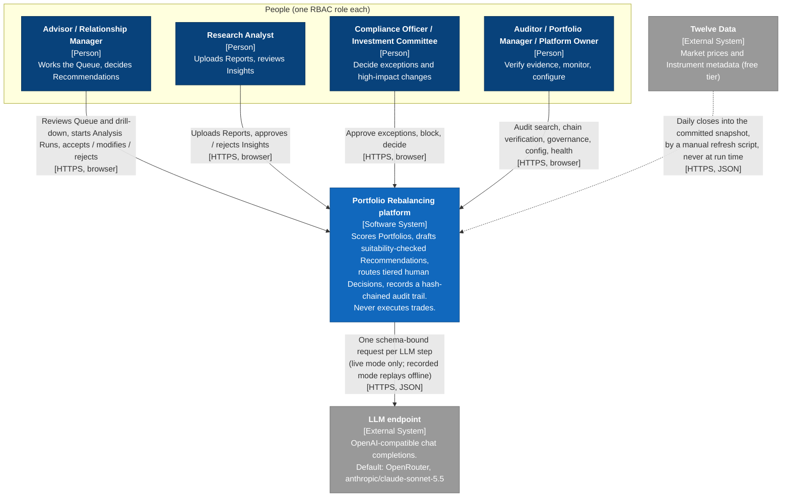

# 3. Context and Scope

The platform's boundary is narrow by design. Humans reach it only through the browser. It calls exactly one external system at run time, the LLM endpoint, and only in live mode. Market data enters through a script an operator runs by hand, never through the running application. Nothing leaves the platform towards a broker, a custodian or a Client.

## 3.1 Business context

C4 Level 1, System Context. What each role expects of the platform is in [1.3 Stakeholders](01-introduction-and-goals.md#13-stakeholders); the table below the diagram adds what crosses the boundary and what stays out of scope.

| Partner | Exchanges with the platform | Not in scope |
| --- | --- | --- |
| Advisor and Relationship Manager | Read the ranked Queue, Portfolio drill-down and Recommendations; start an Analysis Run; take the first Decision on every Recommendation (accept, modify, reject). The Relationship Manager sees Client fields masked. | Talking to the Client; placing the trade |
| Research Analyst | Upload a Report (PDF or text); approve or reject each extracted Insight beside its cited page | Editing what the LLM extracted; publishing research outside the platform |
| Compliance Officer | Approve an exception with a rationale, or block, when a Recommendation is in Suitability breach; read LLM Exchanges | Modifying Trade Lines |
| Investment Committee | Decide Recommendations whose turnover or single Trade Line is at or above its configured threshold | Modifying Trade Lines |
| Auditor | Search Audit Events, follow lineage, verify the chain, run governance checks, read LLM Exchanges | Changing or correcting any business record |
| Portfolio Manager | Read Portfolios, drift, Recommendations and configuration | Any Decision |
| Platform Owner | Change configuration (`PATCH /api/config`), read health, governance and LLM Exchanges | User administration (users are seeded, one per role) |
| Every role | Ask the Assistant about the screen in view, limited by the role's own permissions | Questions outside the platform's scope (refused) |
| LLM endpoint | Receives one prompt per LLM step: Insight extraction, Research Tilt proposal, Recommendation narrative, priority narrative and Assistant Answer. Returns one JSON reply that deterministic code validates, bounds and grounding-checks | Any number, trade or suitability verdict; any tool call or data access ([ADR-0007](../adr/0007-llm-steps-are-single-schema-bound-calls.md)) |
| Twelve Data | Supplies daily closes and metadata for the Instrument universe when an operator runs the refresh | Being called by the running app ([ADR-0003](../adr/0003-market-data-snapshot-synthetic-clients.md)) |

Outside the boundary altogether: brokers, order management, custody, client communication channels, identity providers and any real client data source.

## 3.2 Technical context

| Channel | Between | Protocol and format | Notes |
| --- | --- | --- | --- |
| Browser to API | React SPA and the FastAPI process | HTTP JSON under `/api`, typed from the OpenAPI schema; server-sent events (`text/event-stream`) for Analysis Run progress and the live LLM Exchange feed | Opaque session token in an `HttpOnly`, `SameSite=Lax` cookie. In development the Vite server proxies `/api` to port 8000. Authorization is enforced on the server only. |
| API to LLM endpoint | `app/llm.py` (live adapter) and the configured endpoint | HTTPS `POST chat/completions` with `response_format: json_schema`; API key only in the `Authorization: Bearer` header | Through OpenRouter the request asks to route only to providers that honour every parameter sent, and carries an attribution title header. Every call, replayed or live, is captured as an LLM Exchange before the caller continues; if capture fails the call fails ([ADR-0004](../adr/0004-llm-exchanges-stored-separately-anchored-in-audit-chain.md)). In recorded mode no network call is made. |
| Refresh script to Twelve Data | `app.market_refresh` and `api.twelvedata.com` | HTTPS `GET time_series`, JSON; the key as the `apikey` query parameter | Run by hand. Batches respect the free tier's per-minute limit; any failed symbol leaves the existing snapshot untouched. |
| API to data files | The API process and the repository's `data/` directory | Local files: `market_snapshot.json`, `fund_lookthrough.json`, `assistant_eval.json` (the latest live eval, shown on the model card) and the SQLite database (`sqlite:///./data/app.db` by default) | The data files are read-only at run time; the seed scripts (`app.seeder`, `app.research_seed`) populate the database before first use. The database is the only state the API writes, except that live mode with `APP_LLM_RECORD=true` also saves each model request's reply as a recording file ([ADR-0008](../adr/0008-one-process-on-sqlite-with-hand-written-migrations.md)). |
| API to recordings | The replay Model and `APP_LLM_RECORDINGS_DIR` | Local JSON files, one per model request, keyed by a hash of task, prompt version, reply schema, tool definitions and the full message list so far | The demo and the tests replay the committed recordings in `tests/fixtures/llm`. |

The containers behind these channels are in [5.1 Level 1: Containers](05-building-block-view.md#51-level-1-containers).
