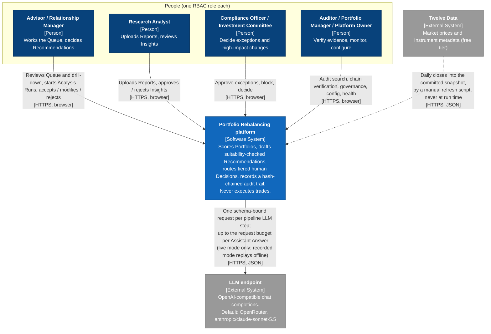

# 3. Context and Scope

The platform's boundary is narrow by design. Humans reach it only through the browser. It calls exactly one external system at run time, the LLM endpoint, and only in live mode. Market data enters through a script an operator runs by hand, never through the running application. Nothing leaves the platform towards a broker, a custodian or a Client.

## 3.1 Business context

C4 Level 1, System Context. What each role expects of the platform is in [1.3 Stakeholders](01-introduction-and-goals.md#13-stakeholders); the table below the diagram adds what crosses the boundary and what stays out of scope.

[Detailed external interfaces catalog](appendices.md#e7-external-interfaces-catalog).

Outside the boundary altogether: brokers, order management, custody, client communication channels, identity providers and any real client data source.

## 3.2 Technical context

[Detailed external interfaces catalog](appendices.md#e6-external-interfaces-catalog).

The containers behind these channels are in [5.1 Level 1: Containers](05-building-block-view.md#51-level-1-containers).
