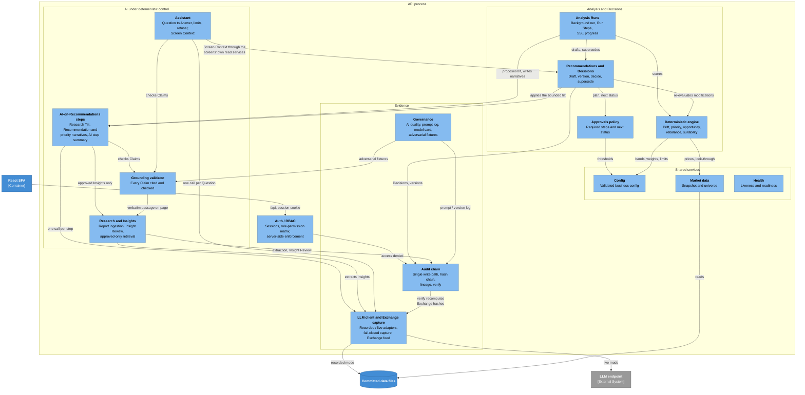

# 5. Building Block View

Two zoom levels below the System Context in [3.1 Business context](03-context-and-scope.md#31-business-context). §5.1 opens the platform into its containers (C4 Level 2). §5.2 opens the API process into its components (C4 Level 3) and states the tiered approval policy exactly as the code applies it. §5.3 lists the screens of the React SPA. How the components cooperate at run time is in [6. Runtime View](06-runtime-view.md).

Top-level orientation: the API process is the `app` Python package, with its HTTP endpoints in `app.routers`. The SPA is `frontend/`. The committed data files are under `data/` and `tests/fixtures/llm`.

## 5.1 Level 1: Containers

C4 Level 2, Containers.

| Container | Technology | Responsibility | Entry point |
| --- | --- | --- | --- |
| React SPA | React 19, TypeScript, React Router, TanStack Query, `openapi-fetch` | Presents every screen and the Assistant drawer. Shows only the navigation the server-issued permissions allow; hiding is cosmetic, the server enforces. Holds no business logic and no state the server does not own. | `frontend/`; in development the Vite dev server proxies `/api` to the API process |
| API process | Python 3.13, FastAPI, SQLAlchemy, Pydantic, `httpx` | Owns every business rule, number and record. Authenticates sessions, enforces RBAC on every endpoint, runs Analysis Runs on a background thread, calls the LLM through one captured interface, records every Decision and LLM Exchange in the audit chain. One process only ([ADR-0005](../adr/0005-run-step-progress-in-process.md), [ADR-0008](../adr/0008-one-process-on-sqlite-with-hand-written-migrations.md)). | `app.main:create_app`, run by `uvicorn` |
| Operator scripts | Python CLI modules run with `uv` | Seed the synthetic Clients deterministically from a seed number; seed the sample Reports and human-verified Insights; refresh the market snapshot from Twelve Data (the only script that uses the network); run an Analysis Run without the API. | `uv run python -m <module>` |
| SQLite database | One SQLite file, not committed | The only state the API writes. Tables are created on start; schema changes are hand-written idempotent migrations run at the same point ([ADR-0008](../adr/0008-one-process-on-sqlite-with-hand-written-migrations.md)). Audit Events and LLM Exchanges are append-only by construction. | `APP_DATABASE_URL` |
| Committed data files | JSON and text in git | Read-only at run time. The market snapshot (prices and Instrument metadata) and the fund look-through (fund sector weights) feed the engine; the seed set holds the sample Reports, their transcribed scorecard and Insights; the committed LLM recordings hold the replies the demo and tests replay when the recordings directory points at them (the default directory is a local, uncommitted one); the eval file holds the latest live eval shown on the model card. | `APP_MARKET_DATA_SNAPSHOT_PATH`, `APP_FUND_LOOKTHROUGH_PATH`, `APP_SEED_DIR`, `APP_LLM_RECORDINGS_DIR`, `APP_ASSISTANT_EVAL_PATH` |
| LLM endpoint (external) | Any OpenAI-compatible endpoint; OpenRouter by default | Answers one schema-bound request per LLM step in live mode. Never reached in recorded mode. | `APP_LLM_BASE_URL`, `APP_LLM_MODEL` |

## 5.2 Level 2: API process components

C4 Level 3, Components of the API process. Every component persists through the SQLAlchemy models of the one SQLite database; those edges are left out to keep the picture readable. Every HTTP endpoint passes through Auth / RBAC first; only the dependencies that carry a design decision are drawn.

| Component | Responsibility | Entry point (module; HTTP) |
| --- | --- | --- |
| Auth / RBAC | Logs a user in (scrypt-checked password, opaque token in an `HttpOnly`, `SameSite=Lax` cookie, only the token's SHA-256 stored, configurable TTL), resolves the session on every request and rejects any role lacking the endpoint's permission. A denial returns 403 and writes an `access_denied` Audit Event. The role-permission matrix is the single source of what each role may do ([8. Crosscutting Concepts](08-crosscutting-concepts.md)). | `app.rbac`; `/api/auth` |
| Deterministic engine | Computes every number, Trade Line and suitability verdict ([ADR-0001](../adr/0001-deterministic-engine-owns-numbers.md)): Asset-Class and Portfolio Drift against Tolerance Bands, the 0–100 priority score with its breakdown, the opportunity component from approved Insights, band-based rebalancing into Trade Lines, the Suitability Rules, and the Portfolio drill-down read model. Pure functions; never sees the LLM. | Called per Portfolio by `app.analysis`; `/api/portfolios` |
| Analysis Runs | Starts one Analysis Run at a time on its own thread, walks the fixed Run Steps (load inputs, score Portfolios, record run, priority narratives, Recommendation narratives), holds their progress in memory and streams it over SSE. A newer run becomes the current result; a run left without an outcome by a dead process is marked interrupted at start-up ([ADR-0005](../adr/0005-run-step-progress-in-process.md), [ADR-0009](../adr/0009-analysis-run-recording-commits-per-audit-event.md)). Serves the ranked Queue from the current run. | `app.analysis_runs`; `/api/analysis/runs`, `/api/queue` |
| Research and Insights | Splits an uploaded Report (PDF or text) into pages, asks the LLM to extract structured Insights, keeps an Insight only if its subject is in the taxonomy and its passage really appears on the cited page, and starts each one pending. Records the Research Analyst's Insight Review (approve or reject, final once taken). Only approved Insights ever leave this component for tilt or opportunity use. | `app.reports`; `/api/reports`, `/api/insights` |
| AI-on-Recommendations steps | The LLM's three jobs inside an Analysis Run. Research Tilt: the LLM proposes tilts per approved Insight; the engine drops unoffered Insights, ignores the wrong-signed part and clips each subject to the configured bound. Recommendation narrative and advisor memo, and the Queue's "why this client, why now" narrative: the LLM writes cited Claims, the memo and summary are assembled from grounded Claims only. A failing LLM leaves the deterministic result untouched. Also summarises, per Recommendation, how each AI step went (mode, latency, grounded counts). | Called by `app.analysis` during an Analysis Run |
| Recommendations and Decisions | Drafts a Recommendation (Trade Lines, turnover, post-trade drift and suitability) for each Portfolio outside its Tolerance Bands, records the Advisor's accept, modify or reject (a modification is re-evaluated by the engine and becomes a new linked version), records the Compliance and Investment Committee Decisions, and supersedes every open Recommendation when a newer Analysis Run is recorded. Serves the Recommendation, its lineage and the shared pending-approvals panel. Nothing is executed. | `app.recommendations`; `/api/recommendations`, `/api/approvals` |
| Approvals policy | Decides which Decision steps a Recommendation needs and what status follows each human Decision; see [Tiered approval policy](#tiered-approval-policy). Pure functions of the Recommendation and the config. | `app.approvals` |
| Grounding validator | Accepts a Claim only if it carries a citation, each Report citation quotes its cited page verbatim, each engine citation names a figure in the set it is checked against, every number in the text equals a cited figure at the stated precision, and a view on an asset also cites a Report. Results are stored per Claim and feed the AI quality panel. | `app.grounding`; `/api/recommendations/{id}/grounding` |
| Audit chain | The only write path for Audit Events, with no update or delete. Each event's hash covers its content and the previous hash; parent links carry lineage from Report passage to Insight, Research Tilt, Recommendation and Decision. Searches events, verifies the chain by walking it, and derives a Recommendation's lineage read-only ([ADR-0002](../adr/0002-hash-chained-append-only-audit-log.md)). | `app.audit`; `/api/audit`, `/api/recommendations/{id}/lineage` |
| LLM client and Exchange capture | One `complete` interface with two adapters: recorded replay keyed by a hash of task, prompt version, system text, schema and prompt (a miss is an error, never a guess), and live OpenAI-compatible HTTP. A capturing wrapper stores every call as an immutable LLM Exchange before the caller continues and fails the call if it cannot ([ADR-0004](../adr/0004-llm-exchanges-stored-separately-anchored-in-audit-chain.md), [ADR-0007](../adr/0007-llm-steps-are-single-schema-bound-calls.md)). Serves the Exchange list, detail and live SSE feed. Prompts are versioned beside it. | `app.llm`; `/api/llm/exchanges` |
| Assistant (incl. Screen Context) | Answers one Question with at most one LLM call: checks the usage limits, rebuilds the Screen Context on the server from the screen identity the browser sends (through the same read services the screen uses, filtered by the user's permissions, Client ids only), sends it with recent history, checks the reply for PII and grounds its Claims. An out-of-scope Question gets the fixed Out-of-Scope Refusal. Every turn, answered, refused or failed, is stored append-only in the session's Conversation and audited ([ADR-0006](../adr/0006-assistant-conversations-persisted-and-audited.md)). | `app.assistant`; `/api/assistant` |
| Governance | Assembles the Auditor's and Platform Owner's governance view from stored facts only: the AI quality panel from stored grounding results, the prompt and version log from Audit Events, the model card from live settings and config plus the latest live eval file, and the adversarial fixture results from a stored run of the real Grounding validator. | `app.governance`; `/api/governance` |
| Config | The single validated configuration surface: Tolerance Bands, priority weights, Research Tilt bound, review SLA, approval thresholds and Suitability limits. Partial updates merge and are validated before they are stored; every engine reads the current values. | `app.config_service`; `/api/config` |
| Market data | Loads the committed snapshot and fund look-through once per process and classifies the Instrument universe with the platform's own taxonomy. Never touches the network ([ADR-0003](../adr/0003-market-data-snapshot-synthetic-clients.md)). | `app.market_data` |
| Health | An unauthenticated liveness probe that exposes nothing, and a permissioned health view: database reachable, market snapshot present and its age, LLM mode and whether live mode has a key. | `/api/health/live`, `/api/health` |

Process settings (secrets, LLM mode and endpoint, Assistant limits, file locations) are read from `APP_`-prefixed environment variables by one settings object; they are not part of the business config above.

### Tiered approval policy

The policy decides which human Decisions a Recommendation needs. It is computed from the Recommendation and the current config; nothing about it is stored.

| Step | Required when | Who decides (permission) | Actions |
| --- | --- | --- | --- |
| Advisor | Always | Advisor or Relationship Manager (`recommendation:decide`) | Accept; modify (rationale required; a new linked version returns to the Advisor step and the original is superseded); reject (rationale required) |
| Compliance | The post-trade suitability status is breach: some Suitability Rule is in breach. Warnings alone do not require it | Compliance Officer (`compliance:decide`) | Approve the exception or block, rationale required |
| Investment Committee | High-impact: turnover is at or above the turnover threshold, or any single Trade Line is at or above the single-Trade-Line threshold, both as % of the Portfolio, set in Config | Investment Committee (`committee:decide`) | Approve or reject, rationale required |

- **Order.** Advisor, then Compliance, then Investment Committee, skipping the steps not required. A step can be decided only while the Recommendation waits at exactly that step; any other attempt is refused (409), and a role without the step's permission is refused (403, audited as `access_denied`).
- **Outcome.** Approved only after a human Decision at every required step. Any rejection or block ends it as rejected. "Approved" means cleared to act outside the platform; nothing is executed.
- **Re-planning when thresholds change.** The plan is recomputed at every read and at every Decision, from the thresholds in force at that moment, and the next status follows the recomputed plan. So lowering a threshold can add the Investment Committee step to a Recommendation that has not reached it yet. A Recommendation already waiting at a step stays there: if thresholds rise while it waits on the Committee, the Committee still decides it, and its approval then completes it.
- **Supersession.** A newer recorded Analysis Run supersedes every Recommendation still waiting at any step; a superseded Recommendation cannot be decided.
- **Evidence.** Every Decision writes an Audit Event (`decision_recorded` for the Advisor and the Committee, `exception_approved` or `exception_blocked` for Compliance) carrying the rationale and resulting status, linked to the Recommendation's previous event. The sequence is in [6.2 Tiered Decisions](06-runtime-view.md#62-tiered-decisions).

## 5.3 React SPA screens

Each screen appears only for a role holding the permission in brackets; the server checks it again on every call. Every screen except Research publishes a screen identity for the Assistant drawer, never its data; the server builds the Screen Context from that identity.

| Screen | Responsibility |
| --- | --- |
| Queue (`queue:read`) | Ranked Portfolios from the current Analysis Run with priority breakdown and cited narrative; starts an Analysis Run and follows its Run Steps live. |
| Portfolio and Recommendation (`portfolio:read`) | Drill-down into Holdings, drift and look-through exposure; the Recommendation with Trade Lines, post-trade suitability, approval plan, grounded memo and flagged Claims, AI step summary, and the Advisor's accept, modify and reject. |
| Approvals (`approvals:read`) | The pending-approvals panel: Compliance sees what waits on Compliance with each rule's limit, actual value and the Trade Lines that drive it; the Committee sees what waits on the Committee with the thresholds and reasons. |
| Research (`report:read`) | The Research Analyst UI. **To review** is the inbox of every Insight awaiting review, grouped by Report; **Reports** lists uploads; **Report detail** shows each Insight beside the full text of its cited page with the passage highlighted. An Analyst uploads a Report, then approves an Insight or rejects it with a note; the selection then moves to the next Insight awaiting review. If another Analyst reviewed it first, the server's 409 is shown as such. |
| Audit and lineage (`audit:read`) | Audit Event search, chain verification (`audit:verify`) and a Recommendation's lineage from Report passage to Decision. |
| Governance (`governance:read`) | AI quality, prompt and version log, model card and the adversarial fixture run (`governance:run`). |
| LLM Exchanges (`llm:read`) | The live Exchange feed and the full detail of any Exchange. |
| Config (`config:read`) and Health (`health:read`) | Read-only views of the business config and the health view. The Platform Owner changes the config through `PATCH /api/config` (`config:write`), not through the screen. |
| Assistant drawer (every role, `assistant:use`) | Ask about the screen in view; shows the Conversation, cited Answers and the screen's Suggested Questions. On the Research screens it shows "No context on this screen" and takes no Question. |
