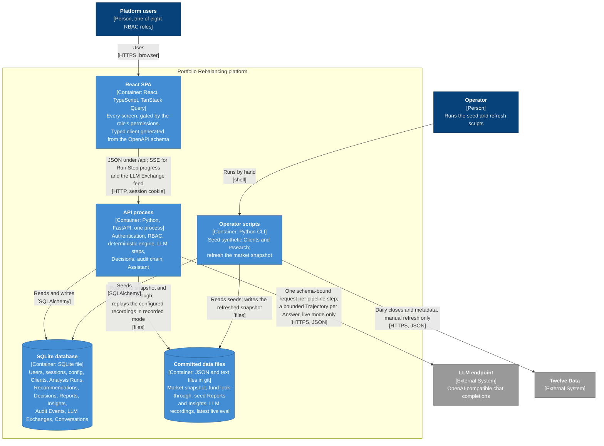
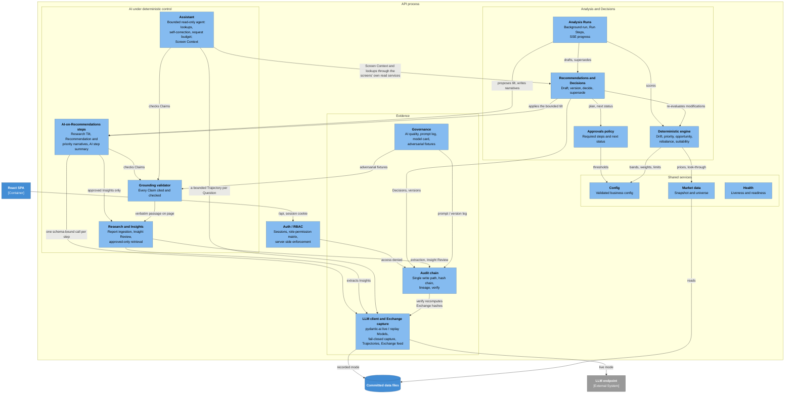

# 5. Building Block View

Two zoom levels below the System Context in [3.1 Business context](03-context-and-scope.md#31-business-context). §5.1 opens the platform into its containers (C4 Level 2). §5.2 opens the API process into its components (C4 Level 3) and states the tiered approval policy exactly as the code applies it. §5.3 lists the screens of the React SPA. How the components cooperate at run time is in [6. Runtime View](06-runtime-view.md).

Top-level orientation: the API process is the `app` Python package, with its HTTP endpoints in `app.routers`. The SPA is `frontend/`. The committed data files are under `data/` and `tests/fixtures/llm`.

## 5.1 Level 1: Containers

C4 Level 2, Containers.

[Detailed container entry points](appendices.md#e10-container-entry-points).

## 5.2 Level 2: API process components

The deterministic engine computes Drift, Priority, Trade Lines and Suitability. Analysis Runs coordinate scoring and narrative steps; Recommendations and the approvals policy enforce human Decisions. Research owns Report ingestion and approved Insights. Grounding checks structured Claims. The Assistant reuses permission-filtered screen builders for read-only lookups. LLM capture and the audit chain retain evidence; governance derives quality views. Config, market data, health and Auth/RBAC provide shared services. The catalog below names each module and HTTP entry point.

C4 Level 3, Components of the API process. Every component persists through the SQLAlchemy models of the one SQLite database; those edges are left out to keep the picture readable. Every HTTP endpoint passes through Auth / RBAC first; only the dependencies that carry a design decision are drawn.

[Detailed component entry points and responsibilities](appendices.md#e9-component-entry-points-and-responsibilities).

Process settings (secrets, LLM mode and endpoint, Assistant limits, file locations) are read from `APP_`-prefixed environment variables by one settings object; they are not part of the business config above.

### Tiered approval policy

Advisor approval is always required (`recommendation:decide`). Compliance follows only for a post-trade Suitability breach (`compliance:decide`); warnings alone do not require it. Investment Committee follows when turnover or any single Trade Line is **at or above** the configured percentage threshold (`committee:decide`). Approved executes nothing.

The plan is recomputed at every read and Decision. Lower thresholds can add a future Committee step; raising a threshold does not remove a step already waiting. Wrong-step Decisions receive 409; missing permissions receive 403 with an `access_denied` event. A modification creates a new version back at Advisor; a newer Analysis Run supersedes open Recommendations. Decisions and rationale are audited.

[Detailed tiered approval policy](appendices.md#e33-tiered-approval-policy). The sequence is in [6.2](06-runtime-view.md#62-tiered-decisions).

## 5.3 React SPA screens

Each screen appears only for a role holding the permission in brackets; the server checks it again on every call. Every screen except Research publishes a screen identity for the Assistant drawer, never its data; the server builds the Screen Context from that identity.

[Detailed spa screen catalog](appendices.md#e8-spa-screen-catalog).
