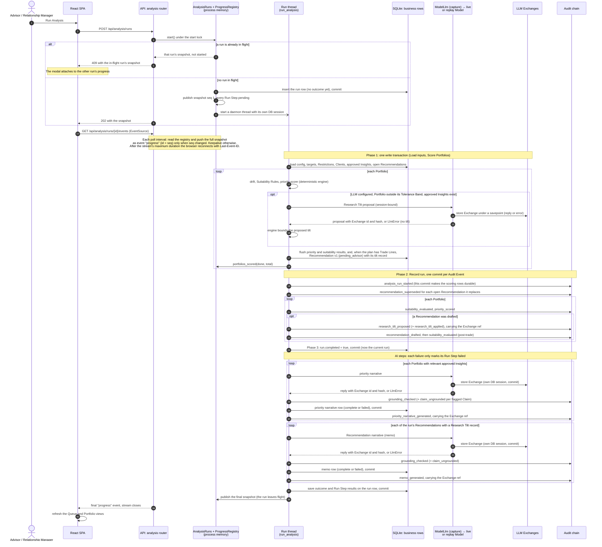
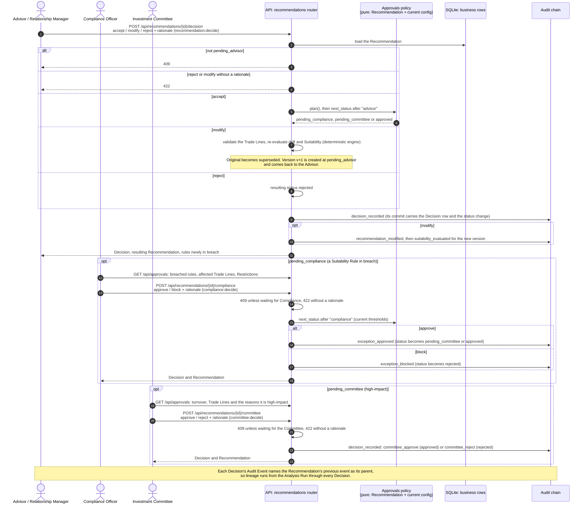
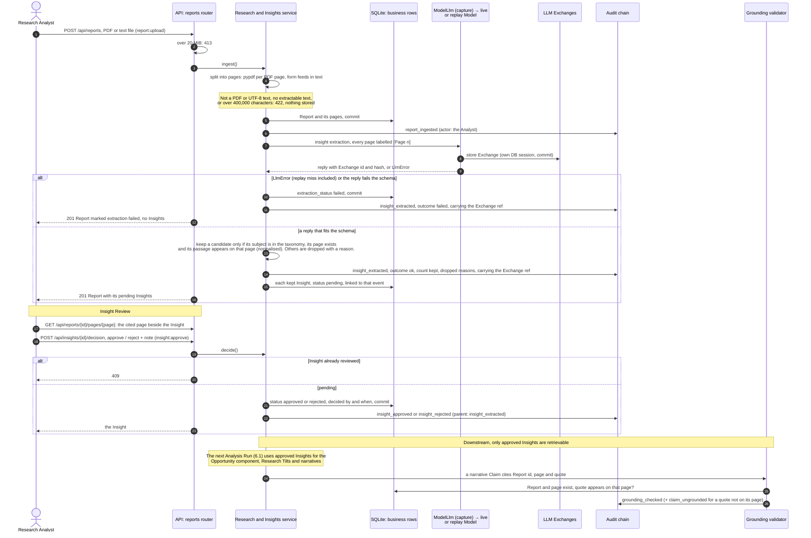
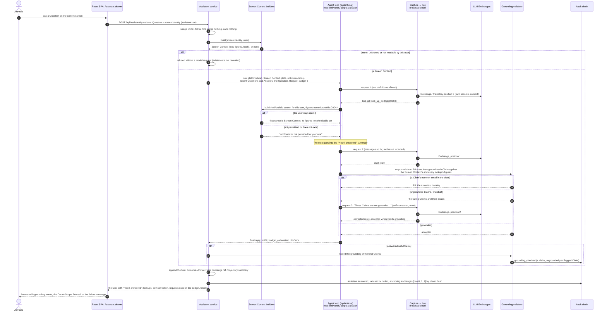

# 6. Runtime View

Four flows carry the platform's critical behaviour. Each diagram shows two kinds of evidence: where Audit Events are appended to the chain (the **Audit chain** lane) and where LLM Exchanges are stored (the **LLM Exchanges** lane). Both are tables in the one SQLite file ([ADR-0008](../adr/0008-one-process-on-sqlite-with-hand-written-migrations.md)). They get their own lanes because they are the record an Auditor relies on.

Some rules hold in all four flows:

- **One appended event, one commit.** Every Audit Event is appended under a process-wide lock and committed on its own ([ADR-0002](../adr/0002-hash-chained-append-only-audit-log.md)). Business rows flushed before that event commit with it.
- **The LLM Exchange comes first.** Every model request goes through one capturing wrapper. The wrapper stores the LLM Exchange, for a reply or an error, before the caller writes the Audit Event that references it by id and hash. If the LLM Exchange cannot be stored, the request fails ([ADR-0004](../adr/0004-llm-exchanges-stored-separately-anchored-in-audit-chain.md)).
- **One call per pipeline step, a bounded Trajectory per Answer.** Insight extraction, the Research Tilt and both narratives are each a single, schema-bound request with no tools. Only an Assistant Answer may take several model requests: read-only lookups and at most one self-correction, within the request budget. Either way the step's one Audit Event anchors its whole LLM Trajectory, in order ([ADR-0010](../adr/0010-assistant-is-a-bounded-read-only-agent-on-pydantic-ai.md)).
- **Replay misses fail.** In recorded mode a prompt with no recording raises a replay miss. It is never answered with a guess, and it fails the call like any other LLM error.
- **Denials are audited.** A role that lacks the endpoint's permission gets `403`, and an `access_denied` Audit Event is written. The diagrams leave this out.

The components named in the lanes are described in [5.2 Level 2: API process components](05-building-block-view.md#52-level-2-api-process-components). Domain terms are defined in [`GLOSSARY.md`](../../GLOSSARY.md).

## 6.1 Analysis Run

An Advisor or Relationship Manager (`analysis:run`) starts an Analysis Run. The run executes on a background thread, and its Run Step progress streams to the browser over server-sent events. Only one run is in flight per process ([ADR-0005](../adr/0005-run-step-progress-in-process.md)).

[Detailed 6.1 analysis run controls and failure paths](appendices.md#e18-61-analysis-run-controls-and-failure-paths).

## 6.2 Tiered Decisions

Every Recommendation starts at `pending_advisor`. The approvals policy decides which further steps it needs:

[Detailed 6.2 tiered decisions controls and failure paths](appendices.md#e19-62-tiered-decisions-controls-and-failure-paths).

## 6.3 Report ingestion to Insight Review

A Research Analyst uploads a Report. The platform splits it into pages and makes one LLM call to extract candidate Insights. Code keeps a candidate only if its subject is in the taxonomy and its quoted passage really appears on the cited page. Every kept Insight starts `pending`, and only an Insight the Analyst approves in Insight Review can influence anything downstream. After approval, the passage is checked again whenever a narrative cites it, by the Grounding validator.

[Detailed 6.3 report ingestion to insight review controls and failure paths](appendices.md#e20-63-report-ingestion-to-insight-review-controls-and-failure-paths).

## 6.4 Assistant Question

Any role holding `assistant:use` can ask the Assistant about the screen in view. The browser sends only the Question and a screen identity (kind, entity ids, selected item), never screen data. The server rebuilds the Screen Context through the same service the screen itself uses, filtered by the user's permissions. The context carries Client ids only, never names or emails.

[Detailed 6.4 assistant question controls and failure paths](appendices.md#e21-64-assistant-question-controls-and-failure-paths).
