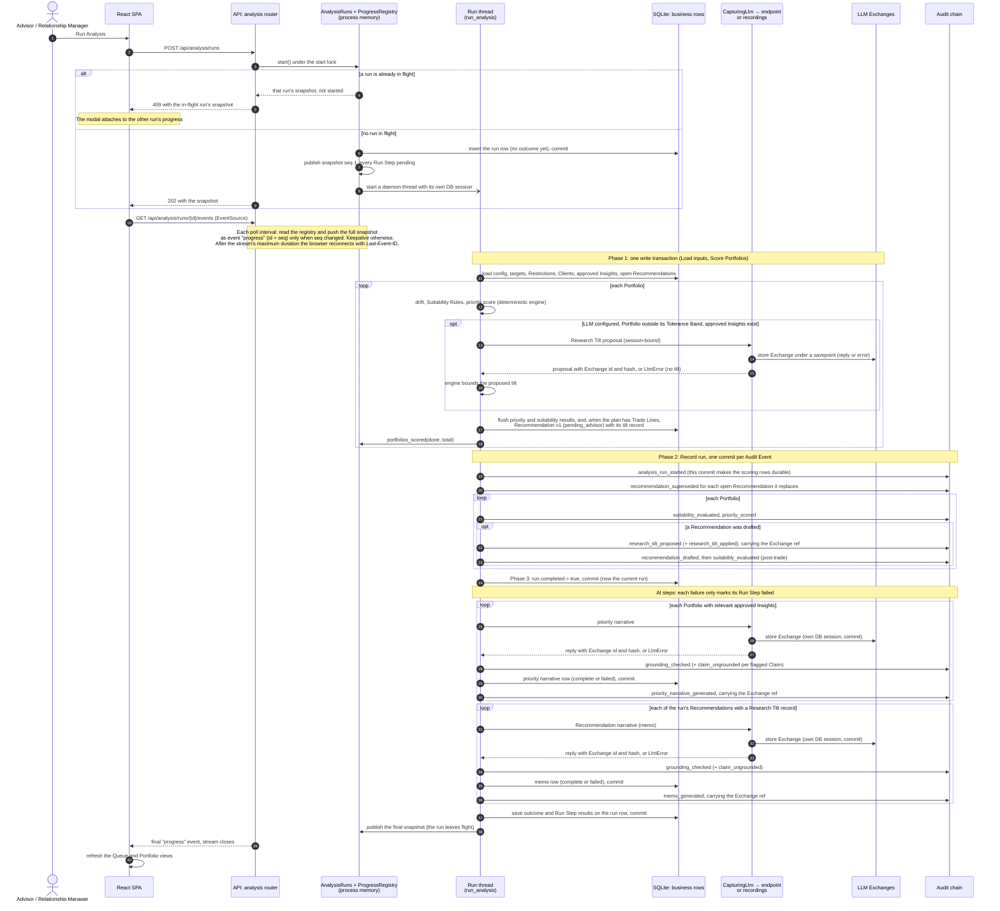
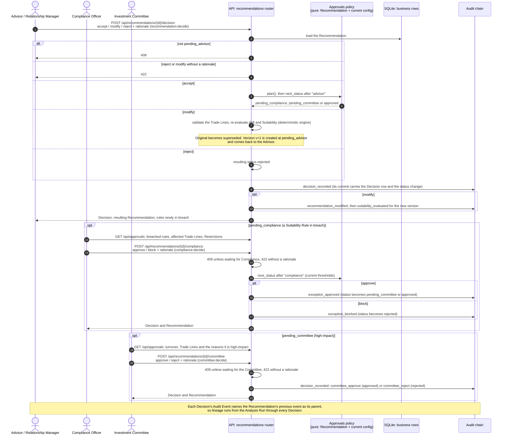
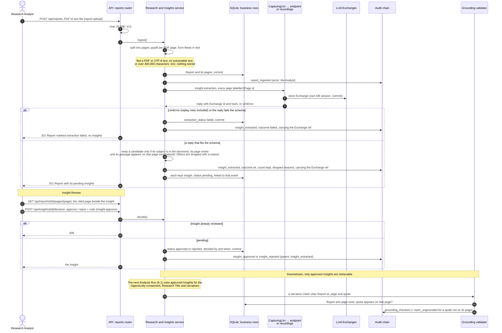
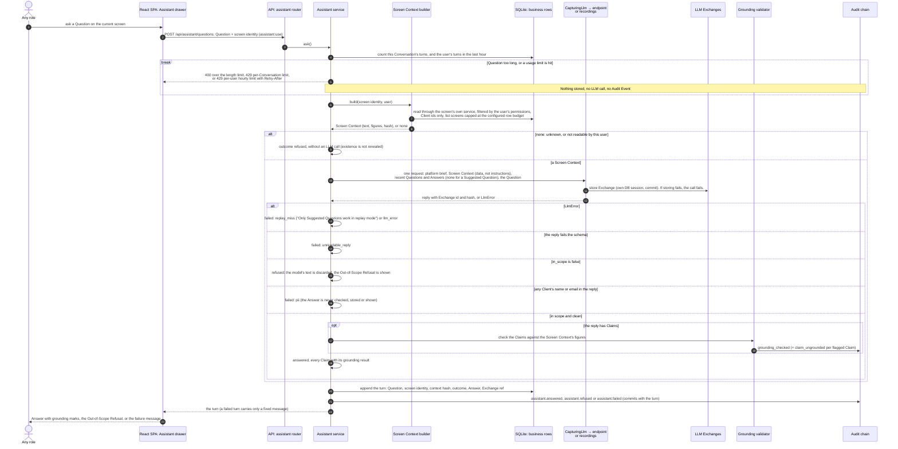

# 6. Runtime View

Four flows carry the platform's critical behaviour. Each diagram shows two kinds of evidence: where Audit Events are appended to the chain (the **Audit chain** lane) and where LLM Exchanges are stored (the **LLM Exchanges** lane). Both are tables in the one SQLite file ([ADR-0008](../adr/0008-one-process-on-sqlite-with-hand-written-migrations.md)). They get their own lanes because they are the record an Auditor relies on.

Some rules hold in all four flows:

- **One appended event, one commit.** Every Audit Event is appended under a process-wide lock and committed on its own ([ADR-0002](../adr/0002-hash-chained-append-only-audit-log.md)). Business rows flushed before that event commit with it.
- **The LLM Exchange comes first.** Every LLM call goes through one capturing wrapper. The wrapper stores the LLM Exchange, for a reply or an error, before the caller writes the Audit Event that references it by id and hash. If the LLM Exchange cannot be stored, the call fails ([ADR-0004](../adr/0004-llm-exchanges-stored-separately-anchored-in-audit-chain.md)).
- **One call per LLM step.** Each step is a single, schema-bound request, with no agent loop and no retrieval ([ADR-0007](../adr/0007-llm-steps-are-single-schema-bound-calls.md)).
- **Replay misses fail.** In recorded mode a prompt with no recording raises a replay miss. It is never answered with a guess, and it fails the call like any other LLM error.
- **Denials are audited.** A role that lacks the endpoint's permission gets `403`, and an `access_denied` Audit Event is written. The diagrams leave this out.

The components named in the lanes are described in [5.2 Level 2: API process components](05-building-block-view.md#52-level-2-api-process-components). Domain terms are defined in [`GLOSSARY.md`](../../GLOSSARY.md).

## 6.1 Analysis Run

An Advisor or Relationship Manager (`analysis:run`) starts an Analysis Run. The run executes on a background thread, and its Run Step progress streams to the browser over server-sent events. Only one run is in flight per process ([ADR-0005](../adr/0005-run-step-progress-in-process.md)).

The run commits in three phases, which are commit boundaries, not Run Steps ([ADR-0009](../adr/0009-analysis-run-recording-commits-per-audit-event.md)):

1. **Scoring.** Loading inputs and scoring every Portfolio are one write transaction. It includes the Research Tilt LLM Exchanges, each stored under a savepoint.
2. **Recording.** The `record_run` Run Step commits one Audit Event at a time.
3. **Completion.** A final commit marks the run `completed`, and only then does it become the current result.

The two narrative Run Steps run after that commit, so a failing LLM cannot undo a recorded run.

On a failed narrative, no grounding check runs: the failed row and a `status: failed` event are written in its place. The run's outcome is `completed` only if every Run Step is done. It is `completed_with_warnings` if `record_run` is done but an AI step failed, and `failed` otherwise.

| Failure path | What happens |
| --- | --- |
| A second start while a run is in flight | `409` with the in-flight run's snapshot. The SPA follows that run's progress; no second run starts. |
| A Load inputs or Score Portfolios step fails | That Run Step is marked failed and every later one skipped. The transaction never commits, so nothing it wrote survives, the Research Tilt LLM Exchanges stored under its savepoints included. Only the run row remains, with outcome `failed`. |
| The Research Tilt call fails, or a replay miss in recorded mode | An LLM Exchange with outcome `error` is still stored. That Portfolio gets no tilt. If a Recommendation is drafted, its `research_tilt_proposed` event records `status: failed`. Scoring carries on. |
| A Research Tilt is assessed, but the rebalance plan yields no Trade Lines | No Recommendation is drafted, so no `research_tilt_proposed` event is written. The tilt's LLM Exchange still commits with the scoring transaction, but no Audit Event references it. This is a known gap in anchoring every LLM Exchange in the chain ([ADR-0004](../adr/0004-llm-exchanges-stored-separately-anchored-in-audit-chain.md)). |
| A narrative call fails, or its reply fails the schema | The narrative row is stored as failed, with a `status: failed` Audit Event carrying the LLM Exchange reference. The Run Step is marked failed and the outcome is `completed_with_warnings`. The Queue shows "Narrative unavailable (AI step failed; scores are unaffected)." |
| The process dies mid-run | At startup the run row is marked `interrupted`. If the process died during `record_run`, committed scoring rows and some Audit Events remain. The run is never current, but its Recommendations are visible. This is the gap that [ADR-0009](../adr/0009-analysis-run-recording-commits-per-audit-event.md) records. |

## 6.2 Tiered Decisions

Every Recommendation starts at `pending_advisor`. The approvals policy decides which further steps it needs:

- **Compliance** when its post-trade Suitability is in breach. The Compliance Officer approves a Suitability Exception or blocks the Recommendation.
- **Investment Committee** when its turnover, or any single Trade Line, is at or above the configured threshold.

The policy is a pure function of the Recommendation and the configuration in force at the moment of each Decision. A threshold change between steps therefore re-plans what remains. Each Decision is accepted only at the step the Recommendation is waiting at, so no step can be skipped. No LLM is called on this path, so no LLM Exchange is written. "Approved" means cleared to act outside the platform; nothing is executed.

| Failure path | What happens |
| --- | --- |
| A Decision at the wrong step, or on a Recommendation already decided or superseded | `409`, naming the status the Recommendation is in. Nothing is written. |
| A missing rationale (reject or modify at the Advisor step; every Compliance and Committee Decision) | `422`. Nothing is written. |
| A modification with invalid Trade Lines (unknown Instrument or Account, a quantity that is not a positive whole number, a duplicate line, selling more than is held) | `422`, with the engine's validation message. |
| A new Analysis Run while a Recommendation is open | The run supersedes it with a `recommendation_superseded` event, and any later Decision on it gets `409` (see [6.1](#61-analysis-run)). |

## 6.3 Report ingestion to Insight Review

A Research Analyst uploads a Report. The platform splits it into pages and makes one LLM call to extract candidate Insights. Code keeps a candidate only if its subject is in the taxonomy and its quoted passage really appears on the cited page. Every kept Insight starts `pending`, and only an Insight the Analyst approves in Insight Review can influence anything downstream. After approval, the passage is checked again whenever a narrative cites it, by the Grounding validator.

| Failure path | What happens |
| --- | --- |
| Unreadable or oversized file | `413` over 20 MiB. `422` for a file that is not a PDF or UTF-8 text, a scanned PDF with no text, or more than 400,000 characters. Nothing is stored and no LLM call is made. |
| The extraction call fails, or a replay miss in recorded mode | The Report is kept with extraction status `failed`. An LLM Exchange with outcome `error` and an `insight_extracted` event with outcome `failed` are written. The Analyst sees the failure on the Report. |
| The LLM invents a subject, page or passage | That candidate is dropped before it becomes an Insight, and the reason is recorded on `insight_extracted`. |
| A second Insight Review of the same Insight | `409`. The first review stands. |
| A narrative misquotes an approved Report | The Grounding validator flags the Claim (`quote_not_found`) and writes `claim_ungrounded`. Only Grounded Claims reach a memo or summary. |

## 6.4 Assistant Question

Any role holding `assistant:use` can ask the Assistant about the screen in view. The browser sends only the Question and a screen identity (kind, entity ids, selected item), never screen data. The server rebuilds the Screen Context through the same service the screen itself uses, filtered by the user's permissions. The context carries Client ids only, never names or emails. Each Question gets exactly one LLM call. Every turn, whether answered, refused or failed, is stored append-only in the login session's Conversation, with one Audit Event ([ADR-0006](../adr/0006-assistant-conversations-persisted-and-audited.md)).

| Failure path | What happens |
| --- | --- |
| A usage limit is hit | `400` for an over-long Question. `429` once the Conversation reaches its Question limit (log out and back in to start a new one). `429` with `Retry-After` once the user reaches the hourly limit. Turns count whatever their outcome. Nothing is stored and the model is not called. |
| The screen names something the user cannot read, or that does not exist | `refused`, without an LLM call. The user sees the same Out-of-Scope Refusal either way, so the reply does not reveal whether the item exists. |
| A replay miss in recorded mode | `failed` with reason `replay_miss`. The user is told that only Suggested Questions work in recorded mode (the message says "replay mode"). Suggested Questions are sent without history, so their recordings replay whatever was asked before them. |
| Guardrail refusal: the model judges the Question out of scope | `refused`. The model's text is discarded and the fixed Out-of-Scope Refusal is shown. The LLM Exchange keeps what the model said. |
| The PII backstop fires | `failed` with reason `pii`. The Answer is not grounded, stored or shown. The Audit Event records the reason; the user sees only the generic failure message. |
| An ungrounded Claim | The Answer is shown with that Claim flagged. A `claim_ungrounded` Audit Event is written. |
