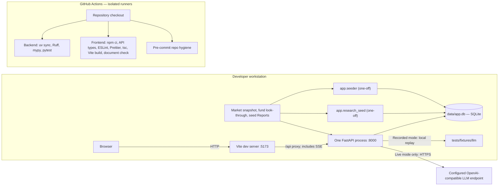

# 7. Deployment View

This section describes the local demonstrator. There is no cloud deployment, container image or infrastructure-as-code baseline in the repository. The proposed production topologies are kept in the [Target / Production Roadmap](13-roadmap.md#logical-production-deployment).

## 7.1 Logical deployment

### Local topology (as-is)

The [README seed and run instructions](../../README.md#seed-and-run) are the executable runbook. After dependency setup and activation of `.venv`, run `uv run python -m app.seeder`, then `uv run python -m app.research_seed` against the same `APP_DATABASE_URL` (default `sqlite:///./data/app.db`). The Client seeder replaces the synthetic Client dataset; it is a setup command, not a service or a safe production refresh. The Research seed is idempotent and inserts human-verified Insights without an LLM call. Use a fresh database for the documented demo replay.

Start the API with `APP_LLM_MODE=recorded APP_LLM_RECORDINGS_DIR=tests/fixtures/llm uv run uvicorn app.main:create_app --factory --port 8000` and the UI with `cd frontend && npm run dev`. Vite serves the SPA at `http://localhost:5173` and proxies `/api`, `/docs` and `/openapi.json` to port 8000. SSE uses the same API proxy. Startup creates missing tables, runs the idempotent migrations, seeds role users and marks unfinished Analysis Runs interrupted. Run Step progress, the one-in-flight guard and audit write serialization remain in the single API process ([ADR-0008](../adr/0008-one-process-on-sqlite-with-hand-written-migrations.md)). Do not add workers or replicas to this topology.

The API reads the committed market snapshot and fund look-through files; it does not fetch market prices. Recorded mode reads matching local LLM recordings without contacting a provider; live mode sends prompts to the configured endpoint. Settings and credentials come from `APP_*` environment variables or the git-ignored `.env`. SQLite holds application state, extracted Report pages, Audit Events and LLM Exchanges. There is no separate queue, progress service, identity provider or database server.

### CI topology (as-is)

[CI](../../.github/workflows/ci.yml) runs on pushes to `development` and `main`, pull requests and manual dispatch. Its three jobs above validate the checkout; they do not deploy it or connect to the developer's database. Backend tests use isolated test databases and recorded replies; the backend job skips Mermaid-dependent tests, while the frontend job renders the document's diagrams with Node. Repo-hygiene hooks run in the third job. A green pipeline is validation evidence, not a production release.

## 7.2 Reference deployment on Azure

Azure is a proposed mapping, not an existing environment. The [Azure reference diagram and mapping](13-roadmap.md#azure-reference-deployment) and [cloud-agnostic production diagram](13-roadmap.md#logical-production-deployment) live in the Roadmap so that target services cannot be mistaken for deployed components.
