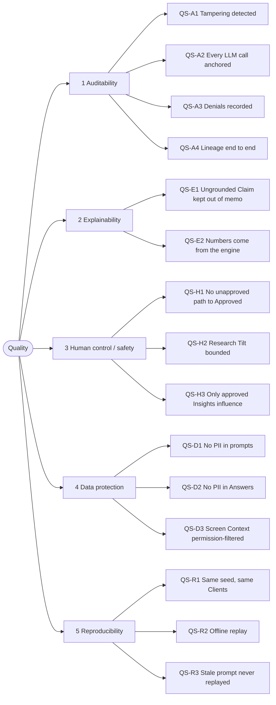

# 10. Quality Requirements

This section turns the ranked quality goals of [1.2 Quality goals](01-introduction-and-goals.md#12-quality-goals) into scenarios a reviewer can check. Each scenario states a stimulus, the system's response and a measure that is either met or not. Each one also names the automated test that asserts it on every CI run. A scenario describes what the code on the baseline commit does. Where a goal has a known gap, the gap is in [11. Risks and Technical Debt](11-risks-and-technical-debt.md), not glossed over here.

## 10.1 Quality tree

Goals are ranked. When two conflict, the higher one wins. For example, an LLM Exchange that cannot be stored fails its AI step (Auditability) even though the step's answer was available (Explainability).

## 10.2 Quality scenarios

All tests named below live in `tests/` and run in the backend CI job.

### Auditability

| ID | Stimulus | Response | Measure | Asserted by |
| --- | --- | --- | --- | --- |
| QS-A1 | Someone with database access edits an Audit Event's payload, deletes an event, or overwrites an event's stored hash | An Auditor runs `GET /api/audit/verify` | The result is `valid: false` and names the first broken event, every time. An edited or removed LLM Exchange that an event references is caught the same way | `test_audit.py::test_verify_names_first_broken_link_after_payload_tamper`, `test_verify_detects_deleted_row`, `test_verify_detects_recomputed_hash_by_relinking`; `test_llm_exchanges.py::test_verify_names_the_first_event_whose_exchange_was_altered`, `test_verify_detects_a_removed_exchange` |
| QS-A2 | Any AI step runs (Insight extraction, Research Tilt, priority narrative, memo, Assistant Answer), including one that has no recording or whose reply the step rejects | Each model request is stored as an LLM Exchange, and the step's Audit Event anchors its LLM Trajectory: every Exchange by id and hash, in order | Every AI-step Audit Event anchors its Trajectory, on success and on failure, a list of one for a single-call step. Verify checks every Exchange in it, and catches a missing, edited, reordered or unanchored one. If the Exchange cannot be stored, the AI step fails and no output reaches a user (fail-closed), while every deterministic feature still works. One exception is known: [TD-03](11-risks-and-technical-debt.md#td-03) | `test_llm_exchange_coverage.py::test_every_ai_step_is_captured_and_referenced_by_its_audit_event`, `test_a_step_with_no_recording_is_captured_as_an_error_exchange_and_the_event_says_so`, `test_losing_the_exchange_store_fails_each_ai_step_but_nothing_deterministic`; `test_llm_exchanges.py::test_recorded_extraction_is_captured_and_anchored_in_the_audit_event`; `test_assistant.py::test_an_answered_turn_writes_an_audit_event_anchoring_its_exchange_and_the_chain_verifies`, `test_an_exchange_that_cannot_be_captured_fails_closed_and_no_answer_reaches_the_user`; `test_llm_trajectory.py::test_a_trajectory_of_three_is_anchored_in_order_and_verifies`, `test_swapping_two_positions_is_caught_even_when_the_exchange_hashes_are_recomputed`; `test_assistant_lookup.py::test_failure_on_the_second_request_anchors_both_exchanges` |
| QS-A3 | A user calls an endpoint their role lacks the permission for | The server refuses with `403` | Every denial writes a searchable `access_denied` Audit Event. A permitted call writes none | `test_audit.py::test_denied_action_produces_searchable_access_denied_event`, `test_permitted_action_is_not_logged_as_denied` |
| QS-A4 | An Auditor opens the lineage of an approved Recommendation | The platform returns the chain from Report through approved Insight, Research Tilt and every Recommendation version to every Decision, oldest first | Every node shows actor and timestamp; every AI node shows model and prompt version; overrides are flagged | `test_lineage.py::test_lineage_runs_from_report_through_every_approval_step_to_the_final_decision`, `test_every_node_shows_actor_and_timestamp_and_ai_nodes_show_model_and_prompt_version` |

Known gaps in Auditability are risks [R-09](11-risks-and-technical-debt.md#r-09) (no external anchor for the chain), [TD-03](11-risks-and-technical-debt.md#td-03) and [TD-04](11-risks-and-technical-debt.md#td-04).

### Explainability

| ID | Stimulus | Response | Measure | Asserted by |
| --- | --- | --- | --- | --- |
| QS-E1 | The model writes a Claim in a Recommendation rationale that quotes text not on the cited page, cites a number that differs from the engine figure, or cites nothing | The Grounding validator flags the Claim and writes a `claim_ungrounded` Audit Event | The flagged Claim stays visible in the rationale, marked. It never reaches the advisor memo: 0 ungrounded Claims in any memo | `test_grounding.py::test_ungrounded_claims_stay_visible_but_are_not_memo_eligible`, `test_memo_claims_keeps_only_grounded_results`, `test_flags_are_recorded_as_audit_events`; `test_ai_recommendations.py::test_rationale_shows_every_claim_with_flags_and_the_memo_keeps_only_grounded_ones` |
| QS-E2 | A memo, priority narrative or Assistant Answer states a figure | The figure is checked against the engine figures or the Screen Context it was given | Every number in a memo comes from the engine. A number with no matching engine figure is flagged, even when cited | `test_ai_recommendations.py::test_memo_numbers_come_from_the_engine`; `test_grounding.py::test_a_number_with_no_engine_figure_is_flagged_even_when_cited`; `test_assistant.py::test_claims_citing_absent_figures_or_mismatched_numbers_are_flagged_and_stay_in_the_answer` |

### Human control / safety

| ID | Stimulus | Response | Measure | Asserted by |
| --- | --- | --- | --- | --- |
| QS-H1 | A Recommendation is in Suitability breach, high impact, both, or neither | The approval policy plans the required Decisions: Advisor always, then Compliance on a breach, then Investment Committee at or above a threshold | No path reaches Approved without a human Decision at every required step. Out-of-order or wrong-role Decisions are refused. Approved executes nothing | `test_approvals.py::test_no_path_reaches_approved_without_a_human_decision_at_every_required_step`, `test_compliance_cannot_act_before_the_advisor_has_decided`, `test_only_the_right_role_may_take_each_step`; `test_recommendations.py::test_accept_without_breach_is_approved_but_executes_nothing` |
| QS-H2 | The model proposes a Research Tilt larger than the configured bound, or against the Insight's direction | The engine clips the tilt to the bound, or refuses it, before any Trade Line moves | No target weight moves by more than the bound, even when tilts stack. Proposed and allowed tilts are both in the audit chain | `test_ai_recommendations.py::test_clip_never_exceeds_the_bound`, `test_no_target_moves_more_than_the_bound_even_when_tilts_stack`, `test_a_proposal_against_the_insight_direction_is_not_allowed`, `test_proposed_and_allowed_tilt_are_in_the_audit_chain` |
| QS-H3 | Insights awaiting review or rejected exist when an Analysis Run starts | Only approved Insights are passed to the Research Tilt step | Insights awaiting review or rejected change no tilt and no score. With no approved Insight, no tilt call is made at all | `test_ai_recommendations.py::test_pending_and_rejected_insights_cannot_influence_a_tilt`, `test_no_llm_call_without_approved_insights`; `test_research.py::test_only_approved_insights_are_retrievable_for_use` |

### Data protection

| ID | Stimulus | Response | Measure | Asserted by |
| --- | --- | --- | --- | --- |
| QS-D1 | Any AI step builds a prompt, including an Assistant Question asked by an Advisor who holds `client:pii` | Prompts and Screen Contexts carry Client ids and pseudonyms only | 0 Client names or emails in any captured prompt, across every AI step and every Assistant screen | `test_llm_exchange_coverage.py::test_no_client_name_or_email_ever_appears_in_a_captured_prompt`; `test_assistant.py::test_the_prompt_carries_no_client_name_or_email_even_for_an_advisor_holding_client_pii` |
| QS-D2 | The model's Answer contains a Client name or email | The PII check on replies rejects the Answer | The user sees a safe failure message, never the leaked text. The turn is stored and audited as failed | `test_assistant.py::test_an_answer_containing_a_client_name_or_email_is_rejected_as_a_failure` |
| QS-D3 | A user asks the Assistant about a Portfolio, Recommendation or screen their role cannot read, on screen or through a lookup | The server rebuilds the Screen Context, or the lookup's screen, with the role's permissions | On screen, the fixed refusal is returned. A lookup returns "not found or not permitted for your role". Both reveal nothing, the same as for an object that does not exist | `test_assistant.py::test_a_portfolio_the_role_cannot_read_gets_the_refusal_and_reveals_nothing`, `test_a_portfolio_that_does_not_exist_gets_the_same_refusal_for_a_reader`, `test_a_role_without_llm_read_gets_no_exchange_body_in_any_prompt`; `test_assistant_lookup.py::test_forbidden_and_missing_lookups_return_the_same_safe_result`; `test_assistant_tools.py::test_every_tool_for_every_role_is_permitted_exactly_where_its_screen_is_and_never_carries_client_pii` |

### Reproducibility

| ID | Stimulus | Response | Measure | Asserted by |
| --- | --- | --- | --- | --- |
| QS-R1 | The seeder runs twice with the same seed against the committed market data snapshot | It generates the synthetic Clients and Holdings | Identical Clients and Holdings each time, with no network call | `test_seeder.py::test_same_seed_gives_identical_clients_and_holdings`; `test_market_data.py::test_load_and_lookup_never_touch_the_network` |
| QS-R2 | The demo walkthrough runs from a fresh seed in recorded mode | Every LLM call is answered from the committed recordings | The walkthrough holds end to end offline. The same screen and data give a byte-identical Assistant prompt | `test_walkthrough.py::test_the_demo_walkthrough_holds_end_to_end_from_a_fresh_seed_on_recorded_responses`; `test_assistant.py::test_the_same_screen_and_data_give_a_byte_identical_prompt` |
| QS-R3 | A prompt is edited, a lookup returns something different, or a request has no recording | Replay looks up each model request's recording by task, prompt version, reply schema, tool definitions and the messages so far | A changed request misses rather than replaying a stale answer or continuing a stale Trajectory. The miss is stored as an error LLM Exchange and the step's Audit Event says `status: failed` | `test_llm_replay.py::test_a_changed_request_misses_its_recording_instead_of_replaying_a_stale_reply`, `test_a_changed_tool_result_misses_the_continuation_instead_of_replaying_it`; `test_llm_exchange_coverage.py::test_a_step_with_no_recording_is_captured_as_an_error_exchange_and_the_event_says_so` |

## 10.3 Non-goals

**Performance and scalability are non-goals for this version.** The platform runs as one API process on one SQLite file ([ADR-0008](../adr/0008-one-process-on-sqlite-with-hand-written-migrations.md)), with one Analysis Run in flight and one writer at a time. No latency, throughput, availability or recovery target is set or measured, and no scenario above implies one.

The limits that do exist are functional guards, not capacity targets:
- A second Analysis Run is refused with `409` while one is in flight.
- The Assistant's usage limits answer `429` when a user goes over them.

The risks this non-goal carries are [R-04](11-risks-and-technical-debt.md#r-04) to [R-06](11-risks-and-technical-debt.md#r-06). The [Target / Production Roadmap](13-roadmap.md) sets targets and lifts the single-process design.
