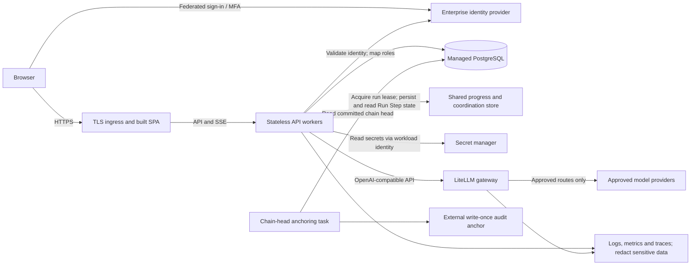
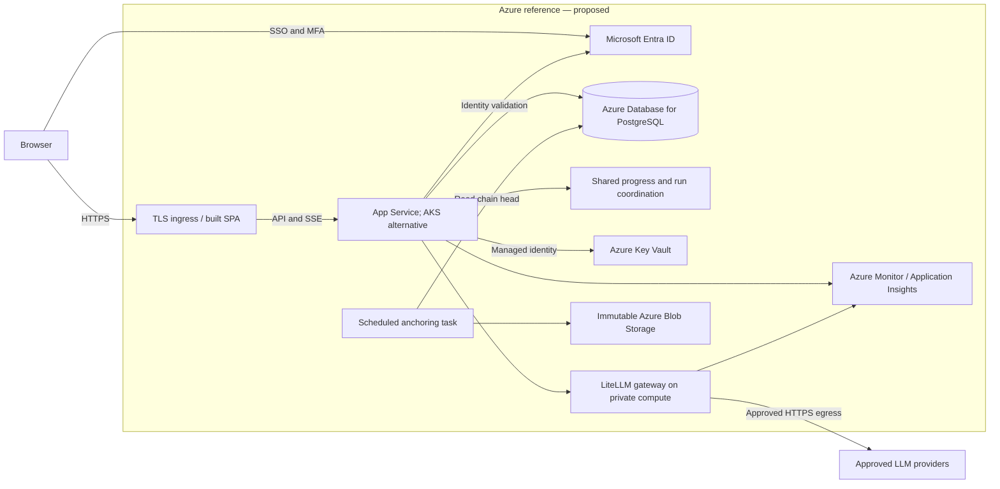

# Target / Production Roadmap

**Proposed target state; none of the changes below is implemented by this document.** The current deployment is [§7](07-deployment-view.md). Every item links to the [§11 register](11-risks-and-technical-debt.md) it addresses. Performance and scalability remain [current-version non-goals (§10.3)](10-quality-requirements.md#103-non-goals); the no-trade-execution boundary in [§1](01-introduction-and-goals.md#1-introduction-and-goals) remains a product constraint.

## Logical production deployment

The production application would retain deterministic engine ownership, permission enforcement, human Decisions, Grounding checks and LLM Exchange capture. A database-backed lease must enforce one Analysis Run globally; a shared progress store must allow any API worker to serve SSE. Audit appends need database-level serialization and bounded conflict handling. A PostgreSQL connection string alone does not remove the in-memory assumptions. Introduce multiple workers only after the [concurrency gate](#rm-03-shared-state-and-run-recovery) passes.

Use a built SPA behind HTTPS ingress rather than a Vite development server. Keep database, progress, secret and gateway administration endpoints private, allow only approved provider egress, and preserve SSE across the ingress's timeout and buffering settings. Reports and full LLM Exchanges require explicit retention and access rules before real data is admitted. These are design requirements, not claims about the current code.

## Azure reference deployment

| Logical responsibility | Azure reference and implementation boundary |
| --- | --- |
| SPA, ingress and API compute | App Service is the initial reference for the built SPA and API. AKS is an alternative if independently operated workers or existing platform policy justify Kubernetes. Neither is provisioned here; neither makes today's single-process API safe to replicate. Validate SSE routing, TLS and deployment rollback in the chosen host. |
| Transactional persistence | Azure Database for PostgreSQL; replace SQLite-specific migrations with Alembic, separate runtime and migration roles, configure encryption, backups and recovery, and prove restore before cutover. |
| Identity | Microsoft Entra ID for federated sign-in and MFA policy; implement application role mapping and server authorization. Workload managed identity is separate from a user's application role. |
| Secrets | Azure Key Vault accessed through managed identity; replace local credential provisioning, define rotation and keep prompt/Exchange contents out of operational logs. |
| Shared run state | Select a durable shared store for progress and a lease with expiry and fencing; PostgreSQL may own coordination. No Azure cache product is mandated until recovery and consistency requirements are agreed. |
| LLM access | Self-host LiteLLM on private compute, with only approved upstream providers. Configure persistence for budget accounting, route allowlists, quotas and evaluated fallbacks; keep the application's Exchange evidence independent of gateway telemetry. |
| Evidence and operations | Immutable Blob Storage for externally retained chain heads, with separately controlled retention; Azure Monitor / Application Insights for redacted operational telemetry. Exporting a hash alone is insufficient: verification must compare against the retained anchor. |

This is an architectural proposal. Microsoft's [managed identity database tutorial](https://learn.microsoft.com/en-us/azure/app-service/tutorial-connect-msi-azure-database) documents the App Service identity pattern. LiteLLM documents [fallback routing](https://docs.litellm.ai/docs/proxy/reliability) and [budget configuration](https://docs.litellm.ai/docs/proxy/users); budgets require persistent accounting and must be tested through fallback paths. Product selection, sizing, region, network design and retention policy require deployment decisions before implementation.

## Roadmap items

Sequence by exit evidence rather than dates. RM-01 and RM-02 establish the identity and storage foundations; RM-03 depends on RM-02. RM-04 and RM-05 close evidence gaps before the real-data pilot. RM-06 to RM-09 can proceed alongside them, but RM-10 admits real Client data only after the applicable gates pass. Owners below are proposed accountable roles, not assigned commitments.

### RM-01 Identity and browser security

Addresses [R-01](11-risks-and-technical-debt.md#r-01), [R-02](11-risks-and-technical-debt.md#r-02) and [R-03](11-risks-and-technical-debt.md#r-03). Owner: application security / identity team. Replace shared seeded logins with federated sign-in, MFA and directory-to-role mapping; remove demo accounts from the production profile. Add failed-login evidence and throttling. Select and test CSRF protection, enforce HTTPS and `Secure` cookies, and reject unsafe production settings at startup. Exit: role and revocation tests pass, forged state-changing requests fail, and a misconfigured production profile refuses to start.

### RM-02 Managed persistence and migrations

Addresses [R-05](11-risks-and-technical-debt.md#r-05) and [TD-07](11-risks-and-technical-debt.md#td-07). Owner: data platform team. Migrate to managed PostgreSQL with an Alembic baseline, encrypted storage, role-separated access, backups and point-in-time recovery. Rehearse data migration and rollback without using the destructive Client seeder. Exit: row counts, lineage and audit verification reconcile after migration; a backup restore and schema rollback or forward-repair drill succeed against agreed recovery targets. This enables RM-03 and independent Exchange writes in RM-04; it does not itself solve either.

### RM-03 Shared state and run recovery

Addresses [R-04](11-risks-and-technical-debt.md#r-04), [R-06](11-risks-and-technical-debt.md#r-06) and the [scalability non-goal](10-quality-requirements.md#103-non-goals). Owner: backend / platform team. Externalize Run Step progress, replace the in-memory run guard with a database-backed lease and fencing, and serialize audit appends across processes. Define interruption and recovery behavior before enabling replicas. Exit: two workers cannot start competing Analysis Runs or fork the chain; killing a worker and reconnecting SSE through another yields durable progress and an explicit recoverable or interrupted outcome. Load and failover tests must pass at the workload agreed in RM-10.

### RM-04 Complete and atomic audit evidence

Addresses [TD-03](11-risks-and-technical-debt.md#td-03), [TD-04](11-risks-and-technical-debt.md#td-04) and [TD-05](11-risks-and-technical-debt.md#td-05). Owner: backend / audit team. Anchor Research Tilt Exchanges even when there are no Trade Lines. After RM-02, persist Exchanges independently of failed scoring transactions and anchor failure evidence. Implement the atomic recording change deferred in [ADR-0009](../adr/0009-analysis-run-recording-commits-per-audit-event.md): audit appends join the caller's transaction; scoring results, recording events and completion publish together. Review every caller that currently relies on `audit.record` committing. Exit: injected crashes preserve evidence of provider calls, and no Recommendation from a partially recorded run can receive a Decision.

### RM-05 External audit anchoring

Addresses [R-09](11-risks-and-technical-debt.md#r-09). Owner: security / records team. Retain chain heads in write-once storage or an external timestamp service under separate administration; define anchor cadence, retention, verification and alerts on missed anchors. Exit: a full database-tail rewrite that passes local hash verification is detected against an earlier external anchor. Record the unanchored interval as residual exposure; anchoring cannot protect events before they are exported.

### RM-06 Governed LLM gateway

Addresses [R-08](11-risks-and-technical-debt.md#r-08). Owner: AI platform / Model Risk team. Put approved providers behind LiteLLM with quotas, bounded retries and explicitly evaluated fallback routes. Agree provider processing terms and data residency before real-data use. Run the live eval for every candidate model and on each model change; preserve resolved provider/model identity in Exchange evidence. Exit: provider outage tests keep deterministic Recommendations usable, every attempted call remains evidenced, and each fallback meets the agreed grounding and safety thresholds. Gateway installation alone does not establish those controls.

### RM-07 Assistant cost and operational telemetry

Addresses [R-10](11-risks-and-technical-debt.md#r-10) and [TD-01](11-risks-and-technical-debt.md#td-01). Owner: application / operations team. Add token and cost budgets per Answer and per user, usage dashboards from LLM Exchanges, structured request logs, metrics and OpenTelemetry traces. Stream tool-step progress without exposing raw provider content or weakening Grounding checks. Exit: budgets reject further spend at the defined boundary, alerts detect injected failures, and a cross-screen Question can be traced through all model requests without logging Client PII or secrets.

### RM-08 Frontend regression coverage

Addresses [TD-02](11-risks-and-technical-debt.md#td-02). Owner: frontend / quality team. Introduce component tests and browser end-to-end checks in CI for role-visible actions, tiered Decisions, Report review, Assistant refusals and SSE reconnects. Exit: a deliberately incorrect Decision action or permission-visible control fails CI; the manual checklist remains release evidence for flows not yet automated.

### RM-09 Model-aware reproducible recordings

Addresses [TD-06](11-risks-and-technical-debt.md#td-06) and [TD-08](11-risks-and-technical-debt.md#td-08). Owner: AI engineering team. Include model identity in recording keys. Prefer controlled re-recording against a pinned model after builder changes over dropping meaningful context from the hash; retain fail-closed replay on any substantive prompt or tool-result change. A live regeneration job needs explicit credentials and a spend ceiling; normal CI remains offline. Exit: a model change misses the old recording, regenerated Suggested Questions and the walkthrough replay offline, and changed tool evidence never silently reuses a stale continuation.

### RM-10 Controlled data pilot and capacity gate

Addresses [R-07](11-risks-and-technical-debt.md#r-07) and the [performance and scalability non-goals](10-quality-requirements.md#103-non-goals). Owner: data governance / service owner. Require data-protection and provider reviews, retention/deletion rules for Reports and Exchanges, and controlled access before introducing real Clients. Integrate a licensed live market feed with freshness checks and reconcile source data before scoring. Set measurable workload, API and Analysis Run latency, availability, RPO and RTO targets with the service owner; no numeric service level is claimed today. Exit: an approved pilot dataset passes engine, Grounding and prompt checks, stale data is detected, and load, restore and failover evidence meets the agreed targets. A cloud deployment alone is not this gate.
