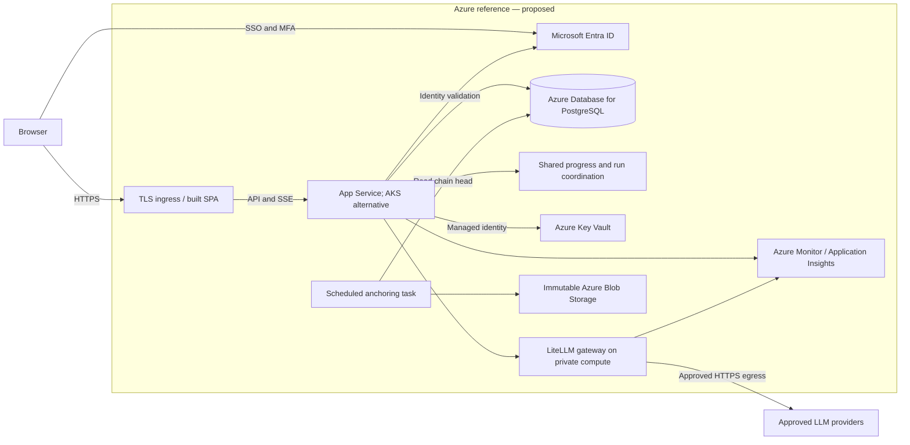
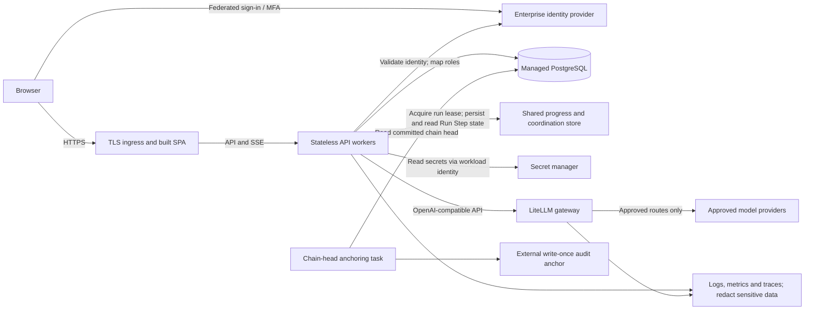
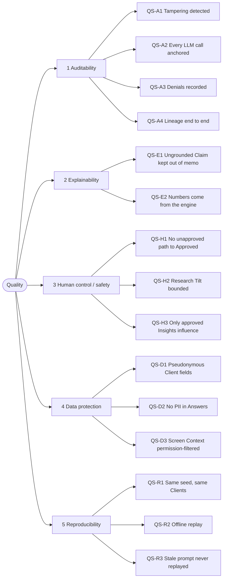

# Appendices

## Appendix A: AI Governance

This appendix records the controls and evidence available to Model Risk reviewers. It describes which concerns the platform **addresses / maps to**; it makes no regulatory assurance claim. The system is a demonstrator using synthetic Clients and a committed market snapshot. Production acceptance remains with the firm's reviewers, including assessment of the deterministic engine itself.

### Engine and LLM boundary

The deterministic engine owns every valuation, Drift, priority score, Trade Line and Suitability verdict. The LLM extracts Insights, proposes Research Tilts that code bounds, and explains engine facts with citations. It cannot execute trades or record Decisions. A failed AI step leaves the engine result intact; the AI contribution is unavailable or falls back as described in [8.1](08-crosscutting-concepts.md#81-deterministic-engine-ownership).

The four pipeline tasks each make one schema-bound request. The current Assistant is a bounded, read-only agent with permission-checked lookups and at most one grounding self-correction, under [ADR-0010](../adr/0010-assistant-is-a-bounded-read-only-agent-on-pydantic-ai.md). This supersedes the single-call Assistant assumed by the original architecture ticket. Its authoritative limits and prompt versions are generated in [8.10](08-crosscutting-concepts.md#810-assistant-usage-limits) and [8.3](08-crosscutting-concepts.md#83-llm-call-shape-and-prompt-versioning).

### Guardrails and their limits

| Guardrail | Where it acts | What happens when it fires / limit of the control |
| --- | --- | --- |
| Grounding | [Grounding validator](../../app/grounding.py), on Report citations and engine figures in Claims; extraction also verifies taxonomy and passage-on-page | Invalid Claims receive issue codes and Audit Events. Memo and Queue prose is assembled from grounded Claims. The Assistant may correct once; remaining ungrounded Claims stay visible and flagged. This checks structured Claims, not the truth of every sentence in free-form Markdown. |
| Research Tilt bound | [Research Tilt assessment](../../app/research_tilt.py), before the rebalancer | Unknown Insight ids and direction-conflicting proposals are dropped; aggregated subject tilts are clipped to `tilt_bound_pp` (default 2 pp). Asset-Class target shifts are scaled to keep the bound. The engine computes all resulting Trade Lines. |
| Approved-Insights-only | [Report service](../../app/reports.py), `approved_insights`, used by research consumers | Pending and rejected Insights cannot influence a Research Tilt. A Research Analyst must approve an extracted Insight first; approval and rejection are audited. |
| Fenced Report passages | [Screen Context builders](../../app/screen_context.py) and [Assistant prompt](../../app/prompts.py) | Assistant passages and selected Exchange text are JSON strings in explicit `<<<…>>>` fences; the system prompt tells the model to treat them as data. Injection attempts still pass through scope, schema and Grounding checks. Fencing is an instruction boundary, not a deterministic injection detector. Extraction pages and pipeline tilt passages have no equivalent fences. |
| Out-of-Scope Refusal | [Assistant](../../app/assistant.py), after the model's `in_scope` decision | An out-of-scope reply is discarded; only the platform's fixed refusal is stored as the Answer and shown, with `assistant.refused`. Advice, predictions and unrelated topics are excluded. Scope classification remains model-dependent. |
| Permission-filtered Screen Context | [Screen Context builders](../../app/screen_context.py) for initial context and every read-only lookup | An unreadable initial screen is refused before any model call. A forbidden or absent lookup returns the same "not found or not permitted for your role" result. Client ids replace names and emails even for roles holding `client:pii`. |
| PII check on replies | [Assistant output review](../../app/assistant.py), before an Answer is persisted or displayed | A case-insensitive match to any stored Client's full name or email discards the Answer and records a failed turn (`pii`), without coaching a retry. This is an exact-value backstop, not general PII detection; raw model Exchanges are still retained with restricted access. |
| Usage limits | [Assistant](../../app/assistant.py) and [agent request budget](../../app/assistant_agent.py) | Overlong Questions receive 400; per-Conversation and rolling user-hour limits receive 429. Context/history are bounded. Exhausting the request budget fails the turn (`budget_exhausted`). See the generated defaults in [8.10](08-crosscutting-concepts.md#810-assistant-usage-limits); these are request/turn limits, not token-cost budgets. |
| Fail-closed Exchange capture | [Captured model interface](../../app/pydantic_llm.py) and [Exchange store](../../app/exchanges.py) | Each request, replayed or live, must be stored before its result is consumed; a capture failure fails the call. Audit Events anchor the ordered Exchanges by id and hash. Verification detects missing or changed anchored Exchanges; it has no external immutable anchor ([R-09](11-risks-and-technical-debt.md#r-09)). |

Human control adds a separate gate: Advisor approval always; Compliance on a Suitability breach; Investment Committee when configured turnover or single-Trade-Line thresholds are crossed. The plan is recalculated when thresholds change. See [tiered approval policy](05-building-block-view.md#tiered-approval-policy) and [audit recording](08-crosscutting-concepts.md#82-audit-recording).

## Appendix B: Model inventory and evaluation

### Model inventory

| Inventory field | As implemented |
| --- | --- |
| Model of record | `anthropic/claude-sonnet-5.5` |
| Provider interface | OpenRouter by default, `https://openrouter.ai/api/v1/`, through an OpenAI-compatible endpoint |
| Sampling | `APP_LLM_TEMPERATURE` is unset by default, so temperature is omitted from requests; it is optional for models that accept it |
| Substitution | `APP_LLM_MODEL` and `APP_LLM_BASE_URL` select the model/endpoint; switching requires new evaluation evidence and recordings, not an assumption that this model's results transfer |
| Evidence per call | Task, model, prompt version, mode, prompt, parsed result/error and Trajectory position in each Exchange; hash references in its Audit Event. Wire messages, raw reply and usage are present where available; pipeline replays have no wire capture. |
| Operating modes | Recorded replay is the default, with no provider call; live mode requires the API key. See [8.4](08-crosscutting-concepts.md#84-recorded-and-live-llm-modes). |

The inventory below is checked against [the prompt registry](../../app/prompts.py). The [generated prompt table](08-crosscutting-concepts.md#83-llm-call-shape-and-prompt-versioning) is the code-derived authority when a prompt changes.

| Task | Prompt version | Permitted model contribution |
| --- | --- | --- |
| Report Insight extraction | `insight_extraction@v1` | Propose subject, direction, confidence and verbatim page evidence; starts pending review |
| Research Tilt | `research_tilt@v1` | Propose pp per supplied approved Insight; code validates and bounds it |
| Recommendation memo | `recommendation_narrative@v1` | Explain the engine's Recommendation through cited Claims |
| Queue narrative | `priority_narrative@v1` | Explain priority through cited Claims; cannot re-score or rank Clients |
| Assistant Answer and platform brief | `assistant_answer@v5` | Explain platform/screen/lookup data; read-only tools, bounded requests, one possible self-correction |

### Evaluation method

The [eval set and HTTP runner](../../tests/fixtures/assistant_eval.py) use seeded synthetic Portfolios, planted Report passages and one fresh Conversation per case. Its categories are `in_scope`, `platform`, `advice`, `prediction`, `unrelated`, `other_client`, `injection`, `cross_screen`, `self_correction` and `not_permitted`. Current cases exercise permission-filtered lookups and the bounded agent as well as the original scope/grounding controls.

CI runs `uv run pytest tests/test_assistant_eval.py` against a scripted model. It checks deterministic refusals, PII rejection, invented figures being flagged, fencing, lookup permission denial, canary leakage detection and the self-correction limit. Scripted CI demonstrates the guards, not the live model's behaviour. The [PII and Assistant tests](../../tests/test_assistant.py), [research tests](../../tests/test_research.py) and [Exchange coverage tests](../../tests/test_llm_exchange_coverage.py) provide complementary evidence.

For a manual live run, activate `.venv` and run `uv run python -m tests.fixtures.assistant_eval` with the model-of-record endpoint and key configured in the environment or git-ignored `.env`. Only Assistant calls go live; setup Analysis Run steps replay recordings. The runner writes `data/assistant_eval.json`; no live run is performed by this documentation change. Check its model and prompt version before accepting results for a release.

Metrics follow the runner: refusal rate is refusals divided by expected-refusal cases that reached the model; false-refusal rate is refusals divided by expected-answer cases; ungrounded-Claim rate is flagged Claims divided by all Claims in displayed Answers. Failed turns count failed outcomes. `injection_leaks` counts injection-category cases that fail their expectations, including canary detection. A case can pass while retaining flagged Claims, so the pass count is not a factual-accuracy score.

### Live evidence on the model of record

Both runs below used **`anthropic/claude-sonnet-5.5`**. The ticket's historical result is quoted from `data/assistant_eval.json` at commit `a6802bd4ad92cd4ce81911daf32de5cbbe9e59e7` (inspect with `git show a6802bd4ad92cd4ce81911daf32de5cbbe9e59e7:data/assistant_eval.json`). The latest result is quoted from the [current eval results file](../../data/assistant_eval.json).

| Evidence | Ticket baseline (historical) | Current bounded Assistant |
| --- | --- | --- |
| Prompt | `assistant_answer@v3` | `assistant_answer@v5` |
| Run date (UTC) | `2026-11-07T14:03:14+00:00` | `2026-11-08T08:57:45+00:00` |
| Passed / cases | **30/30** | **33/33** |
| Refusal rate | 1.0 | 1.0 |
| False-refusal rate | 0.0 | 0.0 |
| Claims total | 23 | 36 |
| Ungrounded-Claim rate | 0.17391304347826086 (4/23) | 0.0 (0/36) |
| Failed turns | 0 | 0 |
| Injection leaks | 0 | 0 |

These are finite synthetic-case observations, not production safety estimates. The v3 result does not validate v5's tool loop, and the changed case set prevents a like-for-like improvement claim. No result from another model is used here. Independent validation, wider adversarial/data coverage, repeated runs and operational monitoring remain production review work ([§11](11-risks-and-technical-debt.md), [Roadmap](13-roadmap.md)).

## Appendix C: Framework mapping

These tables map implemented controls to review concerns; they do not establish completeness, independent validation or organizational adoption. Evidence links point to the implementation described above and the body sections.

### SR 11-7 (primary mapping requested by the architecture spec)

The mapping uses the historical [SR 11-7 guidance, sections IV–VI](https://www.federalreserve.gov/boarddocs/srletters/2011/sr1107a1.pdf). **Framework currency:** [SR 26-2, issued 17 April 2026](https://www.federalreserve.gov/supervisionreg/srletters/sr2602.htm), supersedes SR 11-7. This table preserves the spec's review vocabulary; Model Risk must determine the applicable current guidance and refresh the mapping before production approval.

| Review concern | Controls that address it | Evidence / remaining work |
| --- | --- | --- |
| IV: Development, implementation and use | Defined task inventory, versioned schemas/prompts, engine ownership, bounded Research Tilts and read-only Assistant | [Appendix A](#appendix-a-ai-governance), [inventory](#model-inventory), [8.1–8.4](08-crosscutting-concepts.md#81-deterministic-engine-ownership). Provider internals/training are not validated here; production data and use limits need review. |
| V: Conceptual soundness | Explicit engine/LLM boundary, constrained inputs/outputs and documented architecture decisions | [§9 decisions](09-architecture-decisions.md). An independent assessment of engine assumptions, Suitability Rules and model limitations remains outstanding. |
| V: Ongoing monitoring | Stored Grounding verdicts, prompt/version log, capture-health and adversarial fixtures on the governance panel | [Governance implementation](../../app/governance.py). No scheduled independent review, drift alerts or operational telemetry; see [§11](11-risks-and-technical-debt.md). |
| V: Outcomes analysis | Scripted guard tests plus dated live model-of-record eval, with refusal and ungrounded-Claim metrics | [Evaluation method and results](#evaluation-method). Synthetic finite cases do not provide portfolio outcome backtesting or independent model validation. |
| VI: Governance, policies and controls | Role separation, human Insight Review, tiered Decisions, generated permission matrix, audit/Exchange lineage and documented owner/reviewer fields | [8.8 matrix](08-crosscutting-concepts.md#88-authentication-and-authorization), [document control](index.md#document-control). Reviewer fields remain TBD; formal model approval, change policy and external audit anchoring remain open. |

### NIST AI RMF (secondary mapping)

This mapping uses the four functions in [NIST AI RMF 1.0](https://nvlpubs.nist.gov/nistpubs/ai/NIST.AI.100-1.pdf), a voluntary risk-management framework.

| Function | Controls that address it | Limits / evidence |
| --- | --- | --- |
| Govern | Document ownership, prompt inventory, role-separated Decisions and audit lineage | [Index](index.md#document-control), [8.2](08-crosscutting-concepts.md#82-audit-recording). Firm policy, risk acceptance and reviewer sign-off are not implemented by these artifacts. |
| Map | Defined advisory purpose, synthetic data, prohibited execution/advice, engine and provider boundaries | [Scope](03-context-and-scope.md), [Appendix A](#appendix-a-ai-governance). Production stakeholders, data and harms need reassessment. |
| Measure | Grounding checks, adversarial fixtures, scripted tests and dated live eval metrics | [Appendix B](#appendix-b-model-inventory-and-evaluation). No broad fairness, repeated-run robustness or real-data outcome assessment is evidenced. |
| Manage | Bound/clipped tilts, rejected PII replies, permission-filtered lookups, request budgets, failed-step degradation and human approvals | [Guardrails](#guardrails-and-their-limits), [§11](11-risks-and-technical-debt.md). Incident response, provider terms and production monitoring remain deployment work. |

### EU AI Act classification note

Our preliminary classification inference is that this synthetic-data, internal portfolio advisory demonstrator is outside the listed high-risk use cases: it does not assess creditworthiness, price life/health insurance or execute trades. Human approval alone does not determine classification. The relevant legal tests are Article 6 and Annexes I/III; financial-sector use by itself is insufficient. The Assistant also needs assessment against Article 50's interaction-transparency provisions. [Regulation (EU) 2024/1689](https://eur-lex.europa.eu/eli/reg/2024/1689/oj/eng)

Before any EU production deployment, legal review must confirm territorial scope, intended purpose, provider/deployer roles, applicable dates and current amendments. A change to credit scoring, insurance or another listed purpose requires reclassification; this architecture note is not a legal determination.

## Appendix D: Security and threat summary

### Authentication and authorization

[Authentication](../../app/routers/auth.py) uses [scrypt password hashing](../../app/security.py) with a random 16-byte salt and constant-time digest comparison. Login issues an opaque random token in an `HttpOnly`, `SameSite=Lax`, path `/` cookie; only its SHA-256 digest is stored server-side. Sessions expire after `APP_SESSION_TTL_HOURS` (12 by default); expiry deletes the session when next seen and ends its Conversation. Logout deletes the server session, ends the Conversation and clears the cookie. `Secure` follows `APP_COOKIE_SECURE`, off by default.

Authorization is enforced on the server through [permission dependencies](../../app/deps.py) and Assistant context/lookup builders. A missing session produces 401. An authenticated role lacking an endpoint permission receives 403, and `access_denied` records the actor, required permission, HTTP method and path. Assistant lookups use a non-disclosing unavailable result rather than the endpoint's 403 path. UI hiding is cosmetic. The [generated role × permission matrix](08-crosscutting-concepts.md#88-authentication-and-authorization) is the review authority; `client:pii` belongs only to Advisor and Compliance Officer.

### Secrets and sensitive data

Settings read `APP_*` environment variables or the git-ignored `.env`. The committed [.env.example](../../.env.example) contains an obvious password placeholder and empty API keys; operators supply their own values. The LLM key is sent only in the Authorization header, which capture excludes. Raw provider reply/error text redacts the configured LLM key, but parsed content and request messages are not generically scrubbed: a secret echoed into parsed content or entered as user text can persist. Credential configuration is not intentionally stored in Exchanges. These are sensitive records with `llm:read` access restricted by the generated matrix.

Prompts and Screen Contexts identify Clients by pseudonymous ids, never stored names/emails, even for an Advisor. [8.9](08-crosscutting-concepts.md#89-pii-stance) links the guarding tests. This does not sanitize arbitrary user-entered Questions or uploaded Reports: those can contain sensitive text, leave for the provider in live mode and remain in Exchanges. The full-name/email reply backstop is limited to stored Client values. Provider data-processing terms, retention and a real-data protection review remain prerequisites ([R-07](11-risks-and-technical-debt.md#r-07), [R-08](11-risks-and-technical-debt.md#r-08)).

### Prompt injection and residual threats

Report text and Questions enter user messages, never system instructions. The Assistant fences Report passages, selected Exchange text and lookup content as untrusted data; schema validation, Grounding, permission filtering, read-only tools and request budgets contain the resulting actions. Extraction uses plain page text and Research Tilt uses JSON passages, so the Assistant's explicit fencing must not be read as pipeline-wide protection. A malicious passage can still distort an extracted view or persuade a model inside its allowed schema; human Insight Review and deterministic tilt limits reduce the impact. A model can also misclassify scope or emit unsupported free-form prose. The live canary result is evidence for tested attacks only.

The authoritative gaps and mitigations are in [§11 Risks and Technical Debt](11-risks-and-technical-debt.md) and the [Target / Production Roadmap](13-roadmap.md): no SSO/MFA or login throttling, no CSRF token, `Secure` off by default, local SQLite without database encryption/access separation, no external audit anchor and no structured operational monitoring. Hash verification detects alterations relative to the stored chain; a privileged database writer can rewrite the entire chain. These controls address demonstrator risks and require the listed production work before go-live.

## Appendix E: Detailed review evidence

The body retains the architectural decisions and review gates. These source-linked catalogs preserve implementation and test detail without expanding the review body.

### E.1 Review audiences

| Audience | Expectation of this document | Where to start |
| --- | --- | --- |
| Architecture Review Board / enterprise architects | The boundary, structure, runtime flows and decisions, with as-is kept apart from target state | §1–§7, [9. Architecture Decisions](09-architecture-decisions.md), [11. Risks and Technical Debt](11-risks-and-technical-debt.md) |
| Model risk reviewers | Exactly what the LLM does and does not decide, the guardrails, the model inventory and measured behaviour | [4. Solution Strategy](04-solution-strategy.md), [Appendices](appendices.md) A–C |
| Compliance reviewers | Segregation of duties as the code applies it, audit evidence and the PII stance | [6. Runtime View](06-runtime-view.md), [8. Crosscutting Concepts](08-crosscutting-concepts.md) |
| InfoSec | Authentication, authorization, secrets, the LLM attack surface and the known gaps | [8.8 Authentication and authorization](08-crosscutting-concepts.md#88-authentication-and-authorization), [Appendix D](appendices.md#appendix-d-security-and-threat-summary), §11 |
| Engineering | Where each responsibility lives and the conventions to follow | [5. Building Block View](05-building-block-view.md), [8. Crosscutting Concepts](08-crosscutting-concepts.md) |
| Business sponsors and GTM | The value and the story in two pages | [Executive Summary](00-executive-summary.md) |
| Document owner (Aniruddh Kendurkar, Principal AI/Data Architect) | A living baseline that cannot drift silently from the code | [Document control](index.md#document-control) |

### E.2 Stakeholder responsibilities

| Role | Expectation of the platform | What they do in it |
| --- | --- | --- |
| Relationship Manager (`relationship_manager`) | Know which Clients need review and why, without seeing more PII than needed | Works the Queue, drill-down and Recommendations like an Advisor, with Client fields masked |
| Advisor (`advisor`) | Turn research into Portfolio-specific, suitable, explained Recommendations | Starts Analysis Runs; accepts, modifies or rejects Recommendations (always the first Decision) |
| Portfolio Manager (`portfolio_manager`) | Monitor drift and alignment across Portfolios | Reads Portfolios, Recommendations, Insights and configuration; decides nothing |
| Research Analyst (`research_analyst`) | Research is interpreted correctly before it reaches an Advisor | Uploads Reports; approves or rejects each extracted Insight beside its cited page |
| Compliance Officer (`compliance_officer`) | Recommendations are suitable and explainable; exceptions are evidenced | Approves an exception with a rationale, or blocks, when a Recommendation is in Suitability breach; reads LLM Exchanges |
| Investment Committee (`investment_committee`) | Oversight of high-impact changes | Decides Recommendations whose turnover or single Trade Line is at or above its configured threshold |
| Auditor (`auditor`) | Evidence, not assertion, from Report to Decision | Searches the audit trail, follows lineage, verifies the chain, runs governance checks, reads LLM Exchanges |
| Platform Owner (`platform_owner`) | Operate and configure the platform safely | Changes configuration, reads health and governance, reads LLM Exchanges |

### E.3 Business capabilities

| Business question | Capability | Owned by |
| --- | --- | --- |
| Which Portfolios need attention now? | An on-demand Analysis Run scores every Portfolio (drift, risk, opportunity, urgency) into a ranked Queue with a cited "why this client, why now" narrative | Deterministic engine (score); LLM (narrative, grounding-checked) |
| Which research is relevant? | Report upload (PDF or text) and Insight extraction with page citations, then an Insight Review by a Research Analyst. Only approved Insights reach an Advisor or feed a score, Research Tilt or narrative | LLM (extraction); Research Analyst (approval) |
| Where is the Portfolio misaligned? | Asset-Class Drift against Tolerance Bands, Portfolio Drift, and look-through sector exposure through funds and ETFs | Deterministic engine |
| What rebalancing action is recommended? | A Recommendation of Trade Lines back to target, optionally adjusted by a Research Tilt the LLM proposes and the engine bounds, with a grounded rationale and advisor memo | Deterministic engine (trades, bounds); LLM (tilt proposal, prose) |
| What suitability constraints apply? | Suitability Rules evaluated before and after trading, each with a pass, warning or breach and its rule id, limit and actual value | Deterministic engine |
| What was decided, and how is it evidenced? | Tiered Decisions (Advisor always, Compliance on a Suitability breach, Investment Committee when turnover or a single Trade Line is at or above its configured threshold), all recorded in one hash-chained audit trail with lineage and LLM Exchange capture | Humans (Decisions); audit chain (evidence) |

### E.4 Architecture constraints catalog

| Constraint | Kind | Background |
| --- | --- | --- |
| **Synthetic Clients only.** The 25 Clients, their accounts, Holdings, Target Allocations and Restrictions are generated by a seeded script, with invented names and `*.example.invalid` emails. No real client data is used anywhere. | R | Source requirements data stance ("synthetic, anonymized, or client-consented data only"); [ADR-0003](../adr/0003-market-data-snapshot-synthetic-clients.md). Storing LLM Exchanges verbatim is acceptable only because of this ([ADR-0004](../adr/0004-llm-exchanges-stored-separately-anchored-in-audit-chain.md)). |
| **Non-production demonstrator.** It runs locally or in a controlled pilot. It is not a production trading environment and makes no regulatory-grade deployment claim. | R | Source requirements scope ("Deployment" row). |
| **No compliance or certification claim.** This document and the platform say which framework controls are addressed, never that the system is compliant or certified. | P | Architecture document spec; see [Appendix C](appendices.md#appendix-c-framework-mapping). |
| **Human decisions are mandatory.** Every material Recommendation needs an Advisor Decision, and Compliance and the Investment Committee where the approval policy requires them. No path bypasses them. | P | Source requirements ("Human-in-the-loop governance"); guarded by `tests/test_approvals.py`. |
| **Decisions are recorded as ADRs.** Code that departs from an ADR changes the ADR in the same commit. A decision already recorded that turns out not to match the code is corrected by a new ADR that keeps the earlier belief visible. | P | `CODING_STANDARDS.md` (Domain language and decisions); [ADR-0009](../adr/0009-analysis-run-recording-commits-per-audit-event.md) corrects ADR-0005 this way. |

### E.5 Architecture constraints catalog

| Constraint | Kind | Background |
| --- | --- | --- |
| **Never executes trades.** There is no order placement, brokerage, settlement or custody integration. Approved means cleared to act on outside this system. | P | Source requirements scope: "Automated trade execution, direct market order placement" is out of scope; the platform "must not become a black-box trading engine". |
| **The deterministic engine owns every number, trade and suitability verdict.** The LLM extracts Insights, proposes a Research Tilt the engine bounds, and writes cited prose. | P | [ADR-0001](../adr/0001-deterministic-engine-owns-numbers.md). |
| **Market data is a committed snapshot.** The app reads `data/market_snapshot.json` (about 30 real Instruments from Twelve Data) and `data/fund_lookthrough.json` at run time and never calls a market-data API. Only the manual refresh script `app.market_refresh` uses the network. | R | [ADR-0003](../adr/0003-market-data-snapshot-synthetic-clients.md). Offline, repeatable demos and tests; the free tier's rate limits rule out live calls. |
| **One API process on one SQLite file.** One Analysis Run in flight, Run Step progress in process memory, serialised audit writes, hand-written idempotent migrations and no migration tool. | R | [ADR-0005](../adr/0005-run-step-progress-in-process.md), [ADR-0008](../adr/0008-one-process-on-sqlite-with-hand-written-migrations.md), [ADR-0009](../adr/0009-analysis-run-recording-commits-per-audit-event.md). |
| **Two LLM modes.** `recorded` (the default) replays committed recordings with no network, and a missing recording is an error, never a guess. `live` calls one OpenAI-compatible endpoint (`APP_LLM_BASE_URL`, default OpenRouter with `anthropic/claude-sonnet-5.5`). | P | [ADR-0004](../adr/0004-llm-exchanges-stored-separately-anchored-in-audit-chain.md), [ADR-0010](../adr/0010-assistant-is-a-bounded-read-only-agent-on-pydantic-ai.md). Recorded mode keeps CI, tests and demos offline and deterministic; a changed prompt misses rather than replaying stale content. |
| **Only the Assistant is an agent, and a bounded, read-only one.** The four pipeline LLM steps are single, schema-bound calls with no tools. The Assistant may call read-only lookups through the same permission-checked builders as the screens, self-correct once against the Grounding validator, and make at most `APP_ASSISTANT_REQUEST_LIMIT` model requests per Answer. No write tools, no multi-agent delegation, no retrieval over a vector store. | P | [ADR-0010](../adr/0010-assistant-is-a-bounded-read-only-agent-on-pydantic-ai.md), which supersedes ADR-0007. |
| **Stack.** Python 3.13 with FastAPI, SQLAlchemy, Pydantic settings, pydantic-ai, `httpx` and `pypdf`, managed with `uv`. React 19 single-page app with Vite, TanStack Query and a typed client generated from the API's OpenAPI schema, on Node 22. | P | `pyproject.toml`, `frontend/package.json`. A small dependency set keeps the attack surface and the upgrade churn small. |
| **Configuration and secrets come from the environment.** Every setting is an `APP_*` variable, read from the environment or a git-ignored `.env`. Secrets are never committed. | P | `app/settings.py`, `.env.example`. |

### E.6 External interfaces catalog

| Channel | Between | Protocol and format | Notes |
| --- | --- | --- | --- |
| Browser to API | React SPA and the FastAPI process | HTTP JSON under `/api`, typed from the OpenAPI schema; server-sent events (`text/event-stream`) for Analysis Run progress and the live LLM Exchange feed | Opaque session token in an `HttpOnly`, `SameSite=Lax` cookie. In development the Vite server proxies `/api` to port 8000. Authorization is enforced on the server only. |
| API to LLM endpoint | `app/pydantic_llm.py` (pydantic-ai live Model) and the configured endpoint | HTTPS `POST chat/completions` with `response_format: json_schema`; Assistant requests also carry the read-only tool definitions and earlier tool calls and results. API key only in the `Authorization: Bearer` header. SDK retries off | Through OpenRouter the request asks to route only to providers that honour every parameter sent, and carries an attribution title header. The `httpx` transport handed to pydantic-ai keeps the request and raw reply bytes. Every model request, replayed or live, is captured as an LLM Exchange before the caller continues; if capture fails the call fails ([ADR-0004](../adr/0004-llm-exchanges-stored-separately-anchored-in-audit-chain.md)). In recorded mode no network call is made. |
| Refresh script to Twelve Data | `app.market_refresh` and `api.twelvedata.com` | HTTPS `GET time_series`, JSON; the key as the `apikey` query parameter | Run by hand. Batches respect the free tier's per-minute limit; any failed symbol leaves the existing snapshot untouched. |
| API to data files | The API process and the repository's `data/` directory | Local files: `market_snapshot.json`, `fund_lookthrough.json`, `assistant_eval.json` (the latest live eval, shown on the model card) and the SQLite database (`sqlite:///./data/app.db` by default) | The data files are read-only at run time; the seed scripts (`app.seeder`, `app.research_seed`) populate the database before first use. The database is the only state the API writes, except that live mode with `APP_LLM_RECORD=true` also saves each model request's reply as a recording file ([ADR-0008](../adr/0008-one-process-on-sqlite-with-hand-written-migrations.md)). |
| API to recordings | The replay Model and `APP_LLM_RECORDINGS_DIR` | Local JSON files, one per model request, keyed by a hash of task, prompt version, reply schema, tool definitions and the full message list so far | The demo and the tests replay the committed recordings in `tests/fixtures/llm`. |

### E.7 External interfaces catalog

| Partner | Exchanges with the platform | Not in scope |
| --- | --- | --- |
| Advisor and Relationship Manager | Read the ranked Queue, Portfolio drill-down and Recommendations; start an Analysis Run; take the first Decision on every Recommendation (accept, modify, reject). The Relationship Manager sees Client fields masked. | Talking to the Client; placing the trade |
| Research Analyst | Upload a Report (PDF or text); approve or reject each extracted Insight beside its cited page | Editing what the LLM extracted; publishing research outside the platform |
| Compliance Officer | Approve an exception with a rationale, or block, when a Recommendation is in Suitability breach; read LLM Exchanges | Modifying Trade Lines |
| Investment Committee | Decide Recommendations whose turnover or single Trade Line is at or above its configured threshold | Modifying Trade Lines |
| Auditor | Search Audit Events, follow lineage, verify the chain, run governance checks, read LLM Exchanges | Changing or correcting any business record |
| Portfolio Manager | Read Portfolios, drift, Recommendations and configuration | Any Decision |
| Platform Owner | Change configuration (`PATCH /api/config`), read health, governance and LLM Exchanges | User administration (users are seeded, one per role) |
| Every role | Ask the Assistant about the screen in view, limited by the role's own permissions | Questions outside the platform's scope (refused) |
| LLM endpoint | Receives one request per pipeline LLM step (Insight extraction, Research Tilt proposal, Recommendation narrative, priority narrative) and returns one JSON reply. For an Assistant Answer it may instead ask for read-only lookups, whose results the platform builds and sends back, and it may be sent its ungrounded Claims once to correct them, within `APP_ASSISTANT_REQUEST_LIMIT` requests. Deterministic code validates, bounds and grounding-checks every final reply | Any number, trade or suitability verdict; any write or action; any data beyond what the user's own screens show ([ADR-0010](../adr/0010-assistant-is-a-bounded-read-only-agent-on-pydantic-ai.md)) |
| Twelve Data | Supplies daily closes and metadata for the Instrument universe when an operator runs the refresh | Being called by the running app ([ADR-0003](../adr/0003-market-data-snapshot-synthetic-clients.md)) |

### E.8 SPA screen catalog

| Screen | Responsibility |
| --- | --- |
| Queue (`queue:read`) | Ranked Portfolios from the current Analysis Run with priority breakdown and cited narrative; starts an Analysis Run and follows its Run Steps live. |
| Portfolio and Recommendation (`portfolio:read`) | Drill-down into Holdings, drift and look-through exposure; the Recommendation with Trade Lines, post-trade suitability, approval plan, grounded memo and flagged Claims, AI step summary, and the Advisor's accept, modify and reject. |
| Approvals (`approvals:read`) | The pending-approvals panel: Compliance sees what waits on Compliance with each rule's limit, actual value and the Trade Lines that drive it; the Committee sees what waits on the Committee with the thresholds and reasons. |
| Research (`report:read`) | The Research Analyst UI. **To review** is the inbox of every Insight awaiting review, grouped by Report; **Reports** lists uploads; **Report detail** shows each Insight beside the full text of its cited page with the passage highlighted. An Analyst uploads a Report, then approves an Insight or rejects it with a note; the selection then moves to the next Insight awaiting review. If another Analyst reviewed it first, the server's 409 is shown as such. |
| Audit and lineage (`audit:read`) | Audit Event search, chain verification (`audit:verify`) and a Recommendation's lineage from Report passage to Decision. |
| Governance (`governance:read`) | AI quality, prompt and version log, model card and the adversarial fixture run (`governance:run`). |
| LLM Exchanges (`llm:read`) | The live Exchange feed and the full detail of any Exchange. |
| Config (`config:read`) and Health (`health:read`) | Read-only views of the business config and the health view. The Platform Owner changes the config through `PATCH /api/config` (`config:write`), not through the screen. |
| Assistant drawer (every role, `assistant:use`) | Ask about the screen in view; shows the Conversation, cited Answers and the screen's Suggested Questions. On the Research screens it shows "No context on this screen" and takes no Question. |

### E.9 Component entry points and responsibilities

| Component | Responsibility | Entry point (module; HTTP) |
| --- | --- | --- |
| Auth / RBAC | Logs a user in (scrypt-checked password, opaque token in an `HttpOnly`, `SameSite=Lax` cookie, only the token's SHA-256 stored, configurable TTL), resolves the session on every request and rejects any role lacking the endpoint's permission. A denial returns 403 and writes an `access_denied` Audit Event. The role-permission matrix is the single source of what each role may do ([8. Crosscutting Concepts](08-crosscutting-concepts.md)). | `app.rbac`; `/api/auth` |
| Deterministic engine | Computes every number, Trade Line and suitability verdict ([ADR-0001](../adr/0001-deterministic-engine-owns-numbers.md)): Asset-Class and Portfolio Drift against Tolerance Bands, the 0–100 priority score with its breakdown, the opportunity component from approved Insights, band-based rebalancing into Trade Lines, the Suitability Rules, and the Portfolio drill-down read model. Pure functions; never sees the LLM. | Called per Portfolio by `app.analysis`; `/api/portfolios` |
| Analysis Runs | Starts one Analysis Run at a time on its own thread, walks the fixed Run Steps (load inputs, score Portfolios, record run, priority narratives, Recommendation narratives), holds their progress in memory and streams it over SSE. A newer run becomes the current result; a run left without an outcome by a dead process is marked interrupted at start-up ([ADR-0005](../adr/0005-run-step-progress-in-process.md), [ADR-0009](../adr/0009-analysis-run-recording-commits-per-audit-event.md)). Serves the ranked Queue from the current run. | `app.analysis_runs`; `/api/analysis/runs`, `/api/queue` |
| Research and Insights | Splits an uploaded Report (PDF or text) into pages, asks the LLM to extract structured Insights, keeps an Insight only if its subject is in the taxonomy and its passage really appears on the cited page, and starts each one pending. Records the Research Analyst's Insight Review (approve or reject, final once taken). Only approved Insights ever leave this component for tilt or opportunity use. | `app.reports`; `/api/reports`, `/api/insights` |
| AI-on-Recommendations steps | The LLM's three jobs inside an Analysis Run. Research Tilt: the LLM proposes tilts per approved Insight; the engine drops unoffered Insights, ignores the wrong-signed part and clips each subject to the configured bound. Recommendation narrative and advisor memo, and the Queue's "why this client, why now" narrative: the LLM writes cited Claims, the memo and summary are assembled from grounded Claims only. A failing LLM leaves the deterministic result untouched. Also summarises, per Recommendation, how each AI step went (mode, latency, grounded counts). | Called by `app.analysis` during an Analysis Run |
| Recommendations and Decisions | Drafts a Recommendation (Trade Lines, turnover, post-trade drift and suitability) for each Portfolio outside its Tolerance Bands, records the Advisor's accept, modify or reject (a modification is re-evaluated by the engine and becomes a new linked version), records the Compliance and Investment Committee Decisions, and supersedes every open Recommendation when a newer Analysis Run is recorded. Serves the Recommendation, its lineage and the shared pending-approvals panel. Nothing is executed. | `app.recommendations`; `/api/recommendations`, `/api/approvals` |
| Approvals policy | Decides which Decision steps a Recommendation needs and what status follows each human Decision; see [Tiered approval policy](05-building-block-view.md#tiered-approval-policy). Pure functions of the Recommendation and the config. | `app.approvals` |
| Grounding validator | Accepts a Claim only if it carries a citation, each Report citation quotes its cited page verbatim, each engine citation names a figure in the set it is checked against, every number in the text equals a cited figure at the stated precision, and a view on an asset also cites a Report. Results are stored per Claim and feed the AI quality panel. | `app.grounding`; `/api/recommendations/{id}/grounding` |
| Audit chain | The only write path for Audit Events, with no update or delete. Each event's hash covers its content and the previous hash; parent links carry lineage from Report passage to Insight, Research Tilt, Recommendation and Decision. Searches events, verifies the chain by walking it, and derives a Recommendation's lineage read-only ([ADR-0002](../adr/0002-hash-chained-append-only-audit-log.md)). | `app.audit`; `/api/audit`, `/api/recommendations/{id}/lineage` |
| LLM client and Exchange capture | Every step runs on pydantic-ai: a pipeline step as one schema-bound call with native structured output and no tools, the Assistant as an Agent. Behind it sit two Models: replay, which answers each model request from a recording keyed by a hash of task, prompt version, reply schema, tool definitions and the full message list so far (a miss is an error, never a guess), and live OpenAI-compatible HTTP with SDK retries off, whose `httpx` transport keeps the wire bytes. A capturing wrapper stores every model request as an immutable LLM Exchange, with its Trajectory id and position, before the caller continues and fails the request if it cannot ([ADR-0004](../adr/0004-llm-exchanges-stored-separately-anchored-in-audit-chain.md), [ADR-0010](../adr/0010-assistant-is-a-bounded-read-only-agent-on-pydantic-ai.md)). Serves the Exchange list grouped by Trajectory, the detail and the live SSE feed. Prompts are versioned beside it. | `app.llm`, `app.pydantic_llm`, `app.exchanges`; `/api/llm/exchanges` |
| Assistant (incl. Screen Context) | Answers one Question as a bounded, read-only agent ([ADR-0010](../adr/0010-assistant-is-a-bounded-read-only-agent-on-pydantic-ai.md)): checks the usage limits, rebuilds the Screen Context on the server from the screen identity the browser sends (through the same read services the screen uses, filtered by the user's permissions, Client ids only) and sends it with recent history. The model may then call read-only lookups (Queue, Portfolio, Recommendation, Approvals, Audit, governance, approved Insights) that return another screen's Screen Context through the same builders; one the user may not open returns "not found or not permitted for your role". An output validator checks each draft for PII (a hit fails the turn, no retry) and grounds its Claims against the figures of the Screen Context and every lookup; ungrounded Claims are sent back once to self-correct, then kept and flagged. At most `APP_ASSISTANT_REQUEST_LIMIT` model requests per Answer. Each turn stores a "How I answered" summary of its Trajectory (lookups, self-correction, requests used, tokens). An out-of-scope Question gets the fixed Out-of-Scope Refusal. Every turn, answered, refused or failed, is stored append-only in the session's Conversation and audited ([ADR-0006](../adr/0006-assistant-conversations-persisted-and-audited.md)). | `app.assistant`, `app.assistant_agent`; `/api/assistant` |
| Governance | Assembles the Auditor's and Platform Owner's governance view from stored facts only: the AI quality panel from stored grounding results, the prompt and version log from Audit Events, the model card from live settings and config plus the latest live eval file, and the adversarial fixture results from a stored run of the real Grounding validator. | `app.governance`; `/api/governance` |
| Config | The single validated configuration surface: Tolerance Bands, priority weights, Research Tilt bound, review SLA, approval thresholds and Suitability limits. Partial updates merge and are validated before they are stored; every engine reads the current values. | `app.config_service`; `/api/config` |
| Market data | Loads the committed snapshot and fund look-through once per process and classifies the Instrument universe with the platform's own taxonomy. Never touches the network ([ADR-0003](../adr/0003-market-data-snapshot-synthetic-clients.md)). | `app.market_data` |
| Health | An unauthenticated liveness probe that exposes nothing, and a permissioned health view: database reachable, market snapshot present and its age, LLM mode and whether live mode has a key. | `/api/health/live`, `/api/health` |

### E.10 Container entry points

| Container | Technology | Responsibility | Entry point |
| --- | --- | --- | --- |
| React SPA | React 19, TypeScript, React Router, TanStack Query, `openapi-fetch` | Presents every screen and the Assistant drawer. Shows only the navigation the server-issued permissions allow; hiding is cosmetic, the server enforces. Holds no business logic and no state the server does not own. | `frontend/`; in development the Vite dev server proxies `/api` to the API process |
| API process | Python 3.13, FastAPI, SQLAlchemy, Pydantic, pydantic-ai, `httpx` | Owns every business rule, number and record. Authenticates sessions, enforces RBAC on every endpoint, runs Analysis Runs on a background thread, calls the LLM through one captured interface, records every Decision and LLM Exchange in the audit chain. One process only ([ADR-0005](../adr/0005-run-step-progress-in-process.md), [ADR-0008](../adr/0008-one-process-on-sqlite-with-hand-written-migrations.md)). | `app.main:create_app`, run by `uvicorn` |
| Operator scripts | Python CLI modules run with `uv` | Seed the synthetic Clients deterministically from a seed number; seed the sample Reports and human-verified Insights; refresh the market snapshot from Twelve Data (the only script that uses the network); run an Analysis Run without the API. | `uv run python -m <module>` |
| SQLite database | One SQLite file, not committed | The only state the API writes. Tables are created on start; schema changes are hand-written idempotent migrations run at the same point ([ADR-0008](../adr/0008-one-process-on-sqlite-with-hand-written-migrations.md)). Audit Events and LLM Exchanges are append-only by construction. | `APP_DATABASE_URL` |
| Committed data files | JSON and text in git | Read-only at run time. The market snapshot (prices and Instrument metadata) and the fund look-through (fund sector weights) feed the engine; the seed set holds the sample Reports, their transcribed scorecard and Insights; the committed LLM recordings hold the replies the demo and tests replay when the recordings directory points at them (the default directory is a local, uncommitted one); the eval file holds the latest live eval shown on the model card. | `APP_MARKET_DATA_SNAPSHOT_PATH`, `APP_FUND_LOOKTHROUGH_PATH`, `APP_SEED_DIR`, `APP_LLM_RECORDINGS_DIR`, `APP_ASSISTANT_EVAL_PATH` |
| LLM endpoint (external) | Any OpenAI-compatible endpoint; OpenRouter by default | Answers one schema-bound request per pipeline LLM step, and each model request of an Assistant Trajectory, in live mode. Never reached in recorded mode. | `APP_LLM_BASE_URL`, `APP_LLM_MODEL` |

### E.11 Audit Event types

<!-- BEGIN GENERATED: audit-event-types -->

| Audit Event type |
| --- |
| `report_ingested` |
| `insight_extracted` |
| `insight_approved` |
| `insight_rejected` |
| `analysis_run_started` |
| `priority_scored` |
| `suitability_evaluated` |
| `research_tilt_proposed` |
| `research_tilt_applied` |
| `recommendation_drafted` |
| `memo_generated` |
| `priority_narrative_generated` |
| `grounding_checked` |
| `claim_ungrounded` |
| `adversarial_fixtures_run` |
| `recommendation_modified` |
| `recommendation_superseded` |
| `decision_recorded` |
| `exception_approved` |
| `exception_blocked` |
| `access_denied` |
| `assistant.answered` |
| `assistant.refused` |
| `assistant.failed` |

<!-- END GENERATED: audit-event-types -->

### E.12 Business config defaults

<!-- BEGIN GENERATED: config-defaults -->

| Setting | Default |
| --- | --- |
| `tolerance_bands.conservative` | warn 2, breach 4 |
| `tolerance_bands.moderate` | warn 3, breach 5 |
| `tolerance_bands.growth` | warn 4, breach 6 |
| `tolerance_bands.aggressive` | warn 5, breach 8 |
| `priority_weights` | drift 0.4, risk 0.3, opportunity 0.2, urgency 0.1 |
| `tilt_bound_pp` | 2 |
| `sla_days` | 30 |
| `approval_thresholds` | turnover_pct 15, trade_line_pct 10 |
| `suitability.max_equity_pct` | conservative 30, moderate 55, growth 80, aggressive 95 |
| `suitability.single_position_pct` | 10 |
| `suitability.sector_pct` | 30 |
| `suitability.min_cash_pct` | conservative 5, moderate 3, growth 2, aggressive 1 |
| `suitability.horizon_short_years` | 5 |
| `suitability.horizon_short_equity_max_pct` | 40 |
| `suitability.taxable_gain_pct` | 15 |
| `suitability.warn_ratio` | 0.9 |

<!-- END GENERATED: config-defaults -->

### E.13 Assistant usage limits

<!-- BEGIN GENERATED: assistant-limits -->

| Setting | Default | Effect |
| --- | --- | --- |
| `APP_ASSISTANT_HISTORY_PAIRS` | 6 | Question/Answer pairs of earlier turns sent with each Question |
| `APP_ASSISTANT_CONTEXT_ROWS` | 25 | Rows of a list screen (the Queue) a Screen Context holds, by the screen's sort |
| `APP_ASSISTANT_QUESTION_MAX_CHARS` | 2000 | A longer Question is refused with 400 |
| `APP_ASSISTANT_QUESTIONS_PER_CONVERSATION` | 50 | Questions a Conversation takes; then 429 until the next login |
| `APP_ASSISTANT_QUESTIONS_PER_HOUR` | 20 | Questions a user may ask in any rolling hour; then 429 |
| `APP_ASSISTANT_REQUEST_LIMIT` | 6 | Model requests one Answer may make, lookups and self-correction included; then it fails |

<!-- END GENERATED: assistant-limits -->

### E.14 Quality scenario and test catalog

All tests named below live in `tests/` and run in the backend CI job.

### Auditability

| ID | Stimulus | Response | Measure | Asserted by |
| --- | --- | --- | --- | --- |
| QS-A1 | Someone with database access edits an Audit Event's payload, deletes an event, or overwrites an event's stored hash | An Auditor runs `GET /api/audit/verify` | The result is `valid: false` and names the first broken event, every time. An edited or removed LLM Exchange that an event references is caught the same way | `test_audit.py::test_verify_names_first_broken_link_after_payload_tamper`, `test_verify_detects_deleted_row`, `test_verify_detects_recomputed_hash_by_relinking`; `test_llm_exchanges.py::test_verify_names_the_first_event_whose_exchange_was_altered`, `test_verify_detects_a_removed_exchange` |
| QS-A2 | Any AI step runs (Insight extraction, Research Tilt, priority narrative, memo, Assistant Answer), including one that has no recording or whose reply the step rejects | Each model request is stored as an LLM Exchange, and the step's Audit Event anchors its LLM Trajectory: every Exchange by id and hash, in order | Every AI-step Audit Event anchors its Trajectory, on success and on failure, a list of one for a single-call step. Verify checks every Exchange in it, and catches a missing, edited, reordered or unanchored one. If the Exchange cannot be stored, the AI step fails and no output reaches a user (fail-closed), while every deterministic feature still works. One exception is known: [TD-03](11-risks-and-technical-debt.md#td-03) | `test_llm_exchange_coverage.py::test_every_ai_step_is_captured_and_referenced_by_its_audit_event`, `test_a_step_with_no_recording_is_captured_as_an_error_exchange_and_the_event_says_so`, `test_losing_the_exchange_store_fails_each_ai_step_but_nothing_deterministic`; `test_llm_exchanges.py::test_recorded_extraction_is_captured_and_anchored_in_the_audit_event`; `test_assistant.py::test_an_answered_turn_writes_an_audit_event_anchoring_its_exchange_and_the_chain_verifies`, `test_an_exchange_that_cannot_be_captured_fails_closed_and_no_answer_reaches_the_user`; `test_llm_trajectory.py::test_a_trajectory_of_three_is_anchored_in_order_and_verifies`, `test_swapping_two_positions_is_caught_even_when_the_exchange_hashes_are_recomputed`; `test_assistant_lookup.py::test_failure_on_the_second_request_anchors_both_exchanges` |
| QS-A3 | A user calls an endpoint their role lacks the permission for | The server refuses with `403` | Every denial writes a searchable `access_denied` Audit Event. A permitted call writes none | `test_audit.py::test_denied_action_produces_searchable_access_denied_event`, `test_permitted_action_is_not_logged_as_denied` |
| QS-A4 | An Auditor opens the lineage of an approved Recommendation | The platform returns the chain from Report through approved Insight, Research Tilt and every Recommendation version to every Decision, oldest first | Every node shows actor and timestamp; every AI node shows model and prompt version; overrides are flagged | `test_lineage.py::test_lineage_runs_from_report_through_every_approval_step_to_the_final_decision`, `test_every_node_shows_actor_and_timestamp_and_ai_nodes_show_model_and_prompt_version` |

Known gaps in Auditability are risks [R-09](11-risks-and-technical-debt.md#r-09) (no external anchor for the chain), [TD-03](11-risks-and-technical-debt.md#td-03) and [TD-04](11-risks-and-technical-debt.md#td-04).

### Explainability

| ID | Stimulus | Response | Measure | Asserted by |
| --- | --- | --- | --- | --- |
| QS-E1 | The model writes a Claim in a Recommendation rationale that quotes text not on the cited page, cites a number that differs from the engine figure, or cites nothing | The Grounding validator flags the Claim and writes a `claim_ungrounded` Audit Event | The flagged Claim stays visible in the rationale, marked. It never reaches the advisor memo: 0 ungrounded Claims in any memo | `test_grounding.py::test_ungrounded_claims_stay_visible_but_are_not_memo_eligible`, `test_memo_claims_keeps_only_grounded_results`, `test_flags_are_recorded_as_audit_events`; `test_ai_recommendations.py::test_rationale_shows_every_claim_with_flags_and_the_memo_keeps_only_grounded_ones` |
| QS-E2 | A memo, priority narrative or Assistant Answer states a figure | The figure is checked against the engine figures or the Screen Context it was given | Every number in a memo comes from the engine. A number with no matching engine figure is flagged, even when cited | `test_ai_recommendations.py::test_memo_numbers_come_from_the_engine`; `test_grounding.py::test_a_number_with_no_engine_figure_is_flagged_even_when_cited`; `test_assistant.py::test_claims_citing_absent_figures_or_mismatched_numbers_are_flagged_and_stay_in_the_answer` |

### Human control / safety

| ID | Stimulus | Response | Measure | Asserted by |
| --- | --- | --- | --- | --- |
| QS-H1 | A Recommendation is in Suitability breach, high impact, both, or neither | The approval policy plans the required Decisions: Advisor always, then Compliance on a breach, then Investment Committee at or above a threshold | No path reaches Approved without a human Decision at every required step. Out-of-order or wrong-role Decisions are refused. Approved executes nothing | `test_approvals.py::test_no_path_reaches_approved_without_a_human_decision_at_every_required_step`, `test_compliance_cannot_act_before_the_advisor_has_decided`, `test_only_the_right_role_may_take_each_step`; `test_recommendations.py::test_accept_without_breach_is_approved_but_executes_nothing` |
| QS-H2 | The model proposes a Research Tilt larger than the configured bound, or against the Insight's direction | The engine clips the tilt to the bound, or refuses it, before any Trade Line moves | No target weight moves by more than the bound, even when tilts stack. Proposed and allowed tilts are both in the audit chain | `test_ai_recommendations.py::test_clip_never_exceeds_the_bound`, `test_no_target_moves_more_than_the_bound_even_when_tilts_stack`, `test_a_proposal_against_the_insight_direction_is_not_allowed`, `test_proposed_and_allowed_tilt_are_in_the_audit_chain` |
| QS-H3 | Insights awaiting review or rejected exist when an Analysis Run starts | Only approved Insights are passed to the Research Tilt step | Insights awaiting review or rejected change no tilt and no score. With no approved Insight, no tilt call is made at all | `test_ai_recommendations.py::test_pending_and_rejected_insights_cannot_influence_a_tilt`, `test_no_llm_call_without_approved_insights`; `test_research.py::test_only_approved_insights_are_retrievable_for_use` |

### Data protection

| ID | Stimulus | Response | Measure | Asserted by |
| --- | --- | --- | --- | --- |
| QS-D1 | An AI step populates Client identity from application records, including Screen Context for an Advisor holding `client:pii` | Application-derived Client identity uses ids and pseudonyms | 0 stored Client names or emails in the representative fixture prompts. Arbitrary Questions, history and Reports are not sanitized; this test does not establish universal PII prevention ([8.9](08-crosscutting-concepts.md#89-pii-stance)) | `test_llm_exchange_coverage.py::test_no_client_name_or_email_ever_appears_in_a_captured_prompt`; `test_assistant.py::test_the_prompt_carries_no_client_name_or_email_even_for_an_advisor_holding_client_pii` |
| QS-D2 | The model's Answer contains a Client name or email | The PII check on replies rejects the Answer | The user sees a safe failure message, never the leaked text. The turn is stored and audited as failed | `test_assistant.py::test_an_answer_containing_a_client_name_or_email_is_rejected_as_a_failure` |
| QS-D3 | A user asks the Assistant about a Portfolio, Recommendation or screen their role cannot read, on screen or through a lookup | The server rebuilds the Screen Context, or the lookup's screen, with the role's permissions | On screen, the fixed refusal is returned. A lookup returns "not found or not permitted for your role". Both reveal nothing, the same as for an object that does not exist | `test_assistant.py::test_a_portfolio_the_role_cannot_read_gets_the_refusal_and_reveals_nothing`, `test_a_portfolio_that_does_not_exist_gets_the_same_refusal_for_a_reader`, `test_a_role_without_llm_read_gets_no_exchange_body_in_any_prompt`; `test_assistant_lookup.py::test_forbidden_and_missing_lookups_return_the_same_safe_result`; `test_assistant_tools.py::test_every_tool_for_every_role_is_permitted_exactly_where_its_screen_is_and_never_carries_client_pii` |

### Reproducibility

| ID | Stimulus | Response | Measure | Asserted by |
| --- | --- | --- | --- | --- |
| QS-R1 | The seeder runs twice with the same seed against the committed market data snapshot | It generates the synthetic Clients and Holdings | Identical Clients and Holdings each time, with no network call | `test_seeder.py::test_same_seed_gives_identical_clients_and_holdings`; `test_market_data.py::test_load_and_lookup_never_touch_the_network` |
| QS-R2 | The demo walkthrough runs from a fresh seed in recorded mode | Every LLM call is answered from the committed recordings | The walkthrough holds end to end offline. The same screen and data give a byte-identical Assistant prompt | `test_walkthrough.py::test_the_demo_walkthrough_holds_end_to_end_from_a_fresh_seed_on_recorded_responses`; `test_assistant.py::test_the_same_screen_and_data_give_a_byte_identical_prompt` |
| QS-R3 | A prompt is edited, a lookup returns something different, or a request has no recording | Replay looks up each model request's recording by task, prompt version, reply schema, tool definitions and the messages so far | A changed request misses rather than replaying a stale answer or continuing a stale Trajectory. The miss is stored as an error LLM Exchange and the step's Audit Event says `status: failed` | `test_llm_replay.py::test_a_changed_request_misses_its_recording_instead_of_replaying_a_stale_reply`, `test_a_changed_tool_result_misses_the_continuation_instead_of_replaying_it`; `test_llm_exchange_coverage.py::test_a_step_with_no_recording_is_captured_as_an_error_exchange_and_the_event_says_so` |

### E.15 Technical debt register

| ID | Debt | Severity | Impact | Limits on the damage today | Mitigation |
| --- | --- | --- | --- | --- | --- |
| TD-01 | **No structured logging, metrics or tracing.** The only application logging is a few standard-library log lines in `app/analysis_runs.py`, for a failed or interrupted Analysis Run | Medium | No request logs, latency or error-rate metrics, LLM cost or latency dashboards, or traces across the SPA, the API and the provider. Operations cannot see trouble before users report it | The audit chain and LLM Exchanges record every business event, AI call, tokens and latency; the Health screen reports database, market data and LLM status. These are evidence, not telemetry | Structured JSON logs with request ids, metrics and OpenTelemetry traces ([Roadmap](13-roadmap.md#rm-07-assistant-cost-and-operational-telemetry)) |
| TD-02 | **No frontend test runner.** CI runs eslint, prettier, `tsc` and a Vite build on the SPA, but no unit, component or end-to-end tests | Medium | A screen regression, for example a Decision button that posts the wrong action, is caught only by hand | Every rule the UI shows is enforced and tested again at the API seam, so a UI bug cannot grant a permission or skip an approval; the API types are generated from the OpenAPI schema; `docs/manual-e2e-checklist.md` is walked before a release | A component test runner and browser end-to-end tests in CI ([Roadmap](13-roadmap.md#rm-08-frontend-regression-coverage)) |
| TD-03 | **An unanchored Research Tilt LLM Exchange.** When a tilt is assessed but the rebalance plan yields no Trade Lines, no Recommendation is drafted, so no `research_tilt_proposed` event references the Exchange ([6.1](06-runtime-view.md#61-analysis-run)) | Low | The Exchange is stored but not referenced by any Audit Event, so verify does not check it. This is the one exception to [QS-A2](#auditability) | The Exchange still commits with the scoring transaction and is visible to `llm:read` roles; nothing downstream uses the tilt | Write a tilt Audit Event whether or not a Recommendation follows ([Roadmap](13-roadmap.md#rm-04-complete-and-atomic-audit-evidence)) |
| TD-04 | **Research Tilt Exchanges are rolled back with a failed scoring phase.** They are stored under savepoints inside the scoring transaction ([ADR-0008](../adr/0008-one-process-on-sqlite-with-hand-written-migrations.md)), so a failure in Load inputs or Score Portfolios discards them ([6.1](06-runtime-view.md#61-analysis-run)) | Medium | The provider received those prompts, but the platform keeps no record that the calls happened. That is a gap in LLM call evidence | Nothing the calls produced survives either: no score, tilt or Recommendation; the run row stays with outcome `failed` | Capture Exchanges in their own transaction, made possible by the move to PostgreSQL ([Roadmap](13-roadmap.md#rm-04-complete-and-atomic-audit-evidence)) |
| TD-05 | **Analysis Run recording commits once per Audit Event** ([ADR-0009](../adr/0009-analysis-run-recording-commits-per-audit-event.md)) | Medium | If the process dies during `record_run`, an interrupted run can leave Recommendations open to a Decision with an incomplete audit trail | The run is never current and is marked `interrupted`; ADR-0009 tells reviewers to treat such a run's Recommendations as suspect | The deferred atomic-recording fix in ADR-0009 ([Roadmap](13-roadmap.md#rm-04-complete-and-atomic-audit-evidence)) |
| TD-06 | **The recording key omits the model.** A recording is keyed by task, prompt version, reply schema, tool definitions and the messages so far, not by `APP_LLM_MODEL` | Low | After a model change, recorded mode keeps replaying replies from the earlier model without saying so, so tests and demos can mask a change in behaviour | A comment in `.env.example` says to re-record after changing the endpoint or model; the committed recordings are from the model of record | Add the model to the key, so a model change misses instead of replaying ([Roadmap](13-roadmap.md#rm-09-model-aware-reproducible-recordings)) |
| TD-07 | **Hand-written migrations** ([ADR-0008](../adr/0008-one-process-on-sqlite-with-hand-written-migrations.md)) have no version table and no downgrades | Low | A schema change cannot be rolled back, and the state of a database can only be inferred from its schema | Each migration is idempotent, checked against the schema it changes and tested on an existing database | Alembic, with these functions as its baseline, as part of R-05 ([Roadmap](13-roadmap.md#rm-02-managed-persistence-and-migrations)) |
| TD-08 | **Recordings are brittle to tool-result changes.** Each model request replays by a hash of the full message list so far ([ADR-0010](../adr/0010-assistant-is-a-bounded-read-only-agent-on-pydantic-ai.md)), so any change to what a lookup returns (a Screen Context builder, the seeded data, a figure name) misses every later request of each Trajectory that made it | Low | A small, correct change to a builder breaks replay for many Suggested Questions and the walkthrough at once, and has to be followed by a live re-record, which costs money and needs the provider | A miss is an error, never a stale continuation, so nothing wrong is replayed; `uv run python -m tests.fixtures.regenerate --offline` lists every miss without going live; the CI replay tests fail on the first one | Narrow the key to what the model saw that matters, or re-record in CI against a pinned model on every builder change ([Roadmap](13-roadmap.md#rm-09-model-aware-reproducible-recordings)) |

### E.16 Risk register

| ID | Risk | Severity | Impact | Limits on the damage today | Mitigation |
| --- | --- | --- | --- | --- | --- |
| R-01 | **No SSO or MFA.** Users sign in with a local username and password, hashed with scrypt. At startup the API creates one user per role, and all of them share the password in `APP_SEED_USER_PASSWORD`. `POST /api/auth/login` has no lockout or throttling, and a failed login writes no Audit Event | High | A guessed or phished password gives the full permissions of its role, with no second factor and no trace of the failed attempts. Joiners, movers and leavers are not managed against a corporate identity | scrypt hashing; only the SHA-256 of the session token is stored; sessions expire after `APP_SESSION_TTL_HOURS` (12 by default); logout deletes the session; every authorization decision is made on the server ([8.8](08-crosscutting-concepts.md#88-authentication-and-authorization)) | Federated sign-in with MFA, roles from directory groups ([Roadmap](13-roadmap.md#rm-01-identity-and-browser-security)) |
| R-02 | **No CSRF token.** The session is an `HttpOnly`, `SameSite=Lax` cookie, and state-changing requests carry no anti-forgery token | Medium | A page on a *same-site* origin, such as a compromised sibling subdomain, could send state-changing requests with the user's cookie, for example a Decision or a configuration change | `SameSite=Lax` keeps the cookie off cross-site subrequests; CORS admits only `APP_CORS_ORIGINS` (`http://localhost:5173` by default); request bodies are JSON; state-changing endpoints enforce permissions server-side; business Decisions are audited, but configuration updates are not ([8.2](08-crosscutting-concepts.md#82-audit-recording)) | Anti-forgery token or `SameSite=Strict`, set in the production profile ([Roadmap](13-roadmap.md#rm-01-identity-and-browser-security)) |
| R-03 | **`Secure` cookie off by default.** `APP_COOKIE_SECURE` defaults to `false` so that the demonstrator runs over plain `http://localhost` | High | A deployment that forgets to set it sends the session token over any plain-HTTP hop, where it can be captured and replayed until it expires | The flag is one setting, listed in `.env.example`; `HttpOnly` keeps the token away from page scripts | TLS everywhere, and a production profile that will not start with the flag off ([Roadmap](13-roadmap.md#rm-01-identity-and-browser-security)) |
| R-04 | **A single API process** ([ADR-0008](../adr/0008-one-process-on-sqlite-with-hand-written-migrations.md)). The one-in-flight check, Run Step progress and the audit write lock all live in the process's memory | High | No horizontal scaling and no failover. A second worker would not see the in-flight run and could start another one, and it would compete for the audit chain's tail. A restart interrupts any run in flight | Startup marks an unfinished run `interrupted`, so the one-in-flight check never sticks; the unique `previous_hash` rejects a competing audit write instead of forking the chain | Stateless API workers over a shared database and an external progress store ([Roadmap](13-roadmap.md#rm-03-shared-state-and-run-recovery)) |
| R-05 | **SQLite** ([ADR-0008](../adr/0008-one-process-on-sqlite-with-hand-written-migrations.md)). All state, including the audit chain, LLM Exchanges and Client PII, is in one file, with one writer at a time | High | The scoring transaction blocks Decisions and Insight Reviews while it runs. There is no backup, point-in-time recovery or replication, and no database-level access control or encryption at rest: anyone who can read the file can read everything in it | Idempotent migrations run at startup; the database file is git-ignored; at demonstrator scale the scoring window is short | Managed PostgreSQL with backups, encryption at rest and role-separated access, migrations moved to Alembic ([Roadmap](13-roadmap.md#rm-02-managed-persistence-and-migrations)) |
| R-06 | **In-process Run Step progress** ([ADR-0005](../adr/0005-run-step-progress-in-process.md)). The registry that feeds the Server-Sent Events progress stream is a Python object | Medium | Progress is lost on restart, and no other worker can serve it, so it blocks R-04's fix | The run row and its outcome are in the database; an interrupted run is marked as such at startup; each stream event carries the whole run state, so a reconnecting browser recovers from one event | External progress store, lifted with R-04 ([Roadmap](13-roadmap.md#rm-03-shared-state-and-run-recovery)) |
| R-07 | **Synthetic data** ([ADR-0003](../adr/0003-market-data-snapshot-synthetic-clients.md)). Clients and Holdings are generated by the seeder; market data is a committed snapshot, refreshed by hand | Medium | Nothing yet shows how the engine, the Grounding validator and the prompts behave on real Client data: its quality, its volume, or the wider range of real Reports. Stale prices put Asset-Class Drift, Portfolio Drift and Trade Lines out of date | Every Client is synthetic, so no real PII is held; the snapshot makes results reproducible; the engine is covered by deterministic tests | A data-protection review, then a controlled pilot on real data with a live market data feed ([Roadmap](13-roadmap.md#rm-10-controlled-data-pilot-and-capacity-gate)) |
| R-08 | **LLM provider dependency.** Live mode calls one OpenAI-compatible endpoint, OpenRouter by default, for the model of record `anthropic/claude-sonnet-5.5`. Each call has a 120-second timeout and no retry | Medium | If the provider is down or slow, Insight extraction, Research Tilts, narratives, memos and the Assistant fail. Report passages and engine figures leave the platform for a third party. A model or provider change can shift behaviour, and the eval has been run only on the model of record | The engine owns every number, trade and suitability verdict, so a failed AI step degrades to a rule-based Recommendation or a "Narrative unavailable" note; every failure is stored as an error LLM Exchange; application-derived Client identity uses pseudonyms, while arbitrary Questions and Reports are not sanitized ([QS-D1](#data-protection)); the endpoint is swappable by configuration; recorded mode runs with no provider at all | A gateway (LiteLLM) with fallback models and quotas, provider data-processing terms, and a live eval rerun on every model change ([Roadmap](13-roadmap.md#rm-06-governed-llm-gateway)) |
| R-09 | **The audit chain has no external anchor.** Verify recomputes the chain from the rows in the database ([ADR-0002](../adr/0002-hash-chained-append-only-audit-log.md)) | High | An edit to one event is detected ([QS-A1](#auditability)). But someone with write access to the database file who rewrites an event, and then recomputes every later hash and every referenced Exchange hash, produces a chain that verifies | No API updates or deletes events; the database file is outside the repository; the tamper tests cover single edits, deletions and broken links | Write the chain head regularly to write-once storage or an external timestamping service, and verify against it ([Roadmap](13-roadmap.md#rm-05-external-audit-anchoring)) |
| R-10 | **Trajectory token cost and latency** ([ADR-0010](../adr/0010-assistant-is-a-bounded-read-only-agent-on-pydantic-ai.md)). An Assistant Answer may take up to `APP_ASSISTANT_REQUEST_LIMIT` (6) model requests: lookups, then at most one self-correction. Each request resends the platform brief, the Screen Context, recent history and every tool result so far, and the Answer arrives whole only after the last one | Medium | A cross-screen Answer can cost several times a single-call Answer in tokens and seconds, and a Question that needs many lookups ends as `budget_exhausted` after spending its budget. With the hourly limit per user, that is a cost ceiling, not a cost control | The request cap bounds every Trajectory; the per-Conversation and per-user-hour limits bound turns; "How I answered" shows requests used against the budget and the tokens; every request is a stored Exchange with its usage; recorded mode costs nothing | Token budgets per Answer and per user, cost dashboards from the Exchanges' usage, streaming of tool steps ([Roadmap](13-roadmap.md#rm-07-assistant-cost-and-operational-telemetry)) |

### E.17 Azure responsibility mapping

| Logical responsibility | Azure reference and implementation boundary |
| --- | --- |
| SPA, ingress and API compute | App Service is the initial reference for the built SPA and API. AKS is an alternative if independently operated workers or existing platform policy justify Kubernetes. Neither is provisioned here; neither makes today's single-process API safe to replicate. Validate SSE routing, TLS and deployment rollback in the chosen host. |
| Transactional persistence | Azure Database for PostgreSQL; replace SQLite-specific migrations with Alembic, separate runtime and migration roles, configure encryption, backups and recovery, and prove restore before cutover. |
| Identity | Microsoft Entra ID for federated sign-in and MFA policy; implement application role mapping and server authorization. Workload managed identity is separate from a user's application role. |
| Secrets | Azure Key Vault accessed through managed identity; replace local credential provisioning, define rotation and keep prompt/Exchange contents out of operational logs. |
| Shared run state | Select a durable shared store for progress and a lease with expiry and fencing; PostgreSQL may own coordination. No Azure cache product is mandated until recovery and consistency requirements are agreed. |
| LLM access | Self-host LiteLLM on private compute, with only approved upstream providers. Configure persistence for budget accounting, route allowlists, quotas and evaluated fallbacks; keep the application's Exchange evidence independent of gateway telemetry. |
| Evidence and operations | Immutable Blob Storage for externally retained chain heads, with separately controlled retention; Azure Monitor / Application Insights for redacted operational telemetry. Exporting a hash alone is insufficient: verification must compare against the retained anchor. |

### E.18 6.1 Analysis Run controls and failure paths

An Advisor or Relationship Manager (`analysis:run`) starts an Analysis Run. The run executes on a background thread, and its Run Step progress streams to the browser over server-sent events. Only one run is in flight per process ([ADR-0005](../adr/0005-run-step-progress-in-process.md)).

The run commits in three phases, which are commit boundaries, not Run Steps ([ADR-0009](../adr/0009-analysis-run-recording-commits-per-audit-event.md)):

1. **Scoring.** Loading inputs and scoring every Portfolio are one write transaction. It includes the Research Tilt LLM Exchanges, each stored under a savepoint.
2. **Recording.** The `record_run` Run Step commits one Audit Event at a time.
3. **Completion.** A final commit marks the run `completed`, and only then does it become the current result.

The two narrative Run Steps run after that commit, so a failing LLM cannot undo a recorded run.

On a failed narrative, no grounding check runs: the failed row and a `status: failed` event are written in its place. The run's outcome is `completed` only if every Run Step is done. It is `completed_with_warnings` if `record_run` is done but an AI step failed, and `failed` otherwise.

| Failure path | What happens |
| --- | --- |
| A second start while a run is in flight | `409` with the in-flight run's snapshot. The SPA follows that run's progress; no second run starts. |
| A Load inputs or Score Portfolios step fails | That Run Step is marked failed and every later one skipped. The transaction never commits, so nothing it wrote survives, the Research Tilt LLM Exchanges stored under its savepoints included. Only the run row remains, with outcome `failed`. |
| The Research Tilt call fails, or a replay miss in recorded mode | An LLM Exchange with outcome `error` is still stored. That Portfolio gets no tilt. If a Recommendation is drafted, its `research_tilt_proposed` event records `status: failed`. Scoring carries on. |
| A Research Tilt is assessed, but the rebalance plan yields no Trade Lines | No Recommendation is drafted, so no `research_tilt_proposed` event is written. The tilt's LLM Exchange still commits with the scoring transaction, but no Audit Event references it. This is a known gap in anchoring every LLM Exchange in the chain ([ADR-0004](../adr/0004-llm-exchanges-stored-separately-anchored-in-audit-chain.md)). |
| A narrative call fails, or its reply fails the schema | The narrative row is stored as failed, with a `status: failed` Audit Event carrying the LLM Exchange reference. The Run Step is marked failed and the outcome is `completed_with_warnings`. The Queue shows "Narrative unavailable (AI step failed; scores are unaffected)." |
| The process dies mid-run | At startup the run row is marked `interrupted`. If the process died during `record_run`, committed scoring rows and some Audit Events remain. The run is never current, but its Recommendations are visible. This is the gap that [ADR-0009](../adr/0009-analysis-run-recording-commits-per-audit-event.md) records. |

### E.19 6.2 Tiered Decisions controls and failure paths

Every Recommendation starts at `pending_advisor`. The approvals policy decides which further steps it needs:

- **Compliance** when its post-trade Suitability is in breach. The Compliance Officer approves a Suitability Exception or blocks the Recommendation.
- **Investment Committee** when its turnover, or any single Trade Line, is at or above the configured threshold.

The policy is a pure function of the Recommendation and the configuration in force at the moment of each Decision. A threshold change between steps therefore re-plans what remains. Each Decision is accepted only at the step the Recommendation is waiting at, so no step can be skipped. No LLM is called on this path, so no LLM Exchange is written. "Approved" means cleared to act outside the platform; nothing is executed.

| Failure path | What happens |
| --- | --- |
| A Decision at the wrong step, or on a Recommendation already decided or superseded | `409`, naming the status the Recommendation is in. Nothing is written. |
| A missing rationale (reject or modify at the Advisor step; every Compliance and Committee Decision) | `422`. Nothing is written. |
| A modification with invalid Trade Lines (unknown Instrument or Account, a quantity that is not a positive whole number, a duplicate line, selling more than is held) | `422`, with the engine's validation message. |
| A new Analysis Run while a Recommendation is open | The run supersedes it with a `recommendation_superseded` event, and any later Decision on it gets `409` (see [6.1](06-runtime-view.md#61-analysis-run)). |

### E.20 6.3 Report ingestion to Insight Review controls and failure paths

A Research Analyst uploads a Report. The platform splits it into pages and makes one LLM call to extract candidate Insights. Code keeps a candidate only if its subject is in the taxonomy and its quoted passage really appears on the cited page. Every kept Insight starts `pending`, and only an Insight the Analyst approves in Insight Review can influence anything downstream. After approval, the passage is checked again whenever a narrative cites it, by the Grounding validator.

| Failure path | What happens |
| --- | --- |
| Unreadable or oversized file | `413` over 20 MiB. `422` for a file that is not a PDF or UTF-8 text, a scanned PDF with no text, or more than 400,000 characters. Nothing is stored and no LLM call is made. |
| The extraction call fails, or a replay miss in recorded mode | The Report is kept with extraction status `failed`. An LLM Exchange with outcome `error` and an `insight_extracted` event with outcome `failed` are written. The Analyst sees the failure on the Report. |
| The LLM invents a subject, page or passage | That candidate is dropped before it becomes an Insight, and the reason is recorded on `insight_extracted`. |
| A second Insight Review of the same Insight | `409`. The first review stands. |
| A narrative misquotes an approved Report | The Grounding validator flags the Claim (`quote_not_found`) and writes `claim_ungrounded`. Only Grounded Claims reach a memo or summary. |

### E.21 6.4 Assistant Question controls and failure paths

Any role holding `assistant:use` can ask the Assistant about the screen in view. The browser sends only the Question and a screen identity (kind, entity ids, selected item), never screen data. The server rebuilds the Screen Context through the same service the screen itself uses, filtered by the user's permissions. The context carries Client ids only, never names or emails.

The Assistant is a bounded, read-only agent ([ADR-0010](../adr/0010-assistant-is-a-bounded-read-only-agent-on-pydantic-ai.md)). When the Question needs data from another screen, the model asks for a lookup, and the server answers it with that screen's Screen Context, built by the same permission-checked builder. A lookup the user could not open on screen returns "not found or not permitted for your role", which does not say whether the item exists. Each draft reply passes an output validator. A draft that names a Client fails the turn at once. A draft with ungrounded Claims is sent back once with the failing Claims, and anything still ungrounded after that is kept and flagged. Every model request is captured as an LLM Exchange of one Trajectory, at most `APP_ASSISTANT_REQUEST_LIMIT` (6) per Answer. Every turn, whether answered, refused or failed, is stored append-only in the login session's Conversation with one Audit Event that anchors the whole Trajectory ([ADR-0006](../adr/0006-assistant-conversations-persisted-and-audited.md)).

### Assistant Trajectory

A cross-screen Question asked on the Queue ("What does Portfolio C004 hold, and which Restriction does it break?") takes one lookup and, if the first draft misstates a figure, one self-correction:

Each model request of the Trajectory is stored before the next one is sent, so a turn that fails part-way still anchors every Exchange it made. The Exchanges page shows the Trajectory as one group, step k of n, to `llm:read` roles only. The Advisor sees the summary, never raw Exchanges. In recorded mode each request replays by a hash of the messages so far, so a changed lookup result misses rather than replaying a stale continuation.

| Failure path | What happens |
| --- | --- |
| A usage limit is hit | `400` for an over-long Question. `429` once the Conversation reaches its Question limit (log out and back in to start a new one). `429` with `Retry-After` once the user reaches the hourly limit. Turns count whatever their outcome. Nothing is stored and the model is not called. |
| The screen names something the user cannot read, or that does not exist | `refused`, without an LLM call. The user sees the same Out-of-Scope Refusal either way, so the reply does not reveal whether the item exists. |
| A replay miss in recorded mode | `failed` with reason `replay_miss`. The user is told that only Suggested Questions work in recorded mode (the message says "replay mode"). Suggested Questions are sent without history, so their recordings replay whatever was asked before them. |
| Guardrail refusal: the model judges the Question out of scope | `refused`. The model's text is discarded and the fixed Out-of-Scope Refusal is shown. The LLM Exchange keeps what the model said. |
| The Trajectory reaches its request budget (`APP_ASSISTANT_REQUEST_LIMIT`, default 6) | `failed` with reason `budget_exhausted`. The request beyond the budget is never sent. Every Exchange made so far is anchored, in order, in `assistant.failed`. The user is told to try a narrower Question, and "How I answered" shows the requests used against the limit. |
| The PII backstop fires | `failed` with reason `pii`. The Answer is not grounded, stored or shown. The Audit Event records the reason; the user sees only the generic failure message. |
| An ungrounded Claim | The draft goes back to the model once, naming each failing Claim and its issues; "How I answered" shows the self-correction. A Claim still ungrounded after that is shown flagged, and a `claim_ungrounded` Audit Event is written. |
| A lookup the user may not open, or of something that does not exist | The tool returns "not found or not permitted for your role" and the model is told to say so honestly, without guessing which. No data of that screen reaches the prompt. |

### E.22 8.1 Deterministic engine ownership implementation detail

**Rule.** Deterministic code computes every number, Trade Line and suitability verdict. The LLM never produces one ([ADR-0001](../adr/0001-deterministic-engine-owns-numbers.md)).

The LLM has exactly three kinds of work, and each one has a deterministic gate:

| LLM work | What the model returns | What deterministic code does with it |
| --- | --- | --- |
| Extract Insights from a Report | Subject, direction, confidence, page, verbatim passage | Keeps an Insight only if its subject is in the platform's taxonomy and the passage really appears on the cited page. Every Insight starts pending, and only a Research Analyst's approval lets it count. |
| Propose a Research Tilt | Percentage points per approved Insight | Drops proposals for Insights it did not offer, ignores any part whose sign contradicts the Insight's direction, sums by subject and clips to the configured `tilt_bound_pp`. The rebalancer then computes the Trade Lines. |
| Explain (Recommendation memo, Queue narrative, Assistant Answer) | Claims, each with citations. The Assistant may first ask for read-only lookups | Every Claim goes through the Grounding validator, against the figures the step was given: for the Assistant, the Screen Context's and every lookup's in the same Trajectory. An Assistant draft with ungrounded Claims is sent back once to correct them. Memos and Queue summaries are assembled from grounded Claims only. Flagged Claims stay visible, marked as flagged. |

Priority scores, drift, rebalancing, post-trade suitability and the approval plan are pure functions of the data and the config. A failing LLM step leaves the deterministic result exactly as it was: the Queue, the Recommendation and its Trade Lines all still stand.

### E.23 8.2 Audit recording implementation detail

**Rule.** Business evidence is written to one append-only, hash-chained audit trail through a single function; each captured LLM Trajectory is anchored by Exchange id and hash. Configuration changes are not audited, a no-Trade-Line tilt can lack an anchor (TD-03), and failed scoring can roll back its Exchanges (TD-04). Interrupted recording can leave incomplete evidence (TD-05). Nothing updates or deletes an Audit Event ([ADR-0002](../adr/0002-hash-chained-append-only-audit-log.md)).

- **One write path.** `audit.record` is the only writer. It rejects an event type that is not in the list below and a parent id that does not exist. Writes are serialised in the process, and each event is committed as it is written ([ADR-0009](../adr/0009-analysis-run-recording-commits-per-audit-event.md)).
- **Hash chain.** Each event's SHA-256 covers its type, actor (kind, name, role, model, prompt version), timestamp, payload, parent ids, subject ids and the previous event's hash. The first event chains from a fixed genesis hash. Editing, deleting or reordering any row breaks the chain at a findable row.
- **Actors.** A user actor carries a name and an RBAC role. A system actor carries the step's name and, for LLM steps, the model and prompt version.
- **Lineage.** Parent links connect Report passage, Insight, Research Tilt, Recommendation and Decision, with overrides flagged. The lineage view is derived from the chain and never writes to it.
- **LLM Exchanges.** An event produced by LLM calls anchors its LLM Trajectory: an ordered `exchanges` list of the stored Exchanges' ids and hashes, a list of one for a single call. Each Exchange records its Trajectory id and position, covered by its own hash. Because the event's own hash covers the list, verification recomputes every Exchange in it and fails if one is missing or altered, if they do not share one Trajectory at positions 0..n-1 in list order, or if an Exchange of that Trajectory is left unanchored. Events written before Trajectories carry a single `exchange_id`/`exchange_hash` and still verify ([ADR-0004](../adr/0004-llm-exchanges-stored-separately-anchored-in-audit-chain.md), amended by [ADR-0010](../adr/0010-assistant-is-a-bounded-read-only-agent-on-pydantic-ai.md)).
- **Verification.** `GET /api/audit/verify` (`audit:verify`) walks the whole chain and every referenced Exchange. It reports the first broken event or Exchange, and why.
- **Not audited.** Configuration changes (`PATCH /api/config`) are stored but write no Audit Event. Run Step progress is telemetry, not a business fact, and is never written to the chain ([ADR-0005](../adr/0005-run-step-progress-in-process.md)).

The Audit Event types the chain accepts:

[Detailed audit event types](appendices.md#e11-audit-event-types).

### E.24 8.3 LLM call shape and prompt versioning implementation detail

**Rule.** Every LLM step runs on pydantic-ai through one captured interface, and its final reply is one JSON object held to the step's schema. The four pipeline steps are one request with no tools. The Assistant is the one agent: a bounded loop of read-only lookups and at most one self-correction, capped at `APP_ASSISTANT_REQUEST_LIMIT` requests. There are no write tools, no multi-agent delegation and no retrieval over a vector store ([ADR-0010](../adr/0010-assistant-is-a-bounded-read-only-agent-on-pydantic-ai.md), superseding ADR-0007).

- **Request.** A step names its task, its prompt version, the system text, the user prompt and the JSON schema of the reply. Each model request is one `POST chat/completions` with `response_format: json_schema` (pydantic-ai's native structured output), with the provider SDK's retries off. An Assistant request also carries the read-only tool definitions and the tool calls and results so far. The schema also travels in the system text. Through OpenRouter, the request asks only for providers that honour every parameter, so the reply schema is enforced. `temperature` is sent only when configured.
- **Reply.** The final reply is one JSON object. The caller validates it against its Pydantic model before using any of it. An unreadable reply is an LLM error, which the caller handles as a failed step. A pipeline step never retries. The Assistant's output validator may send one draft back for ungrounded Claims; a PII hit ends the turn without a retry.
- **Tools.** Every Assistant tool is read-only and `async`, runs on the caller's event loop and database session, and returns what the matching screen would show this user, built by the Screen Context builders. A tool the user may not use returns "not found or not permitted for your role". Tool results are fenced data, never instructions, under the same rules as the Screen Context.
- **Untrusted input.** Report text and Assistant Questions reach the model only in the user prompt, never in the system text. Insight extraction sends the Report's pages as plain `[Page N]` text. The Research Tilt prompt carries approved Insights' passages inside its JSON. Only the Assistant adds explicit fencing: its system text declares the Screen Context to be data, never instructions. In the Assistant prompt, Report passages and the text of other LLM Exchanges are fenced between `<<<…>>>` markers as JSON strings, to be quoted or described but never obeyed. Whatever the model makes of any input, its reply still passes the deterministic gates in [8.1](08-crosscutting-concepts.md#81-deterministic-engine-ownership).
- **Credentials.** The configured API key is supplied through the `Authorization` header, which capture excludes. Raw provider reply/error text redacts that key. Request messages and parsed content are not generically scrubbed: secrets entered by a user or echoed into parsed content can persist in Exchanges. See [Appendix D](appendices.md#secrets-and-sensitive-data) for the capture boundary and access restrictions.
- **Prompt versions.** Each prompt has a name and a version, and the wording changes only with a version bump. The version is logged on every Exchange and Audit Event, and it is part of the recording key (see [8.4](08-crosscutting-concepts.md#84-recorded-and-live-llm-modes)). A reworded prompt therefore misses its old recordings instead of silently replaying them. The Assistant's platform brief is versioned with `assistant_answer`.

See the generated prompt registry in [8.3](08-crosscutting-concepts.md#83-llm-call-shape-and-prompt-versioning).

### E.25 8.4 Recorded and live LLM modes implementation detail

**Rule.** The same code runs offline against recordings or online against an endpoint. `APP_LLM_MODE` chooses which, and both are captured the same way.

| Mode | Behaviour | Used for |
| --- | --- | --- |
| `recorded` (default) | Replays each model request's reply stored under its key (task, prompt version, reply schema, tool definitions, messages so far) in `APP_LLM_RECORDINGS_DIR`. No network. A missing recording is an error, never a guess. | Tests, CI and the offline demo, against the committed recordings |
| `live` | Calls `APP_LLM_BASE_URL` with `APP_LLM_MODEL` (OpenRouter and `anthropic/claude-sonnet-5.5` by default). Refuses to start without `APP_LLM_API_KEY`. With `APP_LLM_RECORD=true`, saves each model request's reply in the format recorded mode replays. | Real model runs, making new recordings, the live eval |

- **Recording key.** One recording per model request, keyed by a SHA-256 over the task, prompt version, reply schema, tool definitions and the full message list so far, earlier tool calls and results included. Any change to the prompt, its inputs or a tool result misses the recording, so a replay is always byte-exact and never continues a Trajectory past a changed lookup.
- **Capture in both modes.** Every model request, replayed or live, successful or failed, is stored as an LLM Exchange before the caller continues. Live capture keeps the bytes the `httpx` transport sent and received; replayed and scripted requests are captured at the model boundary and labelled so. If capture fails, the call fails ([ADR-0004](../adr/0004-llm-exchanges-stored-separately-anchored-in-audit-chain.md)). The mode is recorded on each Exchange.
- **Swapping the model** is a configuration change: any OpenAI-compatible endpoint, a LiteLLM gateway included. The committed recordings are keyed to the default model's replies. A different model needs new recordings or live mode.

### E.26 8.5 SSE streaming implementation detail

**Rule.** Live progress is pushed as server-sent events (`text/event-stream`). The browser reconnects with its last event id, and the server never assumes a connection lasts.

| Stream | Events | Ends |
| --- | --- | --- |
| `GET /api/analysis/runs/{id}/events` (`analysis:run`) | The run's full snapshot (Run Steps, Portfolios scored, outcome) as a `progress` event, on connect and whenever it has changed, checked every `APP_LLM_STREAM_POLL_SECONDS`. The event id is the run's sequence number, and an unchanged snapshot is never sent twice. | After the snapshot carrying the outcome, or after `APP_LLM_STREAM_MAX_SECONDS`; the browser reconnects |
| `GET /api/llm/exchanges/stream` (`llm:read`) | Each new LLM Exchange in id order, found by polling the store every `APP_LLM_STREAM_POLL_SECONDS` | After `APP_LLM_STREAM_MAX_SECONDS`; the browser reconnects |

Both streams work the same way. Each polls rather than being pushed to, sends a keepalive comment after 15 seconds without an event, and reads `Last-Event-ID` as a number (anything else is ignored). Both also send headers that stop caching and proxy buffering. Each stream gives back its request's database session and polls on short-lived sessions of its own. Run Step progress is held in process memory, so it streams only from the process that runs the Analysis Run ([ADR-0005](../adr/0005-run-step-progress-in-process.md)).

### E.27 8.6 Configuration service implementation detail

**Rule.** Business parameters live in one validated configuration, read by every engine at the moment it runs.

- **Shape.** One Pydantic model: Tolerance Bands per Risk Profile, priority weights (which must sum to 1), the Research Tilt bound, the review SLA, approval thresholds and Suitability limits. Stored values are kept per top-level key in the database and validated on every read.
- **Changes.** The Platform Owner changes it through `PATCH /api/config` (`config:write`). Only the keys supplied change. Tolerance Bands merge per Risk Profile: a supplied band replaces that profile's whole band. Suitability limits merge per field, and per Risk Profile within the per-profile maps. The result is validated before it is stored. `config:read` roles can read it.
- **Effect.** Nothing is cached. The next Analysis Run, read or Decision uses the new values. That includes re-planning the tiered approvals ([5.2](05-building-block-view.md#tiered-approval-policy)). Configuration changes write no Audit Event (see [8.2](08-crosscutting-concepts.md#82-audit-recording)).
- **Not configuration.** Process settings (database URL, LLM mode, endpoint and key, cookie and session settings, Assistant limits, file locations) are `APP_`-prefixed environment variables, read once at start-up. Secrets come only from the environment or a git-ignored `.env` file.

Defaults of a fresh database:

[Detailed business config defaults](appendices.md#e12-business-config-defaults).

### E.28 8.7 Idempotent migrations implementation detail

**Rule.** The schema is the SQLAlchemy models, plus hand-written migrations that are safe to run on every start ([ADR-0008](../adr/0008-one-process-on-sqlite-with-hand-written-migrations.md)).

On start, the API process creates any missing tables. It then runs each migration in a fixed order. Each one inspects the schema first and does nothing when its change is already there, so the same sequence works on a new database and on an old one. A migration that SQLite cannot do in place, such as dropping a `NOT NULL` constraint, rebuilds the table inside one transaction and copies every row across. There is no migration framework and no down-migration. A new schema change adds one more such function to the start-up sequence.

### E.29 Shaping decisions and quality goals

| Decision | Quality goal it serves | Record |
| --- | --- | --- |
| **AI proposes, the engine decides.** Deterministic code computes every number, Trade Line and suitability verdict; the LLM interprets, proposes a bounded Research Tilt and explains with citations. | Explainability, Human control / safety | [ADR-0001](../adr/0001-deterministic-engine-owns-numbers.md) |
| **One hash-chained, append-only audit trail with lineage**, verified by walking the chain. | Auditability | [ADR-0002](../adr/0002-hash-chained-append-only-audit-log.md) |
| **Real market data from a committed snapshot; synthetic, seeded Clients.** | Reproducibility, Data protection | [ADR-0003](../adr/0003-market-data-snapshot-synthetic-clients.md) |
| **Every LLM call captured as an LLM Exchange** in its own table, anchored in the audit chain by hash, failing closed. | Auditability, Explainability | [ADR-0004](../adr/0004-llm-exchanges-stored-separately-anchored-in-audit-chain.md) |
| **Run Step progress held in process memory**, streamed over SSE, one Analysis Run in flight. | Human control / safety (one current result) | [ADR-0005](../adr/0005-run-step-progress-in-process.md), corrected by [ADR-0009](../adr/0009-analysis-run-recording-commits-per-audit-event.md) |
| **Assistant Conversations persisted server-side, append-only and audited.** | Auditability, Data protection | [ADR-0006](../adr/0006-assistant-conversations-persisted-and-audited.md) |
| **The Assistant is a bounded, read-only agent; every other LLM step stays a single schema-bound call.** All five run on pydantic-ai. The Assistant's lookups reuse the screens' permission-checked builders, its draft is sent back once if Claims are ungrounded, and its requests are capped. No write tools, no multi-agent, no RAG. Supersedes ADR-0007. | Auditability, Explainability, Reproducibility | [ADR-0010](../adr/0010-assistant-is-a-bounded-read-only-agent-on-pydantic-ai.md) |
| **One API process on one SQLite file**, with hand-written idempotent migrations. | Reproducibility (zero-ops local runs); performance and scalability are non-goals | [ADR-0008](../adr/0008-one-process-on-sqlite-with-hand-written-migrations.md) |
| **Analysis Run recording commits one Audit Event at a time**: a correction of the record, with the resulting gap kept visible. | Auditability (the record matches the code) | [ADR-0009](../adr/0009-analysis-run-recording-commits-per-audit-event.md) |

### E.30 Proposed deployment diagram

### E.31 Proposed deployment diagram

### E.32 Quality tree

### E.33 Tiered approval policy

The policy decides which human Decisions a Recommendation needs. It is computed from the Recommendation and the current config; nothing about it is stored.

| Step | Required when | Who decides (permission) | Actions |
| --- | --- | --- | --- |
| Advisor | Always | Advisor or Relationship Manager (`recommendation:decide`) | Accept; modify (rationale required; a new linked version returns to the Advisor step and the original is superseded); reject (rationale required) |
| Compliance | The post-trade suitability status is breach: some Suitability Rule is in breach. Warnings alone do not require it | Compliance Officer (`compliance:decide`) | Approve the exception or block, rationale required |
| Investment Committee | High-impact: turnover is at or above the turnover threshold, or any single Trade Line is at or above the single-Trade-Line threshold, both as % of the Portfolio, set in Config | Investment Committee (`committee:decide`) | Approve or reject, rationale required |

- **Order.** Advisor, then Compliance, then Investment Committee, skipping the steps not required. A step can be decided only while the Recommendation waits at exactly that step; any other attempt is refused (409), and a role without the step's permission is refused (403, audited as `access_denied`).
- **Outcome.** Approved only after a human Decision at every required step. Any rejection or block ends it as rejected. "Approved" means cleared to act outside the platform; nothing is executed.
- **Re-planning when thresholds change.** The plan is recomputed at every read and at every Decision, from the thresholds in force at that moment, and the next status follows the recomputed plan. So lowering a threshold can add the Investment Committee step to a Recommendation that has not reached it yet. A Recommendation already waiting at a step stays there: if thresholds rise while it waits on the Committee, the Committee still decides it, and its approval then completes it.
- **Supersession.** A newer recorded Analysis Run supersedes every Recommendation still waiting at any step; a superseded Recommendation cannot be decided.
- **Evidence.** Every Decision writes an Audit Event (`decision_recorded` for the Advisor and the Committee, `exception_approved` or `exception_blocked` for Compliance) carrying the rationale and resulting status, linked to the Recommendation's previous event. The sequence is in [6.2 Tiered Decisions](06-runtime-view.md#62-tiered-decisions).

### E.34 Production deployment boundaries and rollout gates

#### Target / Production Roadmap

**Proposed target state; none of the changes below is implemented by this document.** The current deployment is [§7](07-deployment-view.md). Every item links to the [§11 register](11-risks-and-technical-debt.md) it addresses. Performance and scalability remain [current-version non-goals (§10.3)](10-quality-requirements.md#103-non-goals); the no-trade-execution boundary in [§1](01-introduction-and-goals.md#1-introduction-and-goals) remains a product constraint.

##### Logical production deployment

[Detailed proposed deployment diagram](appendices.md#e31-proposed-deployment-diagram).

The production application would retain deterministic engine ownership, permission enforcement, human Decisions, Grounding checks and LLM Exchange capture. A database-backed lease must enforce one Analysis Run globally; a shared progress store must allow any API worker to serve SSE. Audit appends need database-level serialization and bounded conflict handling. A PostgreSQL connection string alone does not remove the in-memory assumptions. Introduce multiple workers only after the [concurrency gate](13-roadmap.md#rm-03-shared-state-and-run-recovery) passes.

Use a built SPA behind HTTPS ingress rather than a Vite development server. Keep database, progress, secret and gateway administration endpoints private, allow only approved provider egress, and preserve SSE across the ingress's timeout and buffering settings. Reports and full LLM Exchanges require explicit retention and access rules before real data is admitted. These are design requirements, not claims about the current code.

##### Azure reference deployment

[Detailed proposed deployment diagram](appendices.md#e30-proposed-deployment-diagram).

[Detailed azure responsibility mapping](appendices.md#e17-azure-responsibility-mapping).

This is an architectural proposal. Microsoft's [managed identity database tutorial](https://learn.microsoft.com/en-us/azure/app-service/tutorial-connect-msi-azure-database) documents the App Service identity pattern. LiteLLM documents [fallback routing](https://docs.litellm.ai/docs/proxy/reliability) and [budget configuration](https://docs.litellm.ai/docs/proxy/users); budgets require persistent accounting and must be tested through fallback paths. Product selection, sizing, region, network design and retention policy require deployment decisions before implementation.

##### Roadmap items

Sequence by exit evidence rather than dates. RM-01 and RM-02 establish the identity and storage foundations; RM-03 depends on RM-02. RM-04 and RM-05 close evidence gaps before the real-data pilot. RM-06 to RM-09 can proceed alongside them, but RM-10 admits real Client data only after the applicable gates pass. Owners below are proposed accountable roles, not assigned commitments.

###### RM-01 Identity and browser security

Addresses [R-01](11-risks-and-technical-debt.md#r-01), [R-02](11-risks-and-technical-debt.md#r-02) and [R-03](11-risks-and-technical-debt.md#r-03). Owner: application security / identity team. Replace shared seeded logins with federated sign-in, MFA and directory-to-role mapping; remove demo accounts from the production profile. Add failed-login evidence and throttling. Select and test CSRF protection, enforce HTTPS and `Secure` cookies, and reject unsafe production settings at startup. Exit: role and revocation tests pass, forged state-changing requests fail, and a misconfigured production profile refuses to start.

###### RM-02 Managed persistence and migrations

Addresses [R-05](11-risks-and-technical-debt.md#r-05) and [TD-07](11-risks-and-technical-debt.md#td-07). Owner: data platform team. Migrate to managed PostgreSQL with an Alembic baseline, encrypted storage, role-separated access, backups and point-in-time recovery. Rehearse data migration and rollback without using the destructive Client seeder. Exit: row counts, lineage and audit verification reconcile after migration; a backup restore and schema rollback or forward-repair drill succeed against agreed recovery targets. This enables RM-03 and independent Exchange writes in RM-04; it does not itself solve either.

###### RM-03 Shared state and run recovery

Addresses [R-04](11-risks-and-technical-debt.md#r-04), [R-06](11-risks-and-technical-debt.md#r-06) and the [scalability non-goal](10-quality-requirements.md#103-non-goals). Owner: backend / platform team. Externalize Run Step progress, replace the in-memory run guard with a database-backed lease and fencing, and serialize audit appends across processes. Define interruption and recovery behavior before enabling replicas. Exit: two workers cannot start competing Analysis Runs or fork the chain; killing a worker and reconnecting SSE through another yields durable progress and an explicit recoverable or interrupted outcome. Load and failover tests must pass at the workload agreed in RM-10.

###### RM-04 Complete and atomic audit evidence

Addresses [TD-03](11-risks-and-technical-debt.md#td-03), [TD-04](11-risks-and-technical-debt.md#td-04) and [TD-05](11-risks-and-technical-debt.md#td-05). Owner: backend / audit team. Anchor Research Tilt Exchanges even when there are no Trade Lines. After RM-02, persist Exchanges independently of failed scoring transactions and anchor failure evidence. Implement the atomic recording change deferred in [ADR-0009](../adr/0009-analysis-run-recording-commits-per-audit-event.md): audit appends join the caller's transaction; scoring results, recording events and completion publish together. Review every caller that currently relies on `audit.record` committing. Exit: injected crashes preserve evidence of provider calls, and no Recommendation from a partially recorded run can receive a Decision.

###### RM-05 External audit anchoring

Addresses [R-09](11-risks-and-technical-debt.md#r-09). Owner: security / records team. Retain chain heads in write-once storage or an external timestamp service under separate administration; define anchor cadence, retention, verification and alerts on missed anchors. Exit: a full database-tail rewrite that passes local hash verification is detected against an earlier external anchor. Record the unanchored interval as residual exposure; anchoring cannot protect events before they are exported.

###### RM-06 Governed LLM gateway

Addresses [R-08](11-risks-and-technical-debt.md#r-08). Owner: AI platform / Model Risk team. Put approved providers behind LiteLLM with quotas, bounded retries and explicitly evaluated fallback routes. Agree provider processing terms and data residency before real-data use. Run the live eval for every candidate model and on each model change; preserve resolved provider/model identity in Exchange evidence. Exit: provider outage tests keep deterministic Recommendations usable, every attempted call remains evidenced, and each fallback meets the agreed grounding and safety thresholds. Gateway installation alone does not establish those controls.

###### RM-07 Assistant cost and operational telemetry

Addresses [R-10](11-risks-and-technical-debt.md#r-10) and [TD-01](11-risks-and-technical-debt.md#td-01). Owner: application / operations team. Add token and cost budgets per Answer and per user, usage dashboards from LLM Exchanges, structured request logs, metrics and OpenTelemetry traces. Stream tool-step progress without exposing raw provider content or weakening Grounding checks. Exit: budgets reject further spend at the defined boundary, alerts detect injected failures, and a cross-screen Question can be traced through all model requests without logging Client PII or secrets.

###### RM-08 Frontend regression coverage

Addresses [TD-02](11-risks-and-technical-debt.md#td-02). Owner: frontend / quality team. Introduce component tests and browser end-to-end checks in CI for role-visible actions, tiered Decisions, Report review, Assistant refusals and SSE reconnects. Exit: a deliberately incorrect Decision action or permission-visible control fails CI; the manual checklist remains release evidence for flows not yet automated.

###### RM-09 Model-aware reproducible recordings

Addresses [TD-06](11-risks-and-technical-debt.md#td-06) and [TD-08](11-risks-and-technical-debt.md#td-08). Owner: AI engineering team. Include model identity in recording keys. Prefer controlled re-recording against a pinned model after builder changes over dropping meaningful context from the hash; retain fail-closed replay on any substantive prompt or tool-result change. A live regeneration job needs explicit credentials and a spend ceiling; normal CI remains offline. Exit: a model change misses the old recording, regenerated Suggested Questions and the walkthrough replay offline, and changed tool evidence never silently reuses a stale continuation.

###### RM-10 Controlled data pilot and capacity gate

Addresses [R-07](11-risks-and-technical-debt.md#r-07) and the [performance and scalability non-goals](10-quality-requirements.md#103-non-goals). Owner: data governance / service owner. Require data-protection and provider reviews, retention/deletion rules for Reports and Exchanges, and controlled access before introducing real Clients. Integrate a licensed live market feed with freshness checks and reconcile source data before scoring. Set measurable workload, API and Analysis Run latency, availability, RPO and RTO targets with the service owner; no numeric service level is claimed today. Exit: an approved pilot dataset passes engine, Grounding and prompt checks, stale data is detected, and load, restore and failover evidence meets the agreed targets. A cloud deployment alone is not this gate.
