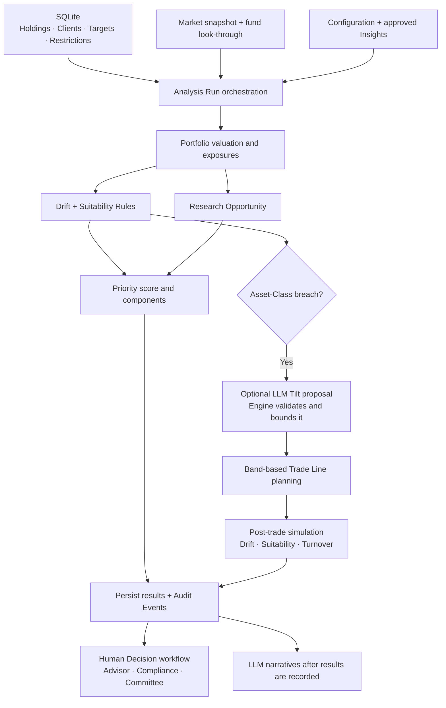

The deterministic engine is the system’s **calculation and policy layer**. It values Holdings, measures allocation drift, evaluates Suitability Rules, calculates Priority scores, sizes proposed Trade Lines and determines the required approval steps.

It is implemented across several focused modules rather than one `engine.py`. Pure calculation functions sit behind an Analysis Run orchestrator and persistence/workflow services.

For the same Holdings, market snapshot, Client context, configuration, approved Insights and accepted Research Tilt inputs, the calculation functions produce the same results. An Analysis Run can also call an LLM to propose a Research Tilt: that proposal is an external input to deterministic validation and sizing, so the complete live workflow is not inherently deterministic.

The main architectural decision is [ADR-0001: deterministic engine owns numbers](adr/0001-deterministic-engine-owns-numbers.md). Transaction behaviour is qualified by [ADR-0009](adr/0009-analysis-run-recording-commits-per-audit-event.md).

**1. How the modules fit together**



| Module | Responsibility |
|---|---|
| [market_data.py](../app/market_data.py) | Supplies snapshot prices and Instrument classifications, plus fund sector weights |
| [portfolio_view.py](../app/portfolio_view.py) | Values Holdings and aggregates direct and fund-based sector exposure |
| [drift.py](../app/drift.py) | Computes Asset-Class Drift, band status and Portfolio Drift |
| [suitability.py](../app/suitability.py) | Evaluates seven Suitability Rules and their risk contribution |
| [opportunity.py](../app/opportunity.py) | Converts research coverage of held sectors into a deterministic Opportunity component |
| [priority.py](../app/priority.py) | Combines Drift, Risk, Opportunity and Urgency into a score and label |
| [rebalance.py](../app/rebalance.py) | Plans, merges, validates and simulates Trade Lines |
| [research_tilt.py](../app/research_tilt.py) | Requests a model proposal, then deterministically validates/clips it and adjusts target weights |
| [recommendations.py](../app/recommendations.py) | Builds Recommendation versions, prices their lines, evaluates post-trade outcomes and records Decisions |
| [approvals.py](../app/approvals.py) | Calculates the required approval plan and next workflow status |
| [config_service.py](../app/config_service.py) | Defines policy defaults, validates configuration and persists updates |
| [analysis.py](../app/analysis.py) | Orchestrates scoring every Portfolio and recording the results |
| [analysis_runs.py](../app/analysis_runs.py) | Runs analysis in a background thread and maintains progress/outcomes |

**2. Inputs and their sources**

| Input | Source | Role |
|---|---|---|
| Quantities and cost bases | SQLite `holdings`, joined to `accounts` | Valuation, tax-status classification and proposed sell limits |
| Risk Profile, horizon, liquidity needs, review date | SQLite `clients` | Policy selection, cash/horizon checks and Urgency |
| Target Allocation | SQLite `target_allocations` | Intended equity/bond/cash weights |
| Restrictions | SQLite `restrictions` | Instrument and sector exclusions |
| Prices | `data/market_snapshot.json` | Latest stored closing price per Instrument |
| Fund sector weights | `data/fund_lookthrough.json` | Approximate sector exposure through funds |
| Instrument taxonomy | `app/universe.py` | Asset Class, kind and sector mapping |
| Policy configuration | SQLite `config`, with code defaults | Bands, scoring weights, Suitability limits, Tilt bounds and approval thresholds |
| Approved research | SQLite `insights` | Research Opportunity and optional Research Tilt input |

Clients and Holdings are synthetic. Prices come from the committed Twelve Data snapshot. The runtime reads local files; the calculation modules do not fetch prices from a provider.

The Analysis Run’s effective date is `market.as_of[:10]`: the snapshot’s fetch date. Review lateness and Urgency use that date, not the current wall-clock date and not each Instrument’s `price_date`. An old snapshot therefore freezes the analysis date as well as prices.

**3. Portfolio valuation and sector look-through**

For each Holding:

```text
Holding market value = quantity × snapshot price
Portfolio value      = sum of Holding market values
Asset Class weight   = Asset Class market value / Portfolio value
```

The valuation read model retains account, tax status, quantity, cost basis, price and Instrument classification. Holdings are returned largest first, with symbol and account tie-breakers.

Sector exposure combines two paths:

- A single equity contributes all of its market value to its mapped sector.
- A fund contributes its market value multiplied by each reference sector weight.

The result distinguishes `direct_pct`, `via_funds_pct` and combined `weight_pct`. Bond funds and the cash proxy contribute to the `Fixed Income` and `Cash` buckets.

The fund weights are hand-built approximations. Historical closes stored in the market snapshot are not used to estimate returns, volatility, correlations or expected performance.

**4. Drift and Tolerance Bands**

`compute_drift(actual, target, band)` accepts fractional weights, such as `0.55`, and returns percentage-point measures:

```text
Signed Asset-Class Drift = actual weight % − target weight %
Asset-Class Drift        = absolute value of Signed Asset-Class Drift
Portfolio Drift          = sum of Asset-Class Drifts / 2
Maximum class drift      = largest Asset-Class Drift
```

Absent Asset Classes are treated as having zero weight. The function examines the union of actual and target classes in sorted order.

Default bands are:

| Risk Profile | Warn at | Breach at |
|---|---:|---:|
| conservative | 2 pp | 4 pp |
| moderate | 3 pp | 5 pp |
| growth | 4 pp | 6 pp |
| aggressive | 5 pp | 8 pp |

Classification uses inclusive thresholds: `drift >= breach` is a breach; otherwise `drift >= warn` is a warning. Absolute drift is rounded to nine decimal places before comparison to absorb floating-point noise at band edges.

A Trade Line plan is triggered only when at least one Asset Class breaches its band. A Suitability breach alone does not trigger this planner.

**5. The seven Suitability Rules**

`suitability.evaluate()` accepts valued Holdings, Client context, policy limits and the market adapter. It returns a result for each rule, including status, explanatory message and numerical findings.

| Rule | Check | Default policy |
|---|---|---|
| SR-01 | Maximum equity share | conservative 30%, moderate 55%, growth 80%, aggressive 95% |
| SR-02 | Single-position concentration | 10% of Portfolio value, single equities aggregated across accounts; diversified funds exempt |
| SR-03 | Sector concentration | 30%, including fund look-through; Cash and Fixed Income excluded |
| SR-04 | Minimum cash reserve | Floors of 5% / 3% / 2% / 1% by Risk Profile; also checks stated liquidity needs |
| SR-05 | Client Restrictions | Restricted Instrument or directly mapped sector holding breaches; indirect fund exposure warns |
| SR-06 | Short investment horizon | Horizon under 5 years uses a 40% equity cap |
| SR-07 | Taxable-gain warning | Positive unrealised gains in taxable accounts at least 15% of Portfolio value |

For the ordinary maximum-limit checks, an actual value **above** the limit breaches. At or above 90% of the limit it warns. Exactly on the maximum is therefore a warning, unlike Drift’s inclusive breach boundary.

Cash uses different logic: below the policy floor breaches; above that floor but below stated liquidity needs warns. SR-07 produces a warning, never a breach, and does not offset gains against losses.

Overall Suitability is the worst rule status. Priority Risk receives 50 points per breaching rule and 15 per warning rule, capped at 100. These are per-rule counts, not counts of individual findings.

The same rules evaluate current and simulated post-trade Holdings. A proposed Recommendation can still have breaches: the approval policy routes those to Compliance rather than treating the planner as a universal constraint solver.

**6. Priority scoring and Research Opportunity**

Every Portfolio receives four normalized components between 0 and 100. Define `clamp(x)` as limiting a value to that range:

```text
Drift raw       = clamp(100 × Portfolio Drift / 10 pp)

Suitability risk = min(100, 50 × breaching rules + 15 × warning rules)
Risk raw         = clamp(max(100 × maximum class drift / breach band,
                            Suitability risk))

Opportunity raw = clamp(100 × eligible sector exposure % / 30)
Urgency raw     = clamp(100 × days past review due / SLA days)

Priority score  = Σ(component raw × configured weight)
```

Default weights are Drift **0.4**, Risk **0.3**, Opportunity **0.2** and Urgency **0.1**. They must sum to one. The review SLA defaults to 30 days. A future review date gives zero Urgency; an SLA breach begins when days past due reaches the SLA.

| Priority label | Score |
|---|---:|
| High | At least 70 |
| Medium | At least 40 and below 70 |
| Low | Below 40 |

Opportunity uses only approved, non-neutral **sector** Insights for sectors the Portfolio holds. Both positive and negative views count as reasons for an Advisor conversation. Each sector contributes its exposure once, regardless of the number of Insights. Asset-Class Insights and confidence labels do not contribute to this score.

For example, eligible research on sectors representing 15% of Portfolio value gives Opportunity raw `50`, contributing `10` weighted points. The Opportunity calculation itself makes no LLM call.

The stored result includes component raw values, weights and weighted points so a reader can inspect why a Portfolio received its score.

**7. Band-based Trade Line planning**

Once any Asset Class breaches, `rebalance.plan()` calculates the value required to move each class toward its target:

```text
Required value change = target fraction × Portfolio value − current class value
Whole-unit quantity   = floor(allocated trade amount / Instrument price)
```

The planner:

- Sells overweight Asset Classes pro rata across their existing Holdings by market value, capped at units held.
- Buys underweight Asset Classes through their existing non-restricted funds, pro rata by current fund value.
- Uses SPY for equity, AGG for bond and SGOV for cash when no eligible existing fund is available.
- Selects a tax-advantaged account first for that default-fund fallback, otherwise the first sorted account.
- Skips class adjustments smaller than 0.5 percentage points of Portfolio value.
- Uses whole units, so residual allocation drift can remain.

The planner does not buy additional individual equities to fill an underweight class. Instrument Restrictions filter buy candidates; the complete post-trade Suitability evaluation checks remaining policy issues.

`TradeLine` carries account, symbol, buy/sell side and integer quantity. `merge()` nets opposing lines by account and symbol and removes zero-net lines. Output ordering is stable: sells before buys, then symbol and account.

This is a rule-based allocation heuristic. It does not solve a mean-variance, expected-return, transaction-cost or tax-lot optimization problem.

**8. How Research Tilts enter the engine**

For an out-of-tolerance Portfolio, the orchestrator can ask the LLM for a Research Tilt using approved Insights and the Portfolio’s exposures. If there are no approved Insights, no Tilt call is made.

The deterministic half of `research_tilt.py` then:

1. Rejects Insight IDs outside the approved set offered to the model.
2. Rejects duplicate entries for an Insight.
3. Excludes adjustments whose signs contradict the supporting Insight’s direction.
4. Groups usable proposals by subject and clips them to the configured bound, **2 pp by default**.
5. Produces allowed adjustments and reasons, retaining proposed and allowed values separately.

Asset-Class Tilts adjust the planning targets. Other classes absorb offsets proportionally; weights are normalized and stacked movements are scaled back when required by the bound. Original Client targets remain the reference for reported post-trade Drift.

Sector Tilts create switches inside equity: positive Tilts sell SPY and buy the matching sector ETF; negative Tilts reverse the switch. These use available Holdings in the same account, obey the sleeve’s restriction checks and floor quantities to whole units. The sleeve is added after an initial class-rebalancing plan exists.

A failed Tilt assessment leaves the ordinary band-based planning path available. A different valid LLM proposal can change allowed targets, proposed Trade Lines and downstream Suitability outcomes. Determinism applies once those proposal inputs are fixed; it does not make different model proposals equivalent.

**9. Post-trade simulation and human Decisions**

`recommendations.evaluate_lines()` prices every proposed line from the snapshot and uses `rebalance.apply()` to create hypothetical post-trade Holdings. It then reruns Drift and the seven Suitability Rules.

Simulation copies the Holdings rather than executing trades or updating the actual Holdings table. New purchased units use the snapshot price as cost basis; additional buys update average cost basis. Sells reduce quantity, and zero-quantity Holdings are omitted.

Turnover is calculated as:

```text
Turnover % = (sum of absolute Trade Line amounts / 2)
             / original Portfolio value × 100
```

Thus $100,000 sold and $100,000 bought in a $1,000,000 Portfolio gives 10% turnover. Line amounts are rounded to cents before this aggregation.

Advisor modifications are checked for known Instruments, valid Client accounts, positive quantities, duplicate account/symbol lines and sales exceeding Holdings. Modified lines receive a fresh post-trade evaluation and create a new linked Recommendation version, with the original superseded. The new version starts at `pending_advisor`.

These checks do not implement a full cash ledger, buying-power validation, settlement, fees, slippage or broker execution. The simulation’s buy/sell rounding residuals are not settled into a separate cash balance.

The deterministic approval plan is:

| Step | When required |
|---|---|
| Advisor | Always |
| Compliance | Post-trade Suitability status is `breach` |
| Investment Committee | Turnover is at least 15%, or any individual Trade Line is at least 10% of Portfolio value, by default |

Warnings alone do not require Compliance. Approval plans use current configuration when read or advanced, so configuration changes can alter remaining requirements. Workflow order is enforced; a Decision cannot skip the currently pending step. Modification/rejection by the Advisor and every Compliance/Committee Decision require a rationale.

`approved` means cleared for action outside this application. No approval path executes a trade or alters actual Holdings.

**10. Analysis Run orchestration and persistence**

`POST /api/analysis/runs`, protected by `analysis:run`, starts a background thread and returns HTTP 202. Another start while a run is in flight returns HTTP 409 with that run’s snapshot.

The fixed Run Steps are:

```text
Load inputs
→ Score Portfolios
→ Record run
→ Priority narratives
→ Recommendation narratives
```

Scoring processes each Client using the same loaded market adapter and configuration. It calculates current valuations, Drift, Suitability, Opportunity and Priority, optionally assesses a Research Tilt, then drafts a Recommendation when the planner produces lines.

Default persistence is SQLite at `data/app.db`:

| Table | Stored evidence |
|---|---|
| `analysis_runs` | Effective date, actor, configuration snapshot, completion/outcome and final Run Step states |
| `priority_results` | Total value, score, label, component breakdown, Drift and review timing |
| `suitability_results` | Overall status and detailed current-Portfolio rule results |
| `recommendations` | Version links, priced Trade Lines, turnover, post-trade Drift/Suitability and workflow status |
| `recommendation_tilts` | Assessment status and proposed/allowed research adjustments |
| `decisions` | Human actions, rationale, actor and resulting status |
| `audit_events` | Business events and their lineage in the hash chain |

The Queue reads the latest run marked `completed`. Narrative failures after numerical results are recorded can produce `completed_with_warnings`; those numerical results remain usable. A scoring failure stops subsequent steps. Narrative stages recover independently so one failed narrative stage does not prevent the other from being attempted.

Progress is kept in an in-memory registry and delivered over server-sent events; it is not continually written into SQLite during scoring. Final progress/outcome is saved when the run ends. Startup marks stranded runs interrupted. The one-run-at-a-time lock and registry are process-local, so this design assumes one API process.

**11. Transaction and audit boundaries**

The entire Analysis Run is **not one atomic transaction**:

1. Input loading and Portfolio scoring share a transaction, including bound Research Tilt Exchanges.
2. `record_run` emits Audit Events. `audit.record()` commits each event, with the first committing the accumulated scoring rows.
3. A later commit marks the results completed. Narratives run afterward.

Failure before the recording commits rolls back scoring changes. A crash during recording can leave durable scoring rows and a partial event trail while the run remains interrupted and is never selected as current by the Queue.

Recommendation reads use their own latest/status queries. Consequently, Recommendations from an interrupted recording phase can still appear while Queue scores come from the previous completed run. [ADR-0009](adr/0009-analysis-run-recording-commits-per-audit-event.md) explicitly records this gap.

Configuration snapshots help explain a run, but the run does not persist a complete copy/hash of all input Holdings and market data. Reproduction still depends on preserving the relevant inputs. Configuration updates also currently lack their own Audit Event.

**12. Worked example and practical limits**

Consider an illustrative moderate Portfolio worth $1,000,000, with no Research Tilt:

| Asset Class | Actual | Target | Signed Drift | Status |
|---|---:|---:|---:|---|
| equity | 65% | 55% | +10 pp | breach |
| bond | 30% | 40% | −10 pp | breach |
| cash | 5% | 5% | 0 pp | ok |

Portfolio Drift is `(10 + 10 + 0) / 2 = 10 pp`. At the moderate 5 pp breach threshold, the maximum class drift saturates the Risk component. Equity also exceeds the moderate SR-01 cap of 55%.

Assume approved non-neutral sector Insights cover 15% of Portfolio value, and the review is 15 days overdue against a 30-day SLA:

| Component | Raw | Weight | Points |
|---|---:|---:|---:|
| Drift | 100 | 0.4 | 40 |
| Risk | 100 | 0.3 | 30 |
| Opportunity | 50 | 0.2 | 10 |
| Urgency | 50 | 0.1 | 5 |
| **Total** | | | **85 — High** |

Before Instrument selection and whole-unit rounding, the class-level plan sells $100,000 of equity and buys $100,000 of bonds. Exact Trade Lines and approval requirements depend on the underlying Holdings and post-trade checks. The 55% illustrative equity target sits at the moderate Suitability cap, where SR-01 warns rather than breaches; other rules must still be evaluated.

The Drift, Opportunity and Priority values in this example were checked by calling the actual calculation functions. This documentation change does not alter engine behaviour or claim a new full-suite test run.

Existing behavioural coverage includes [Drift/Priority tests](../tests/test_drift_priority.py), [Suitability tests](../tests/test_suitability.py), [Opportunity tests](../tests/test_opportunity.py), [Recommendation tests](../tests/test_recommendations.py), [approval tests](../tests/test_approvals.py) and [Analysis Run tests](../tests/test_analysis_runs.py).

The current engine is suitable for demonstrating explainable policy calculations and human-controlled Recommendations. Its practical limits are explicit: fixed snapshot pricing, approximate fund exposures, floating-point arithmetic with local rounding, whole-unit allocation heuristics, simplified tax treatment, no cash/settlement execution model, process-local concurrency and incomplete atomicity during recording. It does not estimate portfolio market risk through VaR or covariance models, optimize expected returns, or establish regulatory compliance merely by passing its seven configured rules.
