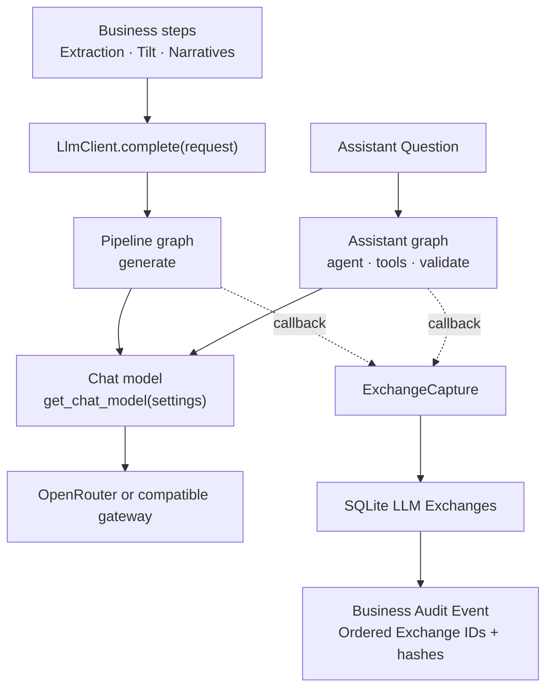

The LLM layer is a **shared model execution and evidence-capture stack** built on LangGraph and a LangChain chat model, with two LLM Graphs:

- The pipeline graph makes one structured request for each of four pipeline steps.
- The Assistant graph runs a bounded agent loop with read-only tools and a reflection edge.

Every call is live: the test suite runs on fake chat models instead.

The deterministic engine calculates valuations, drift, suitability, Priority scores and Trade Lines. LLMs extract research, propose bounded adjustments and explain results. Human approval remains in the application’s decision workflows.

This is the current implementation governed by [ADR-0011](adr/0011-llm-steps-are-langgraph-graphs-on-a-captured-transport.md), which supersedes ADR-0010.

**1. How the modules fit together**



The main responsibilities are:

| Module | Responsibility |
|---|---|
| [llm.py](../app/llm.py) | Application-facing request/response contracts and errors |
| [chat_model.py](../app/chat_model.py) | `get_chat_model`: the only module that names a provider package |
| [llm_graph.py](../app/llm_graph.py) | The pipeline graph and its structured call |
| [exchanges.py](../app/exchanges.py) | `ExchangeCapture`: records each model call and persists its evidence |
| [prompts.py](../app/prompts.py) | Versioned system prompts, reply schemas and platform brief |
| [assistant.py](../app/assistant.py) | Questions, conversation history, limits, outcomes and persistence |
| [assistant_agent.py](../app/assistant_agent.py) | The Assistant graph: read-only tools, request budget and reflection edge |
| [screen_context.py](../app/screen_context.py) | Permission-filtered context and named engine figures |
| [grounding.py](../app/grounding.py) | Deterministic citation and numerical checks |

At application creation, `build_llm()` constructs the capture stack and stores it in `app.state.llm`. The chat model is built on first use, so the app starts without an API key.

**2. The application-facing contract**

Ordinary business steps depend on this interface:

```python
class LlmClient(Protocol):
    def complete(self, request: LlmRequest) -> LlmResponse: ...
```

`LlmRequest` contains:

```text
task             Which business capability is calling
prompt_version   For example, research_tilt@v1
system           System instructions
user             Business input/context
schema           Expected JSON reply schema
```

`LlmResponse` returns parsed content, model identity, prompt version and the persisted Exchange reference.

Failures use `LlmError`. When an error Exchange was successfully captured, the exception carries its ID and hash too.

This boundary keeps provider and HTTP concerns out of the business modules.

**3. The five LLM capabilities**

| Capability | Input | Model output | Application control |
|---|---|---|---|
| Insight extraction | Uploaded Report text with page markers | Subject, direction, confidence and quoted passage | Checks taxonomy, page existence and passage occurrence; valid Insights enter human review |
| Research Tilt | Portfolio exposure and approved Insights | Proposed percentage-point adjustments | Rejects unknown/duplicate Insight references, checks direction and clips adjustments to configured bounds |
| Recommendation narrative | Engine figures, allowed Tilts and research passages | Cited Claims | Validates Claims; assembles the memo using grounded Claims |
| Priority narrative | Priority components, figures and relevant research | Short “why this Client, why now” Claims | Validates Claims; builds the summary from grounded content |
| Assistant | Question, server-built context and recent conversation | Answer, Claims and follow-up questions | Permission checks, read-only tools, grounding, PII backstop and request limits |

The first four use `complete()`, which runs the pipeline graph: `START → generate → END`. The single node `generate` makes one call with:

- Native JSON-schema output (`with_structured_output(..., method="json_schema")`).
- No tools.
- No retry edge: an unparseable reply fails the step.
- Subsequent validation against the business step’s Pydantic model.

Prompt versions are currently `v1` for those four capabilities and `v5` for the Assistant.

**4. The provider path**

The configured defaults in [settings.py](../app/settings.py) are:

| Setting | Default |
|---|---|
| `APP_LLM_API_KEY` | Unset (required for any call) |
| `APP_LLM_BASE_URL` | `https://openrouter.ai/api/v1/` |
| `APP_LLM_MODEL` | `anthropic/claude-sonnet-5.5` |
| `APP_LLM_TEMPERATURE` | Unset |

These are code defaults; environment variables and `.env` can override them.

For an OpenRouter URL, `get_chat_model` builds the LangChain OpenRouter chat model. It adds the application attribution title and `require_parameters: true`, so OpenRouter routes only to a provider that honours every parameter sent, the reply schema included.

Other URLs use the OpenAI-compatible integration. That is the integration point for a compatible gateway.

The HTTP client has a **120-second timeout**, and provider SDK retries are disabled, so every request that reaches the wire is one an Exchange records. Temperature is sent only when configured. With no API key, a call fails as an `LlmError` and nothing is recorded.

Before transmission, `wire_schema()` converts `oneOf` to `anyOf` and removes discriminators for provider compatibility. Business validation still runs after the response.

**5. The Assistant’s agent loop**

The initial prompt contains four labelled blocks:

```text
PLATFORM BRIEF
SCREEN CONTEXT
CONVERSATION SO FAR — when included
QUESTION
```

The server builds Screen Context from authoritative application data. The browser supplies screen identity and selection, rather than providing the context’s business figures.

The Assistant can call seven tools:

```text
look_up_queue
look_up_portfolio
look_up_recommendation
look_up_approvals
look_up_audit
look_up_governance
list_approved_insights
```

Each tool reuses permission-checked context builders. Missing and unauthorized entities return the same message, avoiding disclosure of whether a hidden entity exists.

Tool results also add named engine figures to the turn’s permitted citation set. There is no vector database, embedding retrieval or multi-agent delegation in this path.

The Assistant graph has four nodes:

| Node | What it does |
|---|---|
| `agent` | One model request: call a tool or give a candidate reply |
| `tools` | Runs the requested read-only lookups |
| `validate` | Checks the candidate against the guardrails (grounding and PII) |
| `budget_exhausted` | Ends the turn when the request budget is spent |

and these edges:

```text
START ─────► agent                  (or budget_exhausted if no request is allowed)
agent ─────► tools                  while the model calls a tool
agent ─────► validate               when it gives a candidate reply
tools ─────► agent                  (or budget_exhausted)
validate ──► END                    accepted, retry already used, or a Client named (the turn fails)
validate ──► agent                  reflection: the failing Claims go back once
budget_exhausted ─► END
```

Current default limits are:

| Control | Default |
|---|---:|
| Model requests per Answer | 6 |
| Previous Question/Answer pairs | 6 |
| Rows included in list context | 25 |
| Question length | 2,000 characters |
| Questions per Conversation | 50 |
| Questions per user per rolling hour | 20 |

The six-request allowance includes requests used after tools and during correction. There is **no explicit token budget**. Exceeding the request allowance fails the turn as `budget_exhausted`.

Tools run sequentially on the caller’s event loop to preserve the database-session binding. The final Answer arrives as a whole; tool activity is not streamed token by token.

**6. What the guardrails actually enforce**

There are several separate controls.

**Structural validation:** provider-native structured output plus application-side Pydantic validation checks reply shape.

**Grounding:** each structured Claim is checked for:

- At least one citation.
- Existing Report and page, with a matching quoted passage.
- Valid named engine figures.
- Numbers matching figures cited by that Claim, using the validator’s precision rules.
- A Report citation when the Claim declares an asset view.

**Assistant correction:** an ungrounded candidate can receive one correction request naming the failed checks. Claims still ungrounded afterward remain visible and flagged. Recommendation memos exclude ungrounded Claims.

**Authorization:** tool access is enforced by server-side permissions.

**Scope and injection handling:** system instructions define scope, while uploaded passages and Exchange text are fenced and labelled as untrusted data.

Two limits are important:

- Grounding checks the structured `claims` collection; it does not independently prove every sentence in `answer_markdown`.
- The PII check searches for stored Client names and emails in the candidate reply. It is an exact-value backstop, not a general sensitive-data detector.

Questions, conversation text and uploaded Reports are not universally sanitized before provider transmission.

**7. Tests and the fake chat model**

The suite never reaches a provider. `tests/fake_chat.py` has LangChain-style fake chat models: `FakeChatModel` answers each request from a script (a reply object, reply text, a tool call or an error), and `DemoPipeline` gives the seeded demo run deterministic replies. The test configuration refuses the provider SDKs’ network transports, so a test that forgot its fake fails instead of calling out.

Two checks run live, by hand: the Assistant guardrail eval (`uv run python -m tests.fixtures.assistant_eval`, which writes the results the model card shows) and the scripted walkthrough (`uv run python -m scripts.walkthrough`).

Exchanges stored before recorded mode was removed keep their stored mode, because it is part of their hash and chain verification must still pass. Nothing reads it any more.

**8. Exchange capture and audit linkage**

`ExchangeCapture`, a LangChain callback, sees every model request, including tool-selection requests and correction attempts, and stores one Exchange for each.

It stores the messages and reply as LangChain sent and received them. Exchanges store:

- Task, prompt version, model and endpoint host.
- System text, user prompt and reply schema.
- Request messages and raw response.
- Parsed content, usage, latency and errors.
- Trajectory ID, position, the Graph Node that made the call and a content hash.

A business Audit Event subsequently anchors the ordered `{exchange_id, exchange_hash}` references. A single-call step has one Exchange; an Assistant turn can have several.

**An Exchange marked `ok` means transport/parsing success. It does not mean the content passed grounding.**

Capture fails closed: if evidence cannot be stored, the model result is not accepted by the caller.

However, persistence follows transaction boundaries. Analysis-time capture can bind to the existing write transaction, so rollback can discard those Exchanges. Interrupted execution can also leave an Exchange without its eventual Audit Event.

Raw Exchange access requires `llm:read`. Advisor-facing views expose smaller summaries, and the Governance module reports grounding quality, capture health, prompt usage and evaluation evidence.

API authorization headers are not persisted. Known provider credentials are redacted from raw reply/error text, but prompts and parsed content are not generally scrubbed. A PII-rejected draft can therefore remain in the restricted Exchange evidence even though it is withheld from the user’s Answer.

**9. Failure behaviour**

The business workflows degrade differently:

| Failure | Behaviour |
|---|---|
| Report extraction | Report remains stored; extraction is marked failed |
| Research Tilt | No usable Tilt; deterministic processing continues |
| Narrative generation | Failure recorded; completed numerical analysis remains |
| Assistant call, schema, PII or budget failure | Failed turn recorded with a controlled user message |
| No API key or unreachable provider | Failed step or turn; no Exchange when nothing was sent |
| Exchange persistence failure | Model output rejected |

Numerical Analysis Run results are committed before narrative generation, so a narrative failure cannot undo the completed run.

Architecturally, the central separation is sound: **business modules define the task, an LLM Graph executes it, deterministic controls assess it, and Exchanges preserve the evidence**. The main production gaps are broader input/output data protection, validation of free-form answer prose, explicit token/cost budgets and stronger durability of audit evidence.
