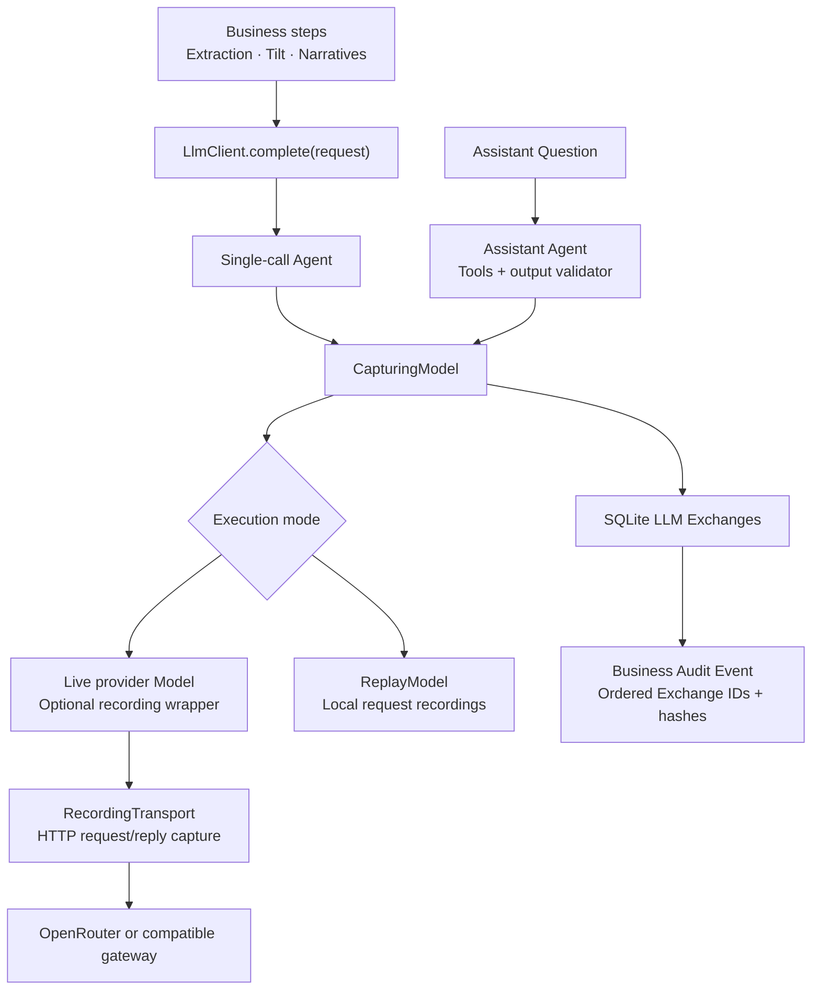

The LLM layer is a **shared model execution and evidence-capture stack**, with two execution patterns:

- Four pipeline steps make a single structured request each.
- The Assistant runs a bounded agent loop with read-only tools.

The deterministic engine calculates valuations, drift, suitability, Priority scores and Trade Lines. LLMs extract research, propose bounded adjustments and explain results. Human approval remains in the application’s decision workflows.

This is the current implementation governed by [ADR-0010](/Users/aniruddh/git/alpha-portfolio-ai/docs/adr/0010-the-assistant-is-a-bounded-read-only-agent-on-pydantic-ai.md).

**1. How the modules fit together**



The main responsibilities are:

| Module | Responsibility |
|---|---|
| [llm.py](/Users/aniruddh/git/alpha-portfolio-ai/app/llm.py) | Application-facing request/response contracts and errors |
| [pydantic_llm.py](/Users/aniruddh/git/alpha-portfolio-ai/app/pydantic_llm.py) | Provider construction, HTTP capture, structured calls, recording and replay |
| [exchanges.py](/Users/aniruddh/git/alpha-portfolio-ai/app/exchanges.py) | Captures each model request and persists its evidence |
| [prompts.py](/Users/aniruddh/git/alpha-portfolio-ai/app/prompts.py) | Versioned system prompts, reply schemas and platform brief |
| [assistant.py](/Users/aniruddh/git/alpha-portfolio-ai/app/assistant.py) | Questions, conversation history, limits, outcomes and persistence |
| [assistant_agent.py](/Users/aniruddh/git/alpha-portfolio-ai/app/assistant_agent.py) | Read-only tools, request budget and self-correction loop |
| [screen_context.py](/Users/aniruddh/git/alpha-portfolio-ai/app/screen_context.py) | Permission-filtered context and named engine figures |
| [grounding.py](/Users/aniruddh/git/alpha-portfolio-ai/app/grounding.py) | Deterministic citation and numerical checks |

At application creation, `build_llm()` constructs the configured stack and stores it in `app.state.llm`.

**2. The application-facing contract**

Ordinary business steps depend on this interface:

```python
class LlmClient(Protocol):
    def complete(self, request: LlmRequest) -> LlmResponse: ...
```

`LlmRequest` contains:

```text
task             Which business capability is calling
prompt_version   For example, research_tilt@v1
system           System instructions
user             Business input/context
schema           Expected JSON reply schema
```

`LlmResponse` returns parsed content, model identity, prompt version and the persisted Exchange reference.

Failures use `LlmError`. When an error Exchange was successfully captured, the exception carries its ID and hash too. `RecordingMissing` identifies an unavailable replay.

This boundary keeps provider and HTTP concerns out of the business modules.

**3. The five LLM capabilities**

| Capability | Input | Model output | Application control |
|---|---|---|---|
| Insight extraction | Uploaded Report text with page markers | Subject, direction, confidence and quoted passage | Checks taxonomy, page existence and passage occurrence; valid Insights enter human review |
| Research Tilt | Portfolio exposure and approved Insights | Proposed percentage-point adjustments | Rejects unknown/duplicate Insight references, checks direction and clips adjustments to configured bounds |
| Recommendation narrative | Engine figures, allowed Tilts and research passages | Cited Claims | Validates Claims; assembles the memo using grounded Claims |
| Priority narrative | Priority components, figures and relevant research | Short “why this Client, why now” Claims | Validates Claims; builds the summary from grounded content |
| Assistant | Question, server-built context and recent conversation | Answer, Claims and follow-up questions | Permission checks, read-only tools, grounding, PII backstop and request limits |

The first four use `complete()`. Internally, each creates a Pydantic AI Agent with:

- Native JSON-schema output.
- No tools.
- No output retries.
- Subsequent validation against the business step’s Pydantic model.

Prompt versions are currently `v1` for those four capabilities and `v5` for the Assistant.

**4. The live provider path**

The configured defaults in [settings.py](/Users/aniruddh/git/alpha-portfolio-ai/app/settings.py) are:

| Setting | Default |
|---|---|
| `APP_LLM_MODE` | `recorded` |
| `APP_LLM_BASE_URL` | `https://openrouter.ai/api/v1/` |
| `APP_LLM_MODEL` | `anthropic/claude-sonnet-5.5` |
| `APP_LLM_TEMPERATURE` | Unset |
| `APP_LLM_RECORD` | `false` |
| `APP_LLM_RECORDINGS_DIR` | `data/llm_recordings` |

These are code defaults; environment variables and `.env` can override them.

For an OpenRouter URL, the factory uses Pydantic AI’s `OpenRouterModel` and provider. It adds the application attribution title and `require_parameters: true`.

Other URLs use `OpenAIChatModel` with an OpenAI-compatible provider. That is the integration point for a compatible gateway.

The HTTP client has a **120-second timeout**, and provider SDK retries are disabled. Temperature is sent only when configured.

Before transmission, `wire_schema()` converts `oneOf` to `anyOf` and removes discriminators for provider compatibility. Business validation still runs after the response.

**5. The Assistant’s agent loop**

The initial prompt contains four labelled blocks:

```text
PLATFORM BRIEF
SCREEN CONTEXT
CONVERSATION SO FAR — when included
QUESTION
```

The server builds Screen Context from authoritative application data. The browser supplies screen identity and selection, rather than providing the context’s business figures.

The Assistant can call seven tools:

```text
look_up_queue
look_up_portfolio
look_up_recommendation
look_up_approvals
look_up_audit
look_up_governance
list_approved_insights
```

Each tool reuses permission-checked context builders. Missing and unauthorized entities return the same message, avoiding disclosure of whether a hidden entity exists.

Tool results also add named engine figures to the turn’s permitted citation set. There is no vector database, embedding retrieval or multi-agent delegation in this path.

The loop is:

```text
Model request → optional lookups → candidate answer → validation
                                                   ↓
                               one correction attempt if ungrounded
                                                   ↓
                                        final answer or failure
```

Current default limits are:

| Control | Default |
|---|---:|
| Model requests per Answer | 6 |
| Previous Question/Answer pairs | 6 |
| Rows included in list context | 25 |
| Question length | 2,000 characters |
| Questions per Conversation | 50 |
| Questions per user per rolling hour | 20 |

The six-request allowance includes requests used after tools and during correction. There is **no explicit token budget**. Exceeding the request allowance fails the turn as `budget_exhausted`.

Tools run sequentially on the caller’s event loop to preserve the database-session binding. The final Answer arrives as a whole; tool activity is not streamed token by token.

**6. What the guardrails actually enforce**

There are several separate controls.

**Structural validation:** provider-native structured output plus application-side Pydantic validation checks reply shape.

**Grounding:** each structured Claim is checked for:

- At least one citation.
- Existing Report and page, with a matching quoted passage.
- Valid named engine figures.
- Numbers matching figures cited by that Claim, using the validator’s precision rules.
- A Report citation when the Claim declares an asset view.

**Assistant correction:** an ungrounded candidate can receive one correction request naming the failed checks. Claims still ungrounded afterward remain visible and flagged. Recommendation memos exclude ungrounded Claims.

**Authorization:** tool access is enforced by server-side permissions.

**Scope and injection handling:** system instructions define scope, while uploaded passages and Exchange text are fenced and labelled as untrusted data.

Two limits are important:

- Grounding checks the structured `claims` collection; it does not independently prove every sentence in `answer_markdown`.
- The PII check searches for stored Client names and emails in the candidate reply. It is an exact-value backstop, not a general sensitive-data detector.

Questions, conversation text and uploaded Reports are not universally sanitized before provider transmission.

**7. Recording and replay**

There are two distinct records:

| Record | Purpose | Storage |
|---|---|---|
| Request recording | Reproduce a model response offline | JSON files under the configured recordings directory |
| LLM Exchange | Inspect and audit an execution | SQLite `llm_exchanges` table |

In live mode with recording enabled, `RecordingModel` saves each model response. In recorded mode, `ReplayModel` loads the matching response without network access.

The recording key hashes:

```text
task + prompt version + output schema/mode
+ tool definitions
+ complete normalized message history
```

For agent continuations, that history includes previous tool calls and results. Changing a lookup result therefore invalidates the continuation’s recording.

A miss raises an error; replay does not substitute another answer or call the live provider.

One reproducibility limitation: **the configured model identity is not part of the recording key**. A recording preserves the model that produced it, but changing the configured model alone does not necessarily force a miss.

**8. Exchange capture and audit linkage**

`CapturingModel` surrounds every underlying model request, including tool-selection requests and correction attempts.

For live execution, the HTTP transport captures the serialized request body and raw reply. Exchanges store:

- Task, prompt version, model, mode and endpoint host.
- System text, user prompt and reply schema.
- Request messages and raw response.
- Parsed content, usage, latency and errors.
- Trajectory ID, position and content hash.

A business Audit Event subsequently anchors the ordered `{exchange_id, exchange_hash}` references. A single-call step has one Exchange; an Assistant turn can have several.

**An Exchange marked `ok` means transport/parsing success. It does not mean the content passed grounding.**

Capture fails closed: if evidence cannot be stored, the model result is not accepted by the caller.

However, persistence follows transaction boundaries. Analysis-time capture can bind to the existing write transaction, so rollback can discard those Exchanges. Interrupted execution can also leave an Exchange without its eventual Audit Event.

Raw Exchange access requires `llm:read`. Advisor-facing views expose smaller summaries, and the Governance module reports grounding quality, capture health, prompt usage and evaluation evidence.

API authorization headers are not persisted. Known provider credentials are redacted from raw reply/error text, but prompts and parsed content are not generally scrubbed. A PII-rejected draft can therefore remain in the restricted Exchange evidence even though it is withheld from the user’s Answer.

**9. Failure behaviour**

The business workflows degrade differently:

| Failure | Behaviour |
|---|---|
| Report extraction | Report remains stored; extraction is marked failed |
| Research Tilt | No usable Tilt; deterministic processing continues |
| Narrative generation | Failure recorded; completed numerical analysis remains |
| Assistant call, schema, PII or budget failure | Failed turn recorded with a controlled user message |
| Replay miss | Explicit failure identifying unavailable recording |
| Exchange persistence failure | Model output rejected |

Numerical Analysis Run results are committed before narrative generation, so a narrative failure cannot undo the completed run.

Architecturally, the central separation is sound: **business modules define the task, Pydantic AI executes it, deterministic controls assess it, and Exchanges preserve the evidence**. The main production gaps are broader input/output data protection, validation of free-form answer prose, explicit token/cost budgets, model-aware replay identity and stronger durability of audit evidence.
